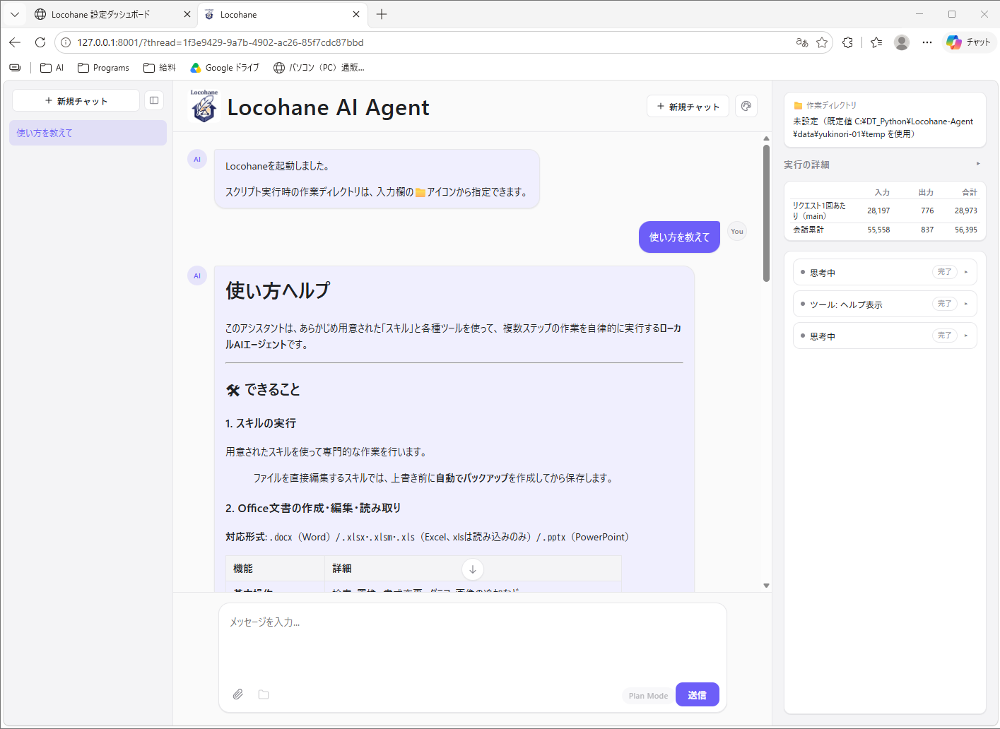
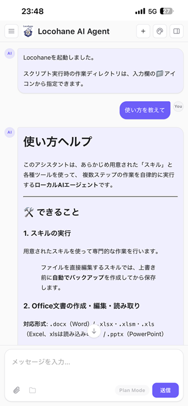

# Locohane-Agent (local AI agent)

[日本語](README.md) | English


Locohane Agent is an **AI agent that runs entirely on your company server or your own PC**.
Just talk to it in the browser chat, and the AI plans and carries out tasks such as reading and creating
Excel, Word, PowerPoint and PDF files, checking images, and processing many files in a folder at once.

- **Fully offline**: The AI model also runs on your own server, so conversations and files are never sent outside.
- **Shared by a team**: Several people can use one server at the same time (with sign-in).
- **PC and smartphone**: Both the chat screen and the admin tool work in PC and smartphone browsers.
- **Stable even with smaller models**: Many safeguards against runaway behavior and mistakes let it finish
  the job without an expensive large model.
- **Learns work through "skills"**: Write a work procedure as a `SKILL.md` and the AI reads it and works the same way
  (compliant with Anthropic's [Agent Skills standard](https://agentskills.io/specification)).
- **Japanese and English**: The screens and the AI's replies can be switched between 日本語 and English per user.

Name origin: **Lo**cal (local environment) + 小羽 (**cohane**, "small feather": lightweight, with a Japanese touch)

> Design details, the full list of settings and the directory layout are in
> [README_DETAIL.en.md](README_DETAIL.en.md) (for administrators and developers; English translation of [README_DETAIL.md](README_DETAIL.md)).

---

## What we value

It is designed for **specialized work where mistakes are not acceptable**, such as engineering design.
So rather than raw AI capability, it puts "**getting the same result every time (reproducibility)**" first.

- Work that can change files, such as writing or running scripts, **shows a plan first and proceeds only after you approve it**
  (automatic approval can also be configured).
- The AI is not given a way to run arbitrary commands (such as a general-purpose shell). It can only run the scripts of
  prepared skills and Python code with safety guards.
- The AI never rewrites its own skills during a conversation with a user. Skills that users create are "draft skills"
  that only they can use. Only after a developer lets the AI fix them in the admin tool's "Skill Lab", they pass repeated
  evaluations and are approved, are they published as official skills of that instance (per department or role).

---

## What it can do

| Area | Details |
|------|------|
| Excel | Read, create and edit (formatting, charts, images, conditional formatting, etc.), recalculate formulas, render sheets as images, read/edit/run VBA macros |
| Word | Read, create and edit (find and replace, images, tracked changes), render pages as images |
| PowerPoint | Read, create, edit parts of templates, render slides as images |
| PDF | Extract text, render pages as images, create PDFs (Japanese supported) |
| Images | Look at images and describe or judge them (with a model that supports images) |
| Many files | Apply the same processing to many files in a folder, split among several AIs in parallel |
| Memory | Remember what you asked it to remember and use it in other conversations (persistent memory) |
| Internal document search | Find the relevant parts of rules, manuals, etc. that the administrator ingested, and answer with sources (vector DB, when enabled by the administrator) |
| Web search | Only when a Tavily API key is set (no external communication by default) |
| Your own skills | Create your own procedures (draft skills) by consulting with the AI in chat |

For the list of bundled skills, see [README_DETAIL.en.md "Bundled skills"](README_DETAIL.en.md#bundled-skills).

---

## Requirements

- **OS**: Windows (tested on Windows 11)
- **Python**: a Python 3.11 virtual environment
- **AI model runtime**: an inference server that provides an OpenAI-compatible endpoint
  (tested with [llama.cpp](https://github.com/ggml-org/llama.cpp)'s `llama-server`, vLLM, Strata, etc.)
  and a model file to run on it
- **GPU**: recommended (the developer tests with an NVIDIA GeForce RTX 5060 Ti 16GB + Qwen3.6-35B-A3B)

> **⚠️ Check the model license**
> Licenses differ from model to model. Always check them for commercial use
> (models under Apache 2.0 are a safe choice if in doubt).

---

## Getting started

For detailed steps and options, see [README_DETAIL.en.md "Setup and startup"](README_DETAIL.en.md#setup-and-startup).
If you can use Claude Code, you can also set it up interactively with `/setup-locohane`.

### 1. Choose the Python environment and install dependencies

Open `python_env.bat` in the project root and set `PYTHON_DIR` to the folder of the Python virtual environment to use.

```bat
set PYTHON_DIR=C:\path\to\your\python_env
```

Then install the dependencies from the command prompt.

```cmd
call python_env.bat
python -m pip install -r requirements.txt
```

### 2. Start the inference server

Any inference server that provides an **OpenAI-compatible endpoint** (`/v1/chat/completions`) can be used.
Besides llama.cpp (llama-server), it has been tested with LLM servers such as vLLM and Strata.

Example: llama-server (listening on `http://localhost:8080/v1`)

```bash
llama-server --model C:\path\to\model.gguf --alias local-model --host 127.0.0.1 --port 8080 -c 8192
```

### 3. Prepare the admin tool sign-in

Copy `.env.example` to `.env` and set the username and password for signing in to the admin tool in `ADMIN_USERS`.

```
ADMIN_USERS=[["admin", "change-me"]]
```

### 4. Start

```cmd
admin.bat
```

The admin tool (settings dashboard) starts at `http://127.0.0.1:8001`, and Locohane itself starts automatically.

1. Sign in to the admin tool, open "Instances" → "Settings" → the `config.ini` tab, set the AI endpoint (`main_url`)
   to the inference server you started in step 2, save, and restart the instance.
2. Open `http://127.0.0.1:8000` in a browser to see the chat screen.

To use English from the start for everyone, set `default_language = en` in the `[ui]` section of `config.ini`
(see "Display language" below).

---

## How to use

### Display language (日本語 / English)

Choose the language from **Display settings (palette icon) → 言語 / Language** at the top right of the chat screen
(or at the bottom of the sign-in screen). The choice is saved in your browser.

- Screen text, buttons, system notices and step labels switch to the chosen language.
- **The AI replies in the chosen language** (from your next message).
- Users who have not chosen a language get the default in `[ui] default_language` of `config.ini`
  (`auto` = follow the browser's language, `ja`, or `en`).
- The starter buttons for English can be set in `[chat_starters] prompts_en`.
- The admin tool also has a language selector at the top right.

### On PC or smartphone

The chat screen works in both PC and smartphone browsers. The layout adapts to the screen width.

| PC | Smartphone |
|----|--------|
|  |  |

- **PC**: Conversations on the left, chat in the middle, and run details (working folder, token usage, steps) on the right.
- **Smartphone**: The chat fills the screen. Open the conversation list from the menu (☰) at the top left of the header,
  and the run details from the button at the top right.
- Add it to your home screen to open it like an app. Tapping a created file opens the share sheet,
  where you can "Save to Files" or pass it to other apps.

To use it from a smartphone, you need a network from which the phone can reach the Locohane-Agent server
(office Wi-Fi, VPN, etc.). To encrypt the traffic, you can prepare a server certificate and start it with HTTPS
(see "5. Listening over HTTPS (optional)" in [README_DETAIL.en.md](README_DETAIL.en.md#5-listening-over-https-optional)).

### Ask in the chat

Write what you want in everyday words in the chat box and send it.

- "Summarize the contents of this Excel file"
- "From the PDFs in this folder, make a table of drawing numbers and revision dates and output it to Excel"
- "Replace every 'old company name' in this Word file with 'new company name', with tracked changes"

Which skill the AI reads and which tools it uses are **shown as steps** on the screen, so you can follow the progress.
Attach files to the chat or specify them with the working folder below.

If you get stuck, ask "**How do I use this?**" and it shows an explanation.

### Review and approve the plan

For work that creates or changes files, a checklist-style **plan** is shown before starting.
Review it and press "Approve" to start. Press "Reject" and nothing is changed.

### Choose the working folder

From the folder icon in the chat box, you can specify **an absolute path** of the folder the AI should read and write
(set it before sending the first message of a new conversation). If not specified, a temporary folder per conversation is used.
The AI can write only inside this working folder.

> **⚠️ When using it from a smartphone or another PC**
> Specify the working folder **as a path seen from the server PC running Locohane-Agent**.
> The AI runs on the server PC, so folders on your own phone or PC (e.g. `C:\Users\...\Desktop` on your PC)
> are invisible to it, and it answers "file not found" and the like.
> Specify a folder on the server PC or a shared folder the server PC can open (e.g. `\\fileserver\share\projectA`).
> To hand over files from your device, attach them to the chat.

### Get the results

Created or processed files appear in the chat as **download buttons**.
Images are previewed right there.

### Resume past conversations

Past conversations are listed in the left sidebar; choose one to continue where you left off.
When sign-in is enabled, only your own conversations are shown.

### Stop long work

You can interrupt at any time with the stop button. For long-running work, elapsed time and progress are shown in the chat.

### Have it remember things

Say something like "Remember that drawing numbers in this project are always written in the ○○ format",
and later conversations will take it into account.

### Create your own skills

Ask "I want to turn my usual procedure into a skill", and you can create
**your own draft skill** with the `skill-creator` skill. Drafts are usable only in their author's conversations
and are invisible to others (with the default settings). To make it an official skill for everyone,
ask the person in charge of skills to promote it (only skills that pass repeated evaluations become official).

---

## For administrators: settings dashboard

The admin tool started by `admin.bat` lets you do the following in the browser.

- Change the AI endpoints and other settings (no text editor needed)
- Add and change sign-in users
- Change the screen header, welcome message and icon
- Start, stop and restart Locohane-Agent as **multiple instances** (different models, different departments, etc.) at the same time
- Check the running status, conversations and logs, and the change history of settings
- **Ask AI**: describe a problem with the button at the top right and the AI suggests which screen and setting to change
  (the AI only reads settings; you make the changes. Setting keys in the answer open the settings screen with one click)
- **Skill Lab**: build user draft skills or new skills and sub-agents together with evaluation cases,
  let the AI fix their own problems until they are ready for production, and promote the approved ones to that instance
  (research themes are separate for each instance and do not mix with other departments' or roles' instances)
- **Knowledge**: register folders of internal documents as collections and ingest them so the AI can search them
  (when documents are added or updated, only the differences are re-ingested. For settings, see
  [README_DETAIL.en.md "Vector DB (semantic search of internal documents)"](README_DETAIL.en.md#vector-db-semantic-search-of-internal-documents))

The admin tool also works in smartphone browsers (tabs scroll horizontally and the settings screen uses one column).


For details, see [README_DETAIL.en.md "Settings dashboard (admin tool)"](README_DETAIL.en.md#settings-dashboard-admin-tool).
Sign-in, conversation logs, data locations and deletion, adding skills, etc. are also covered in README_DETAIL.en.md.

> The descriptions of each `config.ini` key shown in the admin tool, the bundled skills and the prompts for the AI
> are in Japanese. Only the screens and messages are translated.

---

## Data and external communication

- Conversation history, memory, uploaded files, etc. are all stored in the `data/` folder on the server.
- By default it makes no external communication at all. The only destination is the inference server you prepared.
  Only if you set an API key for the web search skill or configure external tool integration (MCP servers) yourself
  may those communicate externally.
- If you enable internal document search (vector DB), the contents of ingested documents are sent to the embedding
  inference server specified by the administrator and (when using Qdrant) the Qdrant server. Specify servers inside your company for both.

For details, see [README_DETAIL.en.md "About external communication (complete offline guarantee)"](README_DETAIL.en.md#about-external-communication-complete-offline-guarantee).

---

## License and disclaimer

This software is under the **MIT License** ([LICENSE](LICENSE)). All dependencies are under licenses that allow
commercial use ([THIRD_PARTY_LICENSES.md](THIRD_PARTY_LICENSES.md)).

This software is provided "as is", without any express or implied warranty.
In no event shall the authors or copyright holders be liable for any damages arising from the use of this software.
For a commercial-use checklist and more, see [README_DETAIL.en.md "License and commercial use"](README_DETAIL.en.md#license-and-commercial-use).

---

## Related documents

Except README_DETAIL.en.md, these documents are currently in Japanese only.

| Document | Audience | Contents |
|-------------|------|------|
| [README_DETAIL.en.md](README_DETAIL.en.md) ([Japanese](README_DETAIL.md)) | Administrators, developers | Design, directory layout, settings reference, operational details |
| [CHANGELOG.md](CHANGELOG.md) | Everyone | Changes per version and migration steps for updates |
| [skills/SKILLS_README.md](skills/SKILLS_README.md) | Skill developers | How to write skills, conventions |
| [agents/README/AGENTS_README.md](agents/README/AGENTS_README.md) | Developers | How to define sub-agent types |
| [mcp_server/MCP_README.md](mcp_server/MCP_README.md) | Developers | How to distribute Locohane-Agent's skills as an MCP server |
| [evals/README.md](evals/README.md) | Developers | How to use the evaluation harness (skill stabilization tryout) |
