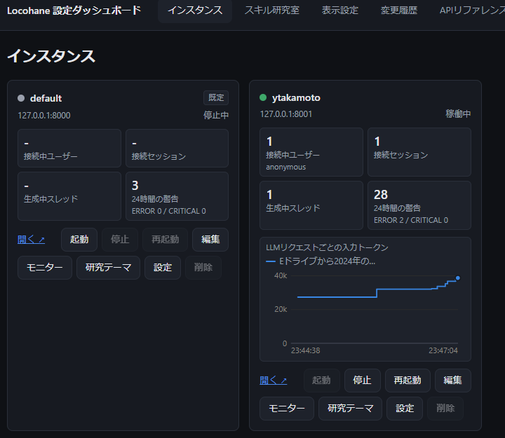

# Locohane-Agent detailed documentation (a local AI agent platform / compliant with the SKILL.md standard)

> For an overview, quick setup steps and basic usage, see [README.en.md](README.en.md).
> This document collects the details of the design, directory layout, settings and operation, for administrators and developers.
> This is the English translation of [README_DETAIL.md](README_DETAIL.md). The Japanese version is authoritative; if they differ, follow the Japanese version.

An AI agent platform that works completely offline. Skill definitions comply with the
**Agent Skills standard (SKILL.md format)** published by Anthropic.
Specification: <https://agentskills.io/specification>

The design policy is "thin and transparent". No clever mechanisms (dynamic imports, hot reloading, metaclasses) are used.
It scans and reads `skills/` at startup, and that is all. The top priority is that the paths and timing of saving and deleting files
can be followed clearly from the code.


Origin of the name: **Lo**cal (the local environment) + 小羽 (**cohane**, "small feather" / lightness and a Japanese-sounding name)

## Purpose of this project

This project aims to be self-hosted and server-driven so that several users in a workplace or group can use it at the same time,
and to let the agent carry out tasks stably not with a high-performance large-parameter model but even with low-parameter models.

The intended use is specialized work where mistakes are not allowed, such as design work. So reproducibility of results
(small variance) is prioritized over performance gains. For growing skills and prompts too, the "self-evolving" approach,
where the agent automatically rewrites its own skills, is not adopted. With the same idea as repeating the same process dozens to a hundred times
to confirm stability when ramping up mass production in manufacturing, every change is followed by running the same evaluation repeatedly
with the real local LLM (**skill stabilization tryout**), and it is adopted only after confirming that every run passes
(see "Automatic tuning loop for prompt assets (evals/)"). What the agent itself does is limited to
recording in persistent memory (issues and countermeasures) and creating draft skills that only their creator can use;
whether to reflect them in the official procedures is decided through external evaluation and the approval of skill developers
(see "Draft skills (per user) and promotion").

- **Path memory** (`src/path_memory.py`, the
  Tool Usage Guidelines of `system_prompt.md`): automatically attaches short reference numbers `@N`
  to the results of `Glob`/`Grep`/`Read`, preventing the LLM from repeatedly failing by rebuilding long absolute paths itself.
  A folder's `@N` followed by a child path, such as `@N/photo_01.png` (`\` also works as the separator), resolves to that path inside the folder
  (appending a child path to a file's `@N` is an error).
- **Loop detection, guards and retries** (`[thinking_loop_guard]` in `config.ini`,
  `ChatLlamaCpp` in `src/llm/chat_model.py`, `ThinkingLoopDetected` in
  `src/llm/loop_guard.py`): detects that a response has fallen into a repetition loop,
  injects a nudge message and retries automatically. So that it does not freeze even beyond the limit,
  `app.py` shows a cutoff message and ends.
- **Extended glob** (`Glob` in `src/tools/glob_tool.py`, common logic in
  `src/tools/_file_tools_common.py`):
  in addition to the normal glob results, returns the number of matches, a directory list and path memory references,
  making it easier for the LLM to correct its search scope by itself.
- **The read-only permission boundary and forced delegation to the explore sub-agent** (`_SUBAGENT_TOOLS` in
  `src/tools/registry.py`, `agents/explore.md`, Task Delegation in
  `system_prompt.md`): carves exploration out to a read-only sub-agent,
  spreading the token usage per request and stabilizing it. In addition,
  `[main_agent_tool_guard]` in `config.ini` restricts with a whitelist the main agent's own direct calls to
  heavy tools and skill scripts with large token consumption, such as `Read`/`Grep`/`analyze_image`,
  effectively forcing delegation.
- **Designing an upper limit on the main agent's token usage** (`agents/worker.md`,
  `src/main_token_guard.py`, `src/context_trim.py`, `[graph] token_guard_*` in
  `config.ini`): the main agent is the control tower, and if it becomes unstable
  the whole task breaks down, so "keeping the number of tokens per request at about 128,000 or fewer"
  is a design principle (originally the guideline was under 64,000, but as the countermeasures below improved,
  up to 128,000 became stable). In processing many files, having sub-agents return their read results
  to the main agent in full makes the token count grow monotonically until it stops without responding
  (measured: in processing 297 images, tokens per request grew from 24,833 to 128,000,
  reaching the context limit of the time and stopping. The guideline of 128,000 is not the stopping point of that case
  but was chosen as the range that the current setup (`--ctx-size 256000`) can handle stably. `[graph] token_guard_soft_threshold`
  is not the guideline but a safety device for when it keeps growing beyond that, set to the context length minus a margin).
  As a countermeasure, there is the writable sub-agent `worker`, which completes everything from reading to writing internally
  and returns only the number processed and failures to the main agent. Since that countermeasure assumes `worker`
  ends normally, `write_scratch_note` exists as insurance for when it is cut off midway by the token limit:
  the sub-agent appends what it found to a scratch file at each milestone of its investigation,
  so even when cut off, the delegator can decide how to continue just by being handed the file path.
  In addition, truncation by `context_trim` and automatic generation of handoff prompts by `main_token_guard`
  reinforce it in multiple layers.
- **A design that gives no bash/npm-equivalent tools** (the `run_script` family of tools in `src/tools/`,
  `create_plan`/`approve_plan`, `_GUARD_BLOCKED_CMDS`): letting low-parameter models
  run arbitrary commands carries a high risk of runaways and mistakes, so no tools equivalent to a general shell,
  bash or npm are exposed at all. Command execution is limited to `run_script` (whitelist method), predefined
  under skills, and all write tools are blocked until user approval through `create_plan` -> `approve_plan`.
  Even `execute_python_code`, which can run arbitrary code, has guards that block starting
  git/npm/pip and writing outside the project, preventing the minimum of destructive operations.
- **The "ops JSON DSL" design of document generation skills** (`scripts/_*.py` of `skills/pptx-create`, `skills/excel-edit`,
  `skills/docx-create`): applies the "no bash/npm-equivalent tools" design above consistently
  to generating xlsx/pptx/docx. Instead of having the LLM write raw `python-pptx`/`openpyxl`/
  `python-docx` code, it is confined to a finite set of `op`s (`set_range`/
  `add_chart`/`format_table`, etc.) and a JSON schema, narrowing it down to operations that work reliably without syntax errors
  or file corruption even with low-parameter models (Anthropic's official `skills/pptx`, `skills/xlsx`, etc. take the opposite approach,
  relying on Claude's own prior knowledge to write raw `python-pptx`/`openpyxl` code directly, and their SKILL.md is a diff document
  that adds only the "pitfalls" rather than the library API itself).
  For visual consistency, `pptx-create`/`excel-edit`/`docx-create`/`pdf-tools`
  share the same 8-color themes (`charcoal`/`navy`, etc., based on the Design
  Ideas of Anthropic's official pptx skill). Only `pdf-tools` (`create_pdf.py`) is an exception,
  having the LLM write semantic HTML directly (converted to `reportlab` Flowables by an in-house parser, no JS execution) —
  unlike the XML-based formats of xlsx/pptx/docx, HTML does not fatally break the file
  even if it is somewhat malformed, so expressiveness can be secured safely within this principle.
- **Running multiple instances with the settings dashboard** (the `admin/` package,
  `admin.bat`): a separate admin tool that supports "several users in a workplace or group can use it at the same time"
  on the settings side too. Besides changing `config.ini`, `public/settings/` and
  sign-in users from a browser UI without a text editor, it can
  **start, stop and restart Locohane as several instances at the same time**
  (e.g. adding a second instance that runs with another model and other endpoints).
  Each instance is completely separated in its data such as conversation history, persistent memory and uploads,
  its settings override diff (`instances/<name>/config_overrides.json`) and its sign-in users,
  and data corruption from multiple launches is prevented by an exclusive lock (`src/instance_lock.py`).
  For details, see "Settings dashboard (admin tool)".

---

## Architecture

```
                 ┌──────────────────────────────────────────────┐
   Browser ────▶ │  app.py (Chainlit UI)                        │
                 │   - receives user input with @cl.on_message  │
                 │   - streams tokens with astream_events       │
                 │   - visualizes tool calls with cl.Step       │
                 │   - confirms approve_plan approvals with     │
                 │     cl.AskActionMessage (approve/reject)     │
                 └───────────────┬──────────────────────────────┘
                                 │ runs
                 ┌───────────────▼──────────────────────────────┐
                 │  src/graph.py  ReAct loop (2 implementations) │
                 │                                               │
                 │  handwritten: START→[agent]⇄[tools]→END       │
                 │    (handwritten StateGraph, wired by hand)    │
                 │  prebuilt   : delegates to create_react_agent │
                 │    (chosen with config.ini [graph] implementation)│
                 └───┬───────────────────────────┬──────────────┘
                     │ model calls               │ tool execution
       ┌─────────────▼───────────┐   ┌───────────▼──────────────────────┐
       │ ChatOpenAI              │   │ src/tools/ (41 tools)               │
       │  → llama-server /v1     │   │  read_skill / read_skill_file /    │
       │  (OpenAI-compatible)    │   │  run_script / execute_python_code /│
       └─────────────────────────┘   │  get_tool_source / check_work_dir_status /│
                                      │  Read / Glob / Grep / json_query / │
                                      │  search_path_memory / analyze_image /│
                                      │  dispatch_agent / create_plan /    │
                                      │  approve_plan / update_task_progress/│
                                      │  get_plan_status / lock_plan_mode /│
                                      │  AskUserQuestion / ask_user_choice /│
                                      │  provide_download /                │
                                      │  create_memory / update_memory /   │
                                      │  delete_memory / read_memory /     │
                                      │  search_memory / list_memories /   │
                                      │  list_document_collections /       │
                                      │  search_documents /                │
                                      │  search_document_paths / help      │
                                      │  (file ops on skills/ are limited  │
                                      │   to it; Read/Glob/Grep take any   │
                                      │   absolute path)                   │
                                      └───────┬───────────────┬──────────┘
                                              │ scan/read/run │ read/write
    startup ┌─────────────────────────────┐  │   ┌────────────▼───────────┐
   Discovery │ src/skills.py                │◀─┘   │ src/memory.py           │
   (stage 1) │  scans skills/ and injects   │      │  saves 4 kinds under    │
             │  name+description into the   │      │  data/memory/:          │
             │  system prompt               │      │  User/Feedback/Project/ │
             └─────────────────────────────┘      │  Reference; inserts the │
                                                    │  MEMORY.md index into  │
   conversation state                               │  {{memory}}            │
           ┌──────────────────────────────┐      └────────────────────────┘
           │ AsyncSqliteSaver              │   ┌────────────────────┐
           │  → data/checkpoints.sqlite   │   │ skills/            │
           └──────────────────────────────┘   │  <name>/SKILL.md   │
                                                │  <name>/scripts/   │
                                                │  <name>/references/│
                                                │  <name>/assets/    │
                                                └────────────────────┘
```

Only `dispatch_agent` is a special tool that runs an independent ReAct loop inside `src/subagent.py`;
its internal tool calls (`read_skill`/`read_skill_file`/`run_script`/`execute_python_code`, etc.,
limited to the tools that the kind chosen with `agent_type` has) do not appear in the parent's conversation history or graph trace
(an intentional design to save context). Kind definitions are loaded at startup by scanning `agents/*.md` (frontmatter with
`name`/`description`/`tools`/`model`, equivalent to Claude Code's `.claude/agents/*.md`).

In `model` (optional), write the `model` name of an endpoint in `[llm].sub_url`. When given, sub-agents of that kind choose an endpoint
according to `sub_routing_strategy`, with only the endpoints in `sub_url` whose `model` matches (case-insensitive) as candidates
(even when `sub_url` is not set and the main endpoints are inherited, if the inherited endpoint is not the specified model, an endpoint of the specified model is chosen).
`model: inherit` (from Claude Code's definition files) and an empty string are treated as not specified.
If no endpoint matches (or all are outside their `start`/`end` time ranges), `[llm].sub_default_model` below is used, and if that cannot be used either, the specification is ignored and the normal routing rules apply.
It can also be specified per delegation with the `model` argument of `dispatch_agent`/`dispatch_agent_batch`, taking precedence over the frontmatter.
If neither is given (or the specified model cannot be used), `[llm].sub_default_model` (if empty, endpoints are chosen without looking at model names as before) is used the same way.
Note that `sub_default_model` is effective even in the setting where `sub_url` is not set and the main endpoints are inherited, so if the main agent is using an endpoint of another model,
it is not inherited, and an endpoint of the `sub_default_model` model is chosen from `main_url`
(leave it empty if you want sub-agents to use the same endpoint as the main agent).
The same specification also applies to building models for rebuilding and compaction inside the job (`_PREFERRED_SUB_MODEL` in `src/llm/routing.py`).

```markdown
---
name: explore
description: ...
tools: read_skill, Read, Grep
model: Qwen3.6-35B-A3B
---
```

At startup, `LOCOHANE.md` under `[paths].project_locohane_dir` (default `.locohane`)
(if it exists) is also loaded and inserted into `{{project_instructions}}` of the system prompt
(equivalent to Claude Code's CLAUDE.md; see `src/project_instructions.py`).

### Where progressive disclosure (3 stages) is implemented

| Stage | Content | Implementation |
|------|------|------|
| 1. Discovery | At startup, inject only the frontmatter (name/description) of each `SKILL.md` | `src/skills.py` |
| 2. Read | The LLM chooses a skill and reads its whole body with `read_skill` | `src/tools/read_skill.py` |
| 3. Execute | Following the instructions in the body, read/run only when needed with `read_skill_file`/`run_script` | `src/tools/read_skill_file.py`/`src/tools/run_script.py` |

Supplements about `read_skill` in stage 2:

- **Constraining the choice of skill names**: at startup, `init_tools(skill_names=...)` replaces the `skill_name` argument of `read_skill`
  with a `Literal` type of the existing skill names (`apply_skill_name_enum`). `"enum": [...]` appears in the tools schema sent to the LLM,
  and names not in the list are returned to the LLM as a validation error before reaching the tool itself.
- **What it returns**: the body without the frontmatter, wrapped in `<skill_content name="...">`, and if there is `references/`,
  the file list with `@N` (path memory) appended at the end (the contents are not read). `read_skill_file`
  accepts these `@N` as is (an `@N` pointing outside the skills root is refused). It also accepts a folder's `@N`
  followed by a child path, such as `@N/xxx.md`.
- **Protection from context reduction**: the last `read_skill` result read per skill name is not truncated by `[context_trim]`
  (`src/context_trim.py`). Even when it falls within the summarized part of `[context_compaction]`, it is not summarized but
  reattached verbatim after the summary (`_render_reattached_skills` in `src/context_compaction.py`;
  limits are `skill_reattach_max_chars_per_skill`/`skill_reattach_total_max_chars`).

Skill loading is implemented **entirely as LangGraph tool calls**, so it appears in the graph trace and
is visualized on the Chainlit side as steps such as "reading this skill now".

### List of built-in tools and how they are exposed to the LLM

"Built-in tools" are stateless functions that are always exposed to the LLM independently of skill bodies
(in contrast, SKILL.md is "knowledge and procedures" and is not itself a tool.
The LLM accesses skill bodies and scripts indirectly through the **built-in tools**
`read_skill`/`read_skill_file`/`run_script`).

**How the LLM learns about them**: **not** by embedding tool descriptions in text such as system_prompt.md
(prompt-based). They are sent as structured data in every request as the `tools` parameter of the OpenAI-compatible API.

1. Each tool is defined as a function with LangChain's `@tool` decorator under the `src/tools/` package
   (as a rule one file per tool). The function's docstring is automatically converted into `description`,
   and its type-hinted arguments into the JSON Schema `parameters`
   (standard functionality of `langchain_core.tools.tool`; this project has no conversion code of its own).
2. `get_all_tools()` (`src/tools/registry.py`) returns a list merging the built-in tools and the dynamic tools from MCP.
3. `build_model(config).bind_tools(get_all_tools())` in `src/graph.py` (on the sub-agent side,
   `src/subagent.py`) binds this list to a `ChatOpenAI`-family class (`ChatLlamaCpp` in
   `src/llm/chat_model.py`).
4. When the HTTP request is actually sent, the functions passed with `bind_tools` are converted into a `tools` array
   in the OpenAI Function Calling format and included in the request body sent to `base_url` (the `/v1` endpoint of llama-server).
   LangGraph receives the `tool_calls` in the LLM's response and runs the corresponding Python functions.

In other words, the LLM's clue to "what tools can be used" is not the text of the system prompt
but **the `tools` field itself, sent with each request**
(including `name`/`description`/`parameters`, interpreted by the model's Function Calling capability).
Only the skills' frontmatter (name/description) is separately injected as text into the system prompt
at startup by `src/skills.py` (the Discovery stage, which is prompt-based).

Besides the 3 stages above, there are the following 41 tools independent of skill loading (all under the `src/tools/` package, as a rule one file per tool).
Tool descriptions and return values are written in English (the LLM relays them to the user in the user's language).

| Tool | Role |
|--------|------|
| `read_skill` | Reads the whole body of a skill's SKILL.md (progressive disclosure stage 2) |
| `read_skill_file` | Reads files under the skills directory (references/assets, etc.; progressive disclosure stage 3) |
| `run_script` | Runs a script under a skill's scripts/ (needs approval; can be switched to no approval in `config.ini`). It blocks until completion, so when a long run close to the timeout is expected, use `run_script_background` |
| `run_script_background` | Starts the same scripts as `run_script` (approval needed likewise). Until completion it waits while notifying progress (elapsed seconds, partial output) directly to the chat, so the LLM itself does not need to poll. Only if it is still not done after the configured safety limit (`[scripts].background_inline_wait_max_seconds`) does it return a `job_id` and end the turn |
| `check_script_job` / `stop_script_job` | Used only in the fallback after the safety limit above: checking the status of the job and forcibly stopping it. Consecutive `check_script_job` calls on a running job at intervals shorter than `[scripts].background_min_poll_interval_seconds` are refused by the server |
| `execute_python_code` | Runs Python code generated by the LLM on the spot (needs approval; can be disabled in `config.ini`). It blocks until completion, so when a long run close to the timeout is expected, use `execute_python_code_background`. To refer to `@N` (path memory) in the code, you need to expand it into the real path by calling `path_memory.resolve()` via the `AGENT_SRC_DIR` environment variable. A pre-run guard blocks writing, deleting and renaming under the project folder, such as `src/`, `app.py`, `config.ini` and `skills/`. The write destination is limited to the working folder if the user specified one (see "Switching the working directory" below), otherwise to the session's own temporary area `_tmp_<name>` under `default_workdir` (writing directly under `default_workdir` is not allowed, to prevent malfunctions in other sessions) |
| `execute_python_code_background` | Starts the same code as `execute_python_code` (approval, disabling in `config.ini`, path memory expansion and the project folder protection guard are the same). Like `run_script_background`, it waits while notifying progress until completion, and checking status and stopping (only after the safety limit) use the shared `check_script_job`/`stop_script_job` |
| `execute_python_code_readonly` | The read-only version of `execute_python_code` (cannot write files, no approval needed). Given only to read-only sub-agent kinds such as `explore` (`tools:` of `agents/*.md`); the main agent does not have it |
| `write_scratch_note` | Appends what was found during an investigation to a scratch file. It can always be called even without plan approval, and since the tool itself decides the write destination, it cannot write to arbitrary paths. For handing off when cut off by the token limit |
| `write_thread_note` / `list_thread_notes` / `read_thread_note` | Thread notes closed within the same thread (see "Difference from thread notes" below). A note mechanism separate from `write_scratch_note` for handing over the details of investigation results between the delegator and delegates. The main agent and all sub-agents can read and write |
| `get_tool_source` | When `run_script` errors, returns the absolute path of the script for investigating the cause (does not return its content) |
| `check_work_dir_status` | Checks the actual access status of the current working directory |
| `Read` / `Glob` / `Grep` | Reading, file name search and full-text search on any absolute path on the local file system (names matching Claude Code's tools of the same names. Read-only, so they can always be called even without plan approval. Logic in `src/tools/read_tool.py`/`glob_tool.py`/`grep_tool.py`, common processing in `_file_tools_common.py`) |
| `json_query` | JMESPath queries on JSON/dicts (read-only) |
| `search_path_memory` | Searches the current conversation's path memory (`@N`) for paths similar to a file name etc. (character bigrams + cosine similarity, read-only). Tools that take a path resolve not only a bare `@N` but also a folder's `@N` followed by a child path (`@N/file name`) |
| `provide_download` | Presents an existing file as a download button on the chat screen |
| `analyze_image` | Shows an image file to the LLM as visual information so the LLM itself analyzes, describes and judges its content (for vision models). With `show_in_chat=True`, it also shows a preview on the chat screen at the same time as analyzing (use this for "show it" / "let me see". It cannot be called to only display without looking at the content). To embed an image within the answer text (a cell of a Markdown table, etc.), just write `` directly in the answer text without using the tool (it is automatically converted right before sending into a URL the browser can fetch; `_embed_local_images_as_session_urls` in `app.py`) |
| `dispatch_agent` | Delegates a task to a sub-agent (`src/subagent.py`) and receives only the final answer. The kind of sub-agent must always be specified with the `agent_type` argument (there is no implicit default). Kind definitions are `agents/*.md` (equivalent to Claude Code's `.claude/agents/*.md`). They are scanned merged with `.locohane/agents/*.md`, and for the same name, the `.locohane/agents` side takes precedence. Specifying the optional `orchestrator_skill` argument (the skill name of an orchestrator SKILL.md that uses several skills across the board) mechanically injects the whole body of that SKILL.md at the start of the task, preventing mandatory rules and prohibitions from dropping out when summarized (details in section 7 of `skills/SKILLS_README.md`). The optional `model` argument can specify a model name from `[llm].sub_url`, taking precedence over the frontmatter `model` of `agents/*.md` (nonexistent model names are ignored). Until completion it waits while notifying progress (elapsed time, number of iterations) directly to the chat, so the LLM itself does not need to poll. Only if it is still not done after the configured safety limit (`[subagent].background_inline_wait_max_seconds`) does it return a `job_id` and end the turn |
| `dispatch_agent_batch` | Delegates work that applies the same processing to many files in a folder to several sub-agents in parallel. It gets the files matching `pattern` (relative to `path`; without `/` only direct children, with levels such as `*/ocr_md/*.md` or `**/*.jpg` subfolders are searched too; `{a,b}` expansion allowed; files outside `path` via `..` etc. are excluded) in order of their path relative to `path`, splits them into groups of `group_size`, mechanically appends the absolute paths of the assigned files to the end of each group's task, and runs them in parallel on the same job infrastructure as `dispatch_agent` (the `[subagent].max_parallel` semaphore, progress notifications, stop button support). The LLM only needs to call it once and does not need to line up several `dispatch_agent` calls in one response (parallel issuing is unstable with low-parameter models). The return value is only the status of each group and the first 400 characters of its final answer; the full text is saved in a thread note. Groups that are "error", "truncated", "killed" or "not started" also list their assigned files for re-delegation. Progress notifications are a single aggregated message for all groups, not one per group. The number of groups per call is up to `[subagent].batch_max_groups` (default 50; 0 or less is unlimited; exceeding it is an error before starting). When the safety limit (`background_inline_wait_max_seconds`) is exceeded, it returns the results of completed groups and the `job_id`s of running groups (the Steps of running groups close with a "background" badge). When the number of groups cut off by LLM timeouts/communication errors reaches `[subagent].batch_stop_after_unreachable_groups`, the remaining groups are not started and are returned as "not started". When interrupted with the stop button, it saves the results of completed groups and the assigned files of unfinished groups in a thread note, and puts that topic in the guidance of the next turn |
| `check_dispatch_agent_job` / `stop_dispatch_agent_job` | Used only in the fallback after the safety limit above: checking the status of the job and forcibly stopping it |
| `create_plan` / `approve_plan` / `update_task_progress` | Create, approve and update the progress of a multi-step execution plan (after approval, the individual confirmations of `run_script` are skipped). Each step has `content` (what to do) and `activeForm` (the present progressive form shown while running) |
| `get_plan_status` / `lock_plan_mode` | Checks whether it is currently Plan Mode (the locked state where write tools are blocked) or Edit Automatically (the state where an approved plan can be executed), and manually goes back from the latter to the former without user approval |
| `AskUserQuestion` / `ask_user_choice` | Asks the user for additional information needed to continue the conversation (`AskUserQuestion` is free text: a single input when `labels` is omitted, several items presented together when given. `ask_user_choice` is multiple choice, and "✏️ Other (free input)" and "❌ Cancel" are always added automatically to the displayed choices) |
| `create_memory` / `update_memory` / `delete_memory` / `read_memory` / `search_memory` / `list_memories` | Save, update, delete, read in full, search and list persistent memory across threads (`src/memory.py`). The main agent has all 6 tools. `dispatch_agent` sub-agents get narrowed sets per kind: `explore` has only the reading tools (`read_memory`/`search_memory`/`list_memories`), and `worker` has all 6 (full access) (see `tools:` of `agents/*.md`) |
| `list_document_collections` / `search_documents` / `search_document_paths` | The collection list and semantic search of internal documents ingested into the vector DB (`src/vector_db/`) (read-only; `search_document_paths` searches by file and folder names). Search results carry the source path (`@N`), page, etc., and the whole is truncated to `[vector_db] max_result_chars`. While `[vector_db] enabled = false`, they return that it is disabled (see "Vector DB (semantic search of internal documents)") |
| `help` | Returns the user-facing help text (`system_prompt/help.md`) as is |

`run_script` (including `run_script_background`) and `execute_python_code` (including `execute_python_code_background`)
are write tools, so they cannot run unless the plan has been approved by the user with `create_plan`/`approve_plan`
(`cl.user_session["plan_approved"]` is True);
if not approved, they return an error (Plan Mode). The approval itself is done with the
✅ approve / 🚫 reject buttons of `cl.AskActionMessage`, and on timeout it errs on the safe side (reject). `execute_python_code`
(including `execute_python_code_background`) can be disabled as a tool with `[scripts] code_execution_enabled`
in `config.ini`.

Not all of the 41 tools and skills above can be called directly from the main agent.
`[main_agent_tool_guard]` in `config.ini` (default `mode = all`) restricts the main agent's
own direct calls to built-in tools and skill scripts under `run_script` with the whitelist
`allow_entries` (sub-agents under `dispatch_agent` are not covered). The `Read`/`Grep`/`json_query`/`analyze_image`/`execute_python_code` family
and most skill scripts are not included in this list, so being unregistered = not callable
effectively forces delegation to `dispatch_agent` (the aim is to prevent hitting the token limit by hammering
heavy tools with large token consumption; for details see the comments in `config.ini`).

---

## File layout

```
Locohane/
├── config.ini              # all settings (LLM endpoints, storage paths, script execution, graph implementation, sub-agents)
├── requirements.txt        # pip dependencies (pinned versions)
├── app.py                  # Chainlit entry point
├── app.bat                 # startup batch for Windows (follows the host/port of instances/default/)
├── admin.bat               # startup batch for the settings dashboard (admin tool)
├── admin/                  # the settings dashboard itself (details in the "Settings dashboard" section)
│   ├── server.py            # FastAPI entry point (`python -m admin.server`)
│   ├── auth.py               # sign-in, sessions and CSRF of the admin tool itself
│   ├── instances.py          # creating, deleting, copying and consistency checks of instances/
│   ├── supervisor.py         # starting, stopping and restarting a child process per instance
│   ├── ini_catalog.py        # read-only parser of config.ini (never rewrites it)
│   ├── ini_catalog_en.py     # English catalog of the config.ini descriptions (for the English display of the dashboard)
│   ├── overrides.py          # validating, saving, backing up and auditing config_overrides.json
│   ├── env_files.py          # reading and writing instances/<name>/.env
│   ├── env_overrides.py      # detecting keys overridden by environment variables
│   ├── settings_files.py     # reading and writing display settings (public/settings/, instances/<name>/settings/)
│   ├── audit.py              # change history log (JSON Lines)
│   ├── monitor.py            # read processing for the monitor screen (running status, conversations, token trends, logs, LLM endpoints)
│   ├── knowledge.py          # HTTP API of the knowledge screen (vector DB collection management, ingestion jobs)
│   ├── assistant.py          # HTTP API of the admin assistant ("Ask AI" at the top right; only reads settings and advises)
│   ├── assistant_index.py    # search for the admin assistant (simple RAG over config.ini, README_DETAIL.md and the API reference)
│   ├── i18n.py               # server-side display language (English translations of error messages, middleware reading X-Locohane-Lang)
│   ├── ASSISTANT_GUIDE.md    # screen guide the admin assistant rereads every time (edits take effect without a restart)
│   ├── skill_lab/            # Skill Lab (the "Skill Lab" section of "Settings dashboard")
│   │   ├── api.py             # HTTP API of the lab (/api/instances/{name}/skill-lab/...)
│   │   ├── themes.py          # storage, file operations and state of research themes (data/<name>/skill_lab/themes/ of the target instance)
│   │   ├── sources.py         # lists of users' drafts, official skills and official agents that can be imported
│   │   ├── evaluation.py      # evaluating themes (layering assets onto evals/run_all.py and running with the lab's LLM endpoints)
│   │   ├── llm.py / fixer.py / judge.py / drafting.py  # AI fixes, AI judging and drafting by the lab's LLM
│   │   ├── worker.py          # the worker started as a skill tuning worker (evaluate -> AI fix -> re-evaluate -> tryout)
│   │   └── promotion.py       # promotion (to the instance-only location), sending back, archiving drafts
│   └── static/                # frontend (plain HTML/JS, no build needed. The lab screen is skill_lab.js, the knowledge screen knowledge.js, the display language i18n.js, English translations i18n_en.js)
├── instances/               # per-instance directories managed by the admin tool (.gitignored, created at run time)
│   └── <name>/               # per-instance settings folder. By default it also serves as the instance-only extension directory ([skill_lab] instance_locohane_dir: skills/ and agents/ promoted in the lab, evals/ for regression tests)
├── Locohane.lnk            # startup shortcut (links to admin.bat)
├── chainlit.md             # Chainlit welcome screen
├── README.en.md            # English version of README.md
├── README_DETAIL.en.md     # English version of README_DETAIL.md (this document)
├── CLAUDE.md               # project-specific additional instructions (Claude Code format)
├── QWEN.md                 # project-specific additional instructions (Qwen Code format; one line referring to CLAUDE.md)
├── VERSION                 # the authoritative version number (one line; "Versioning and release procedure" section)
├── CHANGELOG.md            # change history (Keep a Changelog format)
├── LICENSE                 # this project's license (MIT)
├── THIRD_PARTY_LICENSES.md # list of licenses of dependent OSS (regenerated with tools/gen_licenses.py)
├── memo.md                 # notes for developers
├── issue.md                # notes on known issues (maintained by hand)
├── issue/                  # per-case Markdown files the monitor-app-log skill files automatically when it detects anomalies in app_*.log
├── pytest.ini              # pytest settings
├── .env.example            # sample environment variables
├── .gitignore              # Git exclusion settings
├── .mcp.json                # connection settings to `mcp_server/`, which distributes our own skills as an MCP server (for MCP clients such as Claude Code, project scope)
├── .chainlit/
│   ├── config.toml         # Chainlit settings
│   └── translations/       # translation files
├── .claude/
│   └── skills/             # skills for Claude Code (development support; not used when the app runs)
│       ├── tune-prompt/           # automatic tuning of prompt assets such as system_prompt.md
│       ├── create-eval-case/      # creating new eval cases in evals/cases/
│       ├── consolidate-memory/    # consolidating duplicates in the persistent memory of all instances (daily)
│       ├── apply-memory-to-skills/ # reflecting the memory of a specified instance into SKILL.md and running tune-prompt
│       ├── promote-skill/         # running one draft skill through the skill stabilization tryout and promoting it to the instance-only location (normally use the admin tool's Skill Lab)
│       └── monitor-app-log/       # periodically monitoring app_*.log and filing issues in issue/ automatically
├── .qwen/                  # Qwen Code's directory equivalent to `.claude/` (settings.json, skills/, etc.)
├── .locohane/                # project_locohane_dir (default). Its contents are detected automatically at startup
│   ├── LOCOHANE.md.example  # sample LOCOHANE.md (placing it gives project-specific instructions)
│   ├── settings.json        # MCP server connection settings
│   ├── skills/              # additional skills merged into the scan of skills_dir (same names take precedence; currently only README.md and empty)
│   └── agents/              # additional agent kinds merged into the scan of agents_dir (same names take precedence; currently only README.txt and empty)
├── frontend/                # custom React frontend
│   ├── src/
│   │   ├── components/      # UI components (AskFormBar, PlanCard, SidePanel, etc.)
│   │   ├── i18n/            # display language (Japanese/English texts, LanguageProvider, useI18n)
│   │   └── utils/           # utilities
│   └── public/
├── public/                  # files published by Chainlit
│   ├── build/               # frontend build output
│   ├── settings/            # header, icon and welcome text settings
│   ├── icons/                # UI icon images
│   ├── custom.css           # custom CSS
│   └── UI変更ガイド.md      # UI customization guide (Japanese)
├── system_prompt/
│   ├── system_prompt.md     # system prompt for the main agent
│   ├── help.md              # user-facing help returned by the help tool (English; the LLM relays it in the user's language)
│   ├── compaction_prompt.md # instructions for automatically summarizing the conversation history
│   ├── subagent_common.md   # common prompt for sub-agents
│   ├── handoff_prompt.md    # cutoff/handoff instructions injected into the LLM when approaching the token limit
│   └── compressing_test/    # workspace for verifying the effect of prompt compression (development experiments related to tune-prompt)
├── tools/
│   └── gen_licenses.py      # script to regenerate THIRD_PARTY_LICENSES.md
├── mcp_server/               # implementation of the side that distributes skills/ as an MCP server to external clients (Claude Code, etc.) (started from `.mcp.json`; details in `mcp_server/MCP_README.md`)
│   ├── MCP_README.md         # detailed guide to the distribution methods and client connection settings
│   ├── server.py              # entry point (creates the FastMCP instance, registers Resources/Tools)
│   ├── config.py              # collected settings (SKILLS_SRC/WORKDIR/timeout seconds/excluded file names; overridable with environment variables)
│   ├── publish.py              # creates temporary copies for Resources distribution (excluding secret files such as .env)
│   └── skill_tools.py          # the 3 tools of the Tools method (list_skills/read_skill/run_skill_script)
├── evals/                   # automatic evaluation and tuning loop for prompt assets
│   ├── README.md            # how to run, how to write cases
│   ├── run_all.py           # runs all cases at once
│   ├── run_case.py          # runs one case (no Chainlit UI needed)
│   ├── case_schema.py       # schema of case YAML
│   ├── headless_chainlit.py # Chainlit stub
│   ├── timing_callbacks.py  # callbacks measuring actual timing for config_timeouts
│   ├── analyze_timing.py    # aggregating and analyzing measured timing results
│   ├── analyze_investigation_order.py # temporary aggregation script for verifying tuning
│   ├── tuning_log.md        # tuning history
│   ├── handoff_prompt.md    # handoff notes for resuming tune-prompt
│   ├── handoff_config_timeouts_skill.md # handoff notes from developing the config_timeouts target
│   ├── cases/               # evaluation cases (YAML)
│   │   ├── system_prompt/   # cases for the system prompt
│   │   ├── system_prompt_scale/ # cases for scaling
│   │   ├── config_timeouts/ # cases for tuning timeout settings
│   │   └── excel-skills/    # cases for the Excel skills
│   ├── fixtures/            # fixture data for evaluation (sets of data specified as work_dir)
│   │   └── answer/<target>/ # answer data and fixture generation scripts for cases/<target>
│   ├── history/             # snapshots before tuning
│   └── results/             # run results (regenerable, .gitignored)
├── src/
│   ├── config.py            # config.ini loader (frozen dataclass)
│   ├── version.py           # reads the version number from the VERSION file (__version__)
│   ├── skills.py            # skill discovery middleware (stage 1, Discovery)
│   ├── agent_types.py       # agent kind discovery (agents/*.md)
│   ├── tools/                # LangGraph tools (stages 2 and 3 + independent tools). As a rule one file per tool
│   │   ├── registry.py       # get_all_tools(), MCP tool registration, the _BASE_TOOLS/_SUBAGENT_TOOLS lists
│   │   ├── tool_node.py      # ImageAwareToolNode, filtering tools for the main agent
│   │   ├── _state.py         # central management of module-shared state (config values, semaphores, registries, etc.)
│   │   ├── _file_tools_common.py # common logic of Read/Glob/Grep
│   │   └── (read_skill.py/run_script.py/dispatch_agent.py, etc., one file per tool)
│   ├── path_memory.py       # reading and writing the path memory (@N) registry
│   ├── memory.py            # reading and writing persistent memory, rebuilding the index
│   ├── vector_db/            # vector DB (semantic search of internal documents; the "Vector DB (semantic search of internal documents)" section)
│   │   ├── extract.py / chunking.py # extracting text from documents, splitting into chunks
│   │   ├── render.py         # rendering pages and image files as images for image_input (Office goes through PDF via COM)
│   │   ├── embeddings.py     # computing embeddings with /v1/embeddings
│   │   ├── catalog.py        # collection definitions and records of ingested files (catalog.sqlite)
│   │   ├── store.py / sqlite_vec_store.py / qdrant_store.py # where vectors are stored (sqlite-vec / Qdrant)
│   │   ├── keyword_index.py  # keyword index of the text (keywords.sqlite, BM25 of SQLite FTS5)
│   │   ├── sqlite_batch.py   # batched commits of SQLite writes (for ingestion; WAL, synchronous=NORMAL)
│   │   └── ingest.py / search.py # differential ingestion (CLI: python -m src.vector_db.ingest), search
│   ├── project_instructions.py # loading .locohane/LOCOHANE.md
│   ├── graph.py             # ReAct loop (switches between handwritten / prebuilt)
│   ├── llm/                  # building ChatOpenAI (llama-server connection)
│   │   ├── chat_model.py     # ChatLlamaCpp, build_model()
│   │   ├── loop_guard.py     # repetition loop detection (ThinkingLoopDetected)
│   │   ├── thinking_control.py # switching the thinking level per step ([thinking_control])
│   │   ├── routing.py        # endpoint routing (round_robin/random/priority_failover)
│   │   └── diagnostics.py    # diagnostic logging
│   ├── context_trim.py      # truncating old ToolMessages
│   ├── context_compaction.py # automatic summarization and compaction of the conversation history
│   ├── main_token_guard.py  # token guard of the main agent, automatic generation of handoff prompts
│   ├── tool_loop_guard.py   # detecting loops that repeat exactly the same response consecutively ([tool_loop_guard])
│   ├── subagent.py          # the internal ReAct loop of dispatch_agent
│   ├── mcp_client.py        # MCP server connection (stdio), tool conversion
│   ├── chat_log.py          # recording conversation logs in text files
│   ├── thread_store.py      # conversation thread list (left sidebar), lightweight store for resuming
│   ├── plan_persist.py      # persisting plan/plan_approved changes to thread_store immediately without waiting for the turn to finish
│   ├── ask_relay.py         # state that hands over waiting for responses to approve_plan/AskUserQuestion/ask_user_choice to another session after switching threads
│   ├── ask_reconnect.py     # patch that resends pending questions (buttons, input box) to the new connection after a WebSocket reconnect of the same session
│   ├── instance_lock.py     # process exclusive lock preventing multiple launches on the same data directory
│   ├── cleanup.py           # automatic deletion of unneeded files
│   ├── files.py             # file upload processing
│   ├── images.py            # image processing, Data URL conversion
│   ├── tool_labels.py       # display names of tools (shared by the UI's Step badges and the progress display of sub-agents)
│   ├── i18n.py              # display language for the chat screen (texts of system notices, buttons, etc., and the response language instruction)
│   ├── log_rotation.py      # date-time rotation of app.log
├── agents/
│   ├── README/AGENTS_README.md # guide to writing agent kind definitions (frontmatter) (moved under README/ to avoid warnings when scanning *.md)
│   ├── explore.md           # read-only agent kind for general investigation and office document/PDF investigation
│   ├── worker.md            # writable agent kind that completes read -> write internally along an approved plan
│   └── verifier.md          # agent kind for verifying deliverables
├── skills/
│   ├── SKILLS_README.md    # guide for skill developers
│   ├── skill-creator/       # meta-skill for creating per-user draft skills, making improvements, and eval verification
│   ├── docx-read/           # docx read-only (paragraphs, tables, document properties, whether there are Track Changes)
│   ├── docx-create/         # generating new docx (headings/paragraphs/tables/images/page setup, etc.)
│   ├── docx-edit/           # editing existing docx (find/replace, Track Changes, adding/deleting paragraphs)
│   ├── docx-render/         # rendering Word document pages as images
│   ├── excel-read/          # xlsx/xls/xlsm read-only (sheet list, cell data)
│   ├── excel-edit/          # creating/editing xlsx/xlsm (cells/formatting/rows and columns/charts, etc.)
│   ├── excel-recalc/        # recalculating formulas of xlsx/xlsm/xls, detecting error cells
│   ├── excel-vba-read/      # reading VBA macro code of xlsm/xls only
│   ├── excel-vba-edit/      # adding/overwriting/deleting and running VBA macro code of xlsm
│   ├── excel-render/        # rendering Excel sheets as images
│   ├── excel-knowledge/     # local knowledge base of coding practices and pitfalls when using excel-edit/read/render/recalc
│   ├── excel-vba-knowledge/ # local knowledge base of Excel VBA coding practices and pitfalls
│   ├── pdf-tools/           # reading PDFs, rendering pages as images, generating PDFs
│   ├── pptx-read/           # pptx read-only (extracting text, tables, speaker notes)
│   ├── pptx-create/         # generating new pptx (16:9 template method)
│   ├── pptx-inspect/        # reading the structure of existing pptx templates (finding shape_index)
│   ├── pptx-edit/           # partially editing existing pptx templates (keeping the design)
│   ├── pptx-render/         # rendering PowerPoint slides as images
│   ├── office_shared/       # Python common processing shared by the scripts/ of the docx/excel/pptx skills (has no SKILL.md and is not exposed to the LLM)
│   └── web-search/          # web search with the Tavily API (needs an API key)
│       # Read/Glob/Grep/json_query/search_path_memory are native tools
│       # (src/tools/read_tool.py etc., src/path_memory.py).
├── tests/                   # pytest test cases
│   ├── conftest.py
│   ├── fixtures/
│   └── test_*.py            # tests of each module
└── data/                    # created at run time (.gitignored)
    ├── checkpoints.sqlite   # LangGraph conversation state
    ├── logs/                # app operation logs (date-time rotation)
    ├── logs_chat/           # conversation logs (user messages + AI responses)
    ├── memory/              # persistent memory (subfolders per type + MEMORY.md)
    ├── path_memory/         # path memory registries (.json)
    ├── plans/               # detailed plan Markdown when create_plan is passed detail_markdown
    └── temp/                # default working directory (thread-only folders _tmp_*/; uploaded files go here too)
```

At the top of each module, a comment states "which stage of the specification this file implements".

---

## Scope of compliance with the Agent Skills specification

Specification: <https://agentskills.io/specification>

### What is compliant

- **SKILL.md frontmatter**: `name` and `description` (required) are validated.
  `license`, `compatibility`, `metadata` and `allowed-tools` (optional) can be read.
- **`name` validation rules**: 1-64 characters / only lowercase letters, digits, hyphens and underscores /
  cannot start or end with a separator / no consecutive separators / **must match the parent directory name**.
- **`description` validation**: non-empty, 1024 characters or fewer.
- **Directory structure**: reading and running assume `scripts/`, `references/` and `assets/`.
- **The 3 stages of progressive disclosure** (Discovery / Read / Execute).
- **Call examples in SKILL.md bodies use the command line form**: examples that call scripts under
  `scripts/` are written not in Locohane's own `run_script` JSON argument form
  (`{"skill_name":..., "script_filename":..., "script_args":[...]}`) but in the
  `python <script>.py <args...>` form shared with other Agent Skills environments (Claude Code, etc.)
  (see section 4-0 of `skills/SKILLS_README.md`). This means the `skills/<name>/`
  folders can be taken as is to other environments, and conversely third-party Agent Skills published on GitHub etc.
  in the `python <script>.py <args...>` form (SKILL.md written for other environments)
  can be brought into Locohane without the barrier of differing call notations
  (environment-specific preparation, such as installing dependencies, is needed separately). The conversion from this form
  to Locohane's own `run_script` call has no implementation on either the SKILL.md side or the code side;
  the common prompt instructions on the LLM side (the "Conversion rules for SKILL.md call examples" section of
  `system_prompt/system_prompt.md` and `system_prompt/subagent_common.md`)
  do it when calling the tool.
- SKILL.md files that violate the specification are **skipped with a warning log** (the whole thing does not fail).
- **Draft skills (a Locohane-specific extension)**: drafts created by skill-creator use the same SKILL.md format,
  but they are not scanned at startup; they appear in the list as `username/skill name` only in their creator's conversations
  (see "Draft skills (per user) and promotion"). After promotion, they are treated the same as normal skills.

### Out of scope (not implemented)

- **`allowed-tools`**: the field can be read, but automatic approval based on it is not implemented (it is also experimental in the specification).
- **No integration with the official validator (skills-ref)**: only our own minimal validation. If strict validation is needed,
  use `skills-ref validate ./skills/<name>` separately.
- **Deeply nested references**: reference files are assumed to be one level from SKILL.md.

---

## Where data is stored and how to delete it manually

Everything is under `data/` (changeable with the `dir` keys of `[paths]`/`[elements]`/`[log]`/`[default_workdir]` etc. in `config.ini`). `data/` is .gitignored. To change the storage root all at once, instead of rewriting each key individually, change only `[paths] common_data_dir` (default `./data/${instance}`) (the values of the corresponding keys are written referring to `${common_data_dir}`). `${instance}` is replaced with the name of the running instance (`default` when started directly with `app.bat`), so by default data is separated per instance into `data/<instance name>/`. `data/` in the table below means `data/<instance name>/` (e.g. `data/default/`) with the default settings.

**Migrating from old versions (that stored data directly under `data/`):** the default storage location changed from `./data` to `./data/${instance}`, so if you just start it, past threads, persistent memory, etc. become invisible (they are not deleted). While the app is stopped, moving the files and folders directly under `data/` (`checkpoints.sqlite`, `chat_threads.sqlite`, `memory/`, `logs/`, `elements/`, `plans/`, `path_memory/`, `logs_chat/`, `temp/`, `app.lock`, etc.) to `data/default/` carries them over. If you want to keep using the old location without moving, set `[paths] common_data_dir` of the default instance to `./data` on the admin tool's settings screen.

| Path | Content | When it may be deleted | How to delete |
|------|------|------------------------|----------|
| `data/checkpoints.sqlite` | LangGraph conversation state (the history of all threads) | When past conversation history is no longer needed | Delete the file (while the app is stopped) |
| `data/chat_threads.sqlite` | Metadata for the conversation thread list (left sidebar) and resuming (thread names, owners, Chainlit Step history). A separate file from `checkpoints.sqlite` (see `[thread_store]`) | When the list/resume feature is no longer needed | Delete the file (while the app is stopped; `checkpoints.sqlite` itself remains, so conversation state is not lost) |
| `data/logs/app.log` | App operation log | Any time | Delete the file |
| `data/memory/` | Persistent memory (`user`/`feedback`/`project`/`reference` subfolders + the `MEMORY.md` index) | When the accumulated memories are no longer needed | Delete the folder contents (`MEMORY.md` is regenerated on the next save) |
| `data/vector_db/` | The vector DB's `catalog.sqlite` (collection definitions, records of ingested files), the vectors `vectors.sqlite` with `backend = sqlite_vec`, and the keyword index of the text `keywords.sqlite` (`[vector_db] dir`). `catalog.sqlite` also holds references to collections of other instances (the `collection_refs` table). The source documents themselves are not copied | When a collection is no longer needed | Delete the collection on the Knowledge screen of the settings dashboard (to delete the whole folder, stop the app and the admin tool's ingestion first; with `backend = qdrant` the vectors remain on the Qdrant side) |
| `data/plans/` | Detailed plan Markdown when `create_plan` is passed the `detail_markdown` argument (`[paths] plans_dir`) | When old plans are no longer needed | Delete the folder contents |
| `data/skill_drafts/<username>/` | Per-user draft skills created by skill-creator (`<skill name>/`) and their evaluation results (`_workspace/`). `[skill_creator] draft_dir`. Rejected drafts also remain as records (not shown in the list) | When there are unneeded drafts | Delete the draft folder (the creator can also delete it with `delete_draft.py` of skill-creator). Not deleted automatically |
| `data/<instance name>/skill_drafts_archive/<username>/<skill name>_<date time>/` | Where promoted drafts are moved (together with `_workspace/`; `[skill_creator] archive_dir`) | When the records are no longer needed | Delete the folder |
| `data/skill_lab/themes/<theme ID>/` | Research themes of the Skill Lab (spec, assets under development, cases, input files, records of evaluation and AI fixes `runs/`). Separated per target instance | When the theme is over and the records are no longer needed | Delete the theme folder (it must not be running) |
| `data/temp/_tmp_<creation time>_<short ID>/` | Intermediate output of `execute_python_code`/`run_script`, and the destination of `write_scratch_note`/`write_thread_note`. Files uploaded in the chat (`uploads/<send time>/`; here even if a working folder is specified). Only for the session itself (see `[default_workdir]`). The creation time at the start of the folder name (`YYMMDDHHMMSS`) is for sorting in creation order in a file manager. The short ID is the first 10 hex digits of the SHA-1 of the thread_id (thread_id is not used as is, to avoid exceeding the 260-character path length limit; folders in the old form `_tmp_<creation time>_<thread_id>` are also used as is when resuming) | When no longer needed after the session ends | Delete the folder contents (also deleted automatically by `[default_workdir] retention_days`/`cleanup_interval_hours`) |
| `data/elements/<thread_id>/` | Where attachments (`provide_download`, `analyze_image` with `show_in_chat=True`, etc.) and images embedded in answer text are persisted. The actual files are copied here so they can be shown after resuming a thread or restarting the process (see `[elements]`, `src/thread_store.py`) | When attachments are no longer needed | Delete the folder contents |
| `instances/_assistant_index/` | Cache of embeddings of paragraphs of config.ini, README_DETAIL.md and the API reference, used for search by the admin tool's "Ask AI" (one file per embedding endpoint/model; not under `data/`) | Any time (rebuilt on the next question; the first time takes tens of seconds) | Delete the folder |
| `.files/` | Chainlit's own session file delivery directory (temporary delivery used only for live display right after sending; at the project root, not under `data/`) | Any time | Delete the folder contents |
| `data/app.lock` | Process exclusive lock preventing multiple launches on the same data directory (`src/instance_lock.py`). It only puts an OS file lock on an empty file; its content is not used | While the app is stopped, deleting it does no harm | Delete the file (cannot be deleted while the app is running) |
| `data/runtime_status.json` | Snapshot of connected sessions and threads being generated (for the monitor display of the settings dashboard, `src/runtime_status.py`). The main app updates it every few seconds and deletes it on normal exit | When left behind by an abnormal exit | Delete the file (recreated on the next startup) |
| `instances/<name>/` | Per-instance directories managed by the settings dashboard (admin tool) (`config_overrides.json`, `.env`, `settings/`, `backups/`, `app_stdout.log`, the instance-only skills and sub-agents promoted in the Skill Lab `skills/`/`agents/`, and `evals/` for regression tests. The data itself is in `data/<name>/`) | When the instance itself is no longer needed | Use the admin tool's delete function (not possible while running, or for `default`. Persistent data such as logs, threads and default_workdir is deleted together only for the items selected in the delete dialog; details in the "Settings dashboard" section) |

`data/temp/_tmp_*/` folders older than `[default_workdir] retention_days` in `config.ini` (default 7 days)
are deleted automatically, including uploaded files, every `cleanup_interval_hours` (default 1 hour). Setting `retention_days` to 0 or less
disables automatic deletion. Uploaded images are not embedded directly in the conversation; only the saved path (`@N`) is passed to the LLM,
so if you resume an old thread after this many days, the files uploaded in that thread can no longer be opened (upload them again).
The old `data/uploads/` (`[uploads]` was removed) is no longer used, so you may delete the whole folder if unneeded.
`data/elements/` is also deleted automatically in the same way with `[elements] retention_days` (default 7 days) and
`cleanup_interval_hours` (default 1 hour). `.files/` is also deleted automatically in the same way with `[chainlit_files]
retention_days` (default 7 days) and `cleanup_interval_hours` (default 1 hour)
(it is under Chainlit's own path management, so there is no `dir` key. Unlike the others, it deletes
per directory = per session ID).

Manual full deletion (PowerShell / cmd, run while the app is stopped):

```powershell
Remove-Item -Recurse -Force .\data\*
```

A design that creates no "orphan files": saving is limited to `_save_uploads()` in `app.py` (to `data/temp/_tmp_*/uploads/`),
and conversation history to `AsyncSqliteSaver` (`data/checkpoints.sqlite`).
What is written where can be traced uniquely in the code.

---

## Setup and startup

### 1. Specifying the Python environment and installing dependencies

The Python virtual environment used by the project is specified in **just one place**, `PYTHON_DIR` in
`python_env.bat` at the project root. First rewrite it to your actual environment.

```bat
set PYTHON_DIR=C:\DT_Python\Python311\env_local_agent_system
```

| Variable | Value to set |
|---|---|
| `PYTHON_DIR` | The directory of the Python virtual environment that runs Locohane. `admin.bat`, `app.bat` and `mcp_server.bat` (started from `.mcp.json`) `call` this file. **Each instance started from the admin tool is also started with the same Python (`sys.executable`)** (see `admin/supervisor.py`), and if `[scripts].python` in `config.ini` is empty (default), `run_script`/`execute_python_code` also use this Python |

`python_env.bat` also sets `PYTHONUTF8=1`, so that standard I/O and the default of `open()` are UTF-8 even on non-Japanese Windows (e.g. English Windows).

Next, install the dependencies into that environment (run in Command Prompt).

```cmd
call python_env.bat
python -m pip install -r requirements.txt
```

### 2. Examples of starting the inference server (llama.cpp / vLLM)

The LLM endpoint can be anything OpenAI-compatible, but matching `provider` (`llama_cpp`/`vllm`/unspecified =
`openai_compatible`) in `[llm] main_url`/`sub_url` of `config.ini` to the actual server type
automatically adjusts the names and whether to send extension parameters
(`repeat_penalty`/`dry_*`/`reasoning_budget`, etc.) to each server's dialect (`src/llm/dialect.py`).

**llama-server (llama.cpp)**

Exposes an OpenAI-compatible endpoint at `http://localhost:8080/v1`:

```bash
llama-server --model C:\path\to\model.gguf --alias local-model --host 127.0.0.1 --port 8080 -c 8192
```

- `--alias` is the model name. Match it to `model` in `[llm] main_url` of `config.ini`.
- Sampling defaults (`top_p`/`top_k`/`repeat_penalty`/`frequency_penalty`/`presence_penalty`/`max_tokens`) can also be specified
  with startup CLI options such as `--repeat-penalty`, but values specified on the `[llm]` side of `config.ini`
  take precedence per request (llama-server's startup defaults are used only for unspecified = empty items).

**vLLM**

Exposes an OpenAI-compatible endpoint at `http://localhost:8000/v1`:

```bash
vllm serve /path/to/model --served-model-name local-model --host 127.0.0.1 --port 8000
```

- `--served-model-name` is the model name. Match it to `model` in `[llm] main_url` of `config.ini`.
- To use thinking (`<think>` block) models, you need to specify `--reasoning-parser`
  (e.g. `deepseek_r1`) at startup (unlike llama-server, vLLM cannot switch
  `reasoning_format` per request).
- `dry_*` (the DRY sampler), `reasoning_format` and `reasoning_budget_message` are
  not sent to vLLM (`src/llm/dialect.py` excludes them automatically).

The endpoints and model names can be switched in `config.ini` (or with the environment variables `LLM_MAIN_URL` / `LLM_SUB_URL`).
For either server, the endpoints and extension parameters can be changed after startup from the UI of the settings dashboard
(admin tool) (see the "Settings dashboard (admin tool)" section).

> **⚠️ Model licenses for commercial use**
> llama.cpp and vLLM themselves are both under MIT-based licenses, but **the licenses of the models you run
> differ per model** (they are not included in the base code).
> Always check them for commercial use.
> - Qwen2.5 family / Mistral family -> Apache 2.0 (commercial use OK, recommended)
> - Llama family -> Meta Llama Community License (commercial use OK but with its own restrictions, such as the 700 million MAU clause)
> - Gemma family -> its own Gemma Terms of Use
> When in doubt, choosing an Apache 2.0 model (Qwen2.5, etc.) is safe.

### 3. The minimum settings for environment-dependent paths

After starting the inference server (llama-server/vLLM), set the paths that always need to match
the actual values of your environment. When using the settings dashboard (admin tool),
**the LLM endpoints (`[llm] main_url`/`sub_url`) can be set from the UI after signing in**,
so there is no need to edit `config.ini` directly before starting. The Python environment was already specified in
`python_env.bat` in step 1, so the only files you need to prepare as text beforehand are the following 2.

**`.env` (the admin tool's sign-in information)**

| Key | Value to set |
|---|---|
| `ADMIN_USERS` | Pairs of username/password for signing in to the admin tool. Copy `.env.example` to create `.env` and set it (if not set, the admin tool refuses to start) |

**`admin.bat` (the admin tool's own startup settings)**

| Variable | Value to set |
|---|---|
| `ADMIN_HOST` / `ADMIN_PORT` | The host and port the admin tool itself listens on (default equivalent to `127.0.0.1:8001`). Change only if the port conflicts with something else |

With this, you can start `admin.bat`, and after signing in, go to "Instances" -> "Settings" of the target instance -> the `config.ini` tab
on the dashboard, search for `main_url`/`sub_url`, set and save them, and restart the instance
to apply them (details in the "Settings dashboard (admin tool)" section).
If you want only `run_script`/`execute_python_code` to run with another Python,
specify `[scripts].python` on the same screen (if empty, the environment of `python_env.bat`).

**The project's `CLAUDE.md` (the execution environment Claude Code uses when developing and testing this project; not needed to run the app)**

| Heading | Value to set |
|---|---|
| `Python実行環境` | The absolute path of the Python executable Claude Code uses for running scripts and checking behavior (normally the same virtual environment as `PYTHON_DIR` in `python_env.bat`) |
| `Node.jsパス` | The Node.js directory Claude Code uses for building and testing `frontend/` (which has package.json) |

**When setting it directly with a text editor without the admin tool**

If you rewrite `[llm] main_url`/`sub_url` in `config.ini` directly (the Python environment was specified in
`python_env.bat` in step 1), you can start it standalone with
`app.bat` without the admin tool (for the meaning of each item, see "Settings reference
(config.ini)" below).

### 4. Starting the app

```cmd
admin.bat
```

The admin tool (settings dashboard) starts and automatically starts the `default` instance
(Locohane itself). For details, see the "Settings dashboard
(admin tool)" section.

To run it standalone with hot reloading during development, use one of the following.

```cmd
rem Method A: start chainlit directly (after loading the environment of python_env.bat)
cd C:\DT_Python\Locohane
call python_env.bat
chainlit run app.py -w

rem Method B: app.bat (follows the host/port of instances/default/instance.json)
app.bat
```

Open it in a browser and send, for example, "summarize the contents of this Excel file";
`read_skill` (reading the body of excel-read) -> `run_script` (running `read_excel.py`) are
**visualized as steps**, and the result is streamed.

### 5. Listening over HTTPS (optional)

When you want to encrypt communication, e.g. when using it from other devices or smartphones on the LAN,
specify both the paths of the server certificate and the private key (both in PEM format) in `[admin]` of
`config.ini` (the environment variables `SSL_CERTFILE` / `SSL_KEYFILE` also work).

```ini
[admin]
ssl_certfile = ./certs/server.crt
ssl_keyfile = ./certs/server.key
```

- The admin tool (uvicorn's `ssl_certfile`/`ssl_keyfile`) and the main instances started from the admin tool and
  `app.bat` (`--ssl-cert`/`--ssl-key` of `chainlit run`)
  listen over HTTPS with the same certificate (it cannot be switched per instance).
  The URL becomes `https://<host>:<port>`, and HTTP can no longer connect.
- Specifying only one, or a missing file, makes startup refuse
  (it does not silently fall back to HTTP). The check is `resolve_ssl_files()` in `src/config.py`.
- The admin tool's session cookie gets the `Secure` attribute with HTTPS.
- After changing it, restart `admin.bat` (or `app.bat`). Restarting instances from the admin screen alone
  does not make the admin tool itself HTTPS.

Ideally use a certificate issued by your internal CA if you have one. Example of making a self-signed certificate
for testing (the openssl bundled with Git for Windows. Include the host names and IP addresses used to connect
in `subjectAltName`):

```cmd
openssl req -x509 -newkey rsa:2048 -nodes -days 365 ^
  -keyout certs\server.key -out certs\server.crt -subj "/CN=locohane" ^
  -addext "subjectAltName=DNS:localhost,IP:127.0.0.1,IP:192.168.1.10"
```

A self-signed certificate makes the browser show a warning, so register the certificate as trusted
on the devices that use it ("Add to Home Screen" on smartphones may not work correctly with an untrusted certificate either).
Do not commit the private key to the repository (`certs/` at the project root is in `.gitignore`).

---

## Development environment

An example of the environment actually used to develop and verify this project.

### Coding agent tools

| Tool | Details |
|--------|------|
| ClaudeCode | Claude Pro Plan |
| QwenCode | llama-server (local) + Qwen3.6-35B-A3B |

### OS / hardware

- OS: Windows 11
- CPU: Intel(R) Core(TM) Ultra 5 225 (10 cores / 10 logical processors, base 3.30GHz)
- Memory: 32GB
- GPU: NVIDIA GeForce RTX 5060 Ti (dedicated GPU memory 16.0GB)

### Example llama-server startup command

`llama-server` is started with the following arguments to match the hardware above.

```
  --model .\models\unsloth\Qwen3.6-35B-A3B-GGUF\Qwen3.6-35B-A3B-UD-Q4_K_M.gguf
  --mmproj .\models\unsloth\Qwen3.6-35B-A3B-GGUF\mmproj-F16.gguf
  --n-cpu-moe 25
  --n-gpu-layers 99
  --threads 10
  --threads-batch 10
  --threads-http 4
  --models-max 1
  --parallel 2
  --batch-size 4096
  --ubatch-size 2048
  --ctx-size 256000
  --n-predict 32000
  --temp 0.6
  --top-p 0.95
  --top-k 20
  --min-p 0.0
  --presence-penalty 0
  --repeat-penalty 1.0
  --cache-reuse 256
  --cache-ram -1
  --swa-full
  --cache-type-k q8_0
  --cache-type-v q8_0
  --flash-attn on
  --jinja
  --no-mmap
  --mlock
  --reasoning-format deepseek
  --reasoning-budget 8192
  --reasoning-budget-message "**Wait, I am overthinking this. I should answer now.**"
```

- `n-cpu-moe`/`n-gpu-layers` are MoE offload settings adjusted to fit within the GPU's dedicated memory (16GB).
- `ctx-size`/`cache-type-k`/`cache-type-v` are values balancing the context length and KV cache quantization.

---

## Bundled skills

The SKILL.md files, references and script messages of the bundled skills are written in English (the LLM answers in the user's language).

| Skill | Location | Type | Details |
|--------|----------|------|------|
| `skill-creator` | `skills/` | Runs scripts | Meta-skill for creating your own draft skills, making improvements of existing skills, writing their bodies, repeated evaluation with the eval harness (skill stabilization tryout) and optimizing the trigger accuracy of descriptions. Does not rewrite official skills (see "Draft skills (per user) and promotion" below). |
| `pdf-tools` | `skills/` | Runs scripts | Extracting text from PDFs, rendering pages as images (visually grasping layout/figures/scanned content), generating PDFs (Japanese supported). |
| `docx-read` | `skills/` | Runs scripts | docx read-only (getting paragraphs, tables, document properties, whether there are Track Changes and images). |
| `docx-create` | `skills/` | Runs scripts | Generating new docx (headings/paragraphs/bullets/tables/images/page setup/header and footer, etc.). |
| `docx-edit` | `skills/` | Runs scripts | Editing existing docx (find/replace, inserting and resizing images, adding/accepting/rejecting Track Changes. Cropping images is not supported). |
| `docx-render` | `skills/` | Runs scripts | Rendering Word document pages as images (visually grasping layout, tables, image placement and emphasis). |
| `excel-read` | `skills/` | Runs scripts | xlsx/xls/xlsm read-only (sheet list, cell data, whether there are images). |
| `excel-edit` | `skills/` | Runs scripts | Creating/editing xlsx/xlsm (cells/formatting/rows and columns/charts, adding and positioning images, conditional formatting, data validation. Cropping images is not supported). |
| `excel-recalc` | `skills/` | Runs scripts | Recalculating formulas of xlsx/xlsm/xls, detecting error cells. |
| `excel-vba-read` | `skills/` | Runs scripts | Reading VBA macro code of xlsm/xls only. |
| `excel-vba-edit` | `skills/` | Runs scripts | Adding/overwriting/deleting and running VBA macro code of xlsm. |
| `excel-render` | `skills/` | Runs scripts | Rendering Excel sheets as images (visually grasping borders, formatting, charts and layout). |
| `excel-knowledge` | `skills/` | Reference only | Local knowledge base accumulating coding practices, standard techniques and pitfalls when using excel-edit/excel-read/excel-render/excel-recalc (see `references/`). |
| `excel-vba-knowledge` | `skills/` | Reference only | Local knowledge base accumulating Excel VBA coding practices, standard techniques and pitfalls (see `references/`). |
| `pptx-read` | `skills/` | Runs scripts | pptx read-only (extracting slide titles, body text, tables and speaker notes). |
| `pptx-create` | `skills/` | Runs scripts | Generating new pptx (16:9 template method). |
| `pptx-inspect` | `skills/` | Runs scripts | Reading the structure of existing pptx templates only (finding `shape_index` before `pptx-edit`). |
| `pptx-edit` | `skills/` | Runs scripts | Partially editing existing pptx templates (replacing, duplicating, deleting and reordering while keeping the design, adding new images/charts, cropping images). |
| `pptx-render` | `skills/` | Runs scripts | Rendering PowerPoint slides as images (visually grasping layout, figures, image placement and emphasis). |
| `web-search` | `skills/` | Runs scripts | Web search with the Tavily API. Works only when TAVILY_API_KEY is set in the skill's own `scripts/.env` (no communication by default). |

`.locohane/skills/` is the place for your own skills (merged into the scan of `skills/`, same names take precedence), and currently contains only a `README.md` explaining how to use it.
`.locohane/` is shared by all instances, so skills and sub-agents you want to separate per organization or role go in the instance-only
`instances/<instance name>/skills/` and `agents/` (`[skill_lab] instance_locohane_dir`, scanned with the highest priority).
Things promoted in the admin tool's Skill Lab are placed there.

For detailed procedures and conventions of skill development, see [`skills/SKILLS_README.md`](skills/SKILLS_README.md) (Japanese).

Skills with scripts whose processing time approaches or may exceed `[scripts].timeout` (default 300 seconds)
state that (it may take time to run) in their SKILL.md (Locohane-specific tool names such as `run_script`/`run_script_background`
are not written in SKILL.md bodies; see section 4-0). Whether to use `run_script` or `run_script_background`,
based on whether the script may run long, is decided by the common conversion rules on the LLM side (the
"Conversion rules for SKILL.md call examples" section of `system_prompt/system_prompt.md` and `system_prompt/subagent_common.md`).
`run_script_background` waits automatically until completion
(unless it reaches the safety limit `[scripts].background_inline_wait_max_seconds`) and returns the same final result as `run_script` directly
(progress is notified to the chat automatically for humans, so SKILL.md does not need to instruct polling steps).
Only for very long scripts exceeding the safety limit does guidance with a `job_id` come back, so only in that case
do you need to state how to use `check_script_job`/`stop_script_job` in SKILL.md.

### Draft skills (per user) and promotion

Skills that users (not necessarily skill development experts) create with skill-creator from the chat are placed
not as official skills but as **drafts** in `<username>/<skill name>/` of `[skill_creator] draft_dir` (default `data/<instance name>/skill_drafts/`).
Key points of the design:

- **Structurally preventing them from leaking into production**: making `draft_dir` the same as, or nested with, the startup skill scan targets (`skills_dir`, `agents_dir`,
  `project_locohane_dir`) causes an error at startup (`_validate_skill_draft_dir` in `src/config.py`).
  What skill-creator can write to, limited to runs of skill-creator itself under `skills/`, is only your own draft folder
  (`_skill_creator_draft_roots` in `src/tools/_subprocess_env.py`). To fix an official skill,
  make a draft of the improvement with `fork_skill.py`, which records the original hash.
- **Usable only in the creator's conversations**: per session, drafts are added as `username/skill name`
  to the skill list of the system prompt and the choices of `read_skill` (`_apply_session_draft_skills` in `app.py`,
  `src/tools/session_tools.py`). Creating or deleting a draft or changing its description takes effect from the next message
  (`on_message` in `app.py` compares the state of drafts with the previous time on every message and rebuilds the graph if it changed).
  Users are identified by the signed-in username turned into a folder name (`draft_owner_name()` in `src/skill_drafts.py`;
  in addition to the same replacement as conversation logs, it lowercases, removes trailing dots/spaces and avoids `..` and reserved device names),
  so note that with authentication disabled, everyone shares the same `anonymous` drafts.
- **Other users' drafts are handled in 4 levels** (`[skill_creator] other_users_drafts`): `hidden` (default; not listed,
  and cannot be read from Read/Glob/Grep/execute_python_code etc.) / `listed` (only listed) / `readable` (up to reading) /
  `full` (up to running, writing and evaluating). The decision is centralized in `src/skill_drafts.py` and called from each place:
  `_safe_path`, path resolution of the `Read` family, Grep's recursive search, and the write guard of Python execution (a root where reading and listing are also forbidden,
  and a root where writing is forbidden even if the working directory contains `draft_dir`).
- **Drafts can be used directly without approval**: the scripts of drafts and of skill-creator itself
  can be run directly from the main agent without plan approval, regardless of the `[plan] plan_approval_exempt_scripts` and `[main_agent_tool_guard]` settings
  (because creators cannot edit config.ini). It is decided by the actual location of the script, not by name,
  so impersonating a skill of the same name does not get the exemption. The write destination is limited to the working directory as usual.
  With `[main_agent_tool_guard]` enabled, the `run_script`/`run_script_background` given to the main agent are
  copies whose `skill_name` is constrained to the choices of skills that can be run directly (registered in allow_entries, skill-creator, runnable drafts)
  (preventing round trips of trying uncallable skills and being refused).
- **Evaluation layers the draft on top of the production setup**: `run_isolated_eval.py` of skill-creator
  runs `evals/run_all.py --cases-dir <draft>/evals --skill-overlay <draft>`. It keeps the production skill setup, including the company's own
  `project_locohane_dir`, and layers only the draft on top with the highest priority.
  The scripts of the layered skill are evaluated with plan approval and `[main_agent_tool_guard]` exempted, the same as what is registered at promotion
  (aligning the behavior tried in conversation, the behavior evaluated and the behavior after promotion). `--repeat N` makes it a skill stabilization tryout.
- **A fix resets the pass count to 0**: a tryout fixes the draft and cases at the start in a temporary folder, evaluates all runs,
  and leaves the hash of that content in `tryout.json` (`evals/skill_tree.py`). Fixing the draft in even one place empties
  the tryout records in `_draft_meta.json`, and at promotion, tryout results whose hash does not match cannot be used.
- **Making it official is done by skill developers in the admin tool's Skill Lab** (see "Skill Lab" in "Settings dashboard" below).
  The developer imports the draft into a research theme (working on a copy made at import time, so the creator can keep editing),
  prepares the spec and cases, lets the lab's AI fix defects by itself, and makes it pass every run of the tryout (`[skill_creator] tryout_repeats` times, default 10).
  Humans check, make light manual fixes, and approve/reject. On approval, it is promoted to the location dedicated to the instance that created the draft
  (`[skill_lab] instance_locohane_dir`, default `instances/<instance name>/skills/`), and the original draft
  moves together with `_workspace` to `[skill_creator] archive_dir` (default `data/<instance name>/skill_drafts_archive/`).
  When sent back, the reason appears in the creator's skill-creator (`returned_reason` of `list_drafts.py`) (fixes made in the lab can also be copied to the draft).
- **The promotion destination is only the instance-only location**: it is not placed in the bundled `skills/`/`agents/` or the
  `project_locohane_dir` shared by all instances (`.locohane/`, etc.), to prevent it from mixing into other instances separated per organization or role.
  Improved versions of bundled/shared skills are also placed in the dedicated location with the same name, replacing them only in that instance (the original files and other instances do not change).
  The exemption settings of skills with scripts (`[plan] plan_approval_exempt_scripts`, `[main_agent_tool_guard] allow_entries`) are also
  registered only in that instance's `config_overrides.json` (with the same validation, backup and change history as the admin tool).
  Promoted skills and settings take effect after a restart.
- **Claude Code's promote-skill is also kept**: a route for judging and promoting one draft as is. The promotion destination, archiving and
  settings registration follow the same rules as the lab (`promote_helper.py install` places it only in the `--instance`'s dedicated location). Both record to `evals/promotion_log.md`.

### How to add a new skill

Just create `skills/<name>/SKILL.md` (`<name>` is the folder name = the `name` in the frontmatter).
If you do not want to touch the built-in set, you may put it in `.locohane/skills/<name>/SKILL.md`
(merged into the scan of `skills/`; if there is a skill with the same name, the `.locohane/skills` side takes precedence).
A minimal SKILL.md:

```markdown
---
name: my-skill
description: Write concretely what the skill does and when to use it.
---

# my-skill

Write the procedure here. Add scripts/ references/ assets/ if needed.
```

When writing examples in the body that call scripts under `scripts/`, write them not in Locohane's own
`run_script` JSON argument form but in the command line form `python <script>.py <args...>`
(details in section 4-0 of [`skills/SKILLS_README.md`](skills/SKILLS_README.md)).
The conversion into actual `run_script` calls is done by the common instructions on the LLM side.

Restarting the app discovers it automatically in the startup scan (no dynamic reloading).

---

## MCP server connections

Complying with Anthropic's official Model Context Protocol ([specification](https://modelcontextprotocol.io/specification)),
external MCP servers (stdio transport only) can be used dynamically as LLM tools.
The implementation is `src/mcp_client.py` (uses the official Python SDK, PyPI: `mcp`, directly).

- **Settings file**: `.locohane/settings.json` at the project root (tracked by git).
  Modeled on the `mcpServers` settings format of Claude Code / Qwen Code.
  ```jsonc
  {
    "mcpServers": {
      "my-server": {
        "command": "npx",
        "args": ["-y", "@some/mcp-server"],
        "env": { "API_KEY": "${MY_SERVER_API_KEY}" },
        "cwd": null,
        "disabled": false
      }
    },
    "mcp": {
      "enabled": true,
      "connectTimeoutSeconds": 15,
      "callTimeoutSeconds": 60
    }
  }
  ```
  The top-level `"mcp"` block is optional and overrides the `[mcp]` section (defaults) of `config.ini`.
  Writing `${ENV_VAR_NAME}` in values of `env` expands it from `os.environ` at connection time.
  **`.locohane/settings.json` is tracked by git, so do not write secrets such as API keys directly;
  always refer to them in this `${ENV_VAR_NAME}` form.**
  If there are unresolved environment variables, only that server's connection is skipped (warning log).
- **How it connects**: at app startup (`@cl.on_app_startup`) it connects automatically to all entries in `mcpServers`.
  There is no feature to add them from the Chainlit UI each time.
- **Tool naming rule**: to avoid collisions, tools are exposed to the LLM as `mcp__<server name>__<tool name>`
  (normalized to 64 characters or fewer).
- **Behavior on errors**: connection failures and timeouts to individual servers only log a warning
  for that server and skip it; startup of the whole app continues. Failures of tool calls themselves
  are also returned as strings in the form `"Error: ..."` without raising exceptions.
- **Known limitations**: there is no automatic reconnection if the server process crashes after connecting.
  Only text blocks are extracted from responses (resources such as images are not supported).
- **Relationship with `[main_agent_tool_guard]`**: the names of MCP dynamic tools are only known at run time
  and cannot be registered in `allow_entries` in advance, so with the default `mode=all`
  they cannot be called from the main agent at all. To always allow them without registering in advance,
  use `mode=tools_skills_only` (for details see the comments in `config.ini`).

**MCP server connections are implemented but have not been tested, so there is no guarantee that they work properly.**

### The opposite direction: the side that distributes Locohane's skills (server)

The above is about Locohane as the side that **uses** the tools of external MCP servers (client).
Conversely, the implementation of the side (server) that distributes the SKILL.md files accumulated in Locohane's `skills/`
so that external MCP clients such as Claude Code / Claude Desktop can discover, get and **run** them
is in the `mcp_server/` package, and this side has been verified to work. The settings file is
`.mcp.json` at the project root (`command`/`args` contain full paths on this machine,
so it needs adjusting for other environments). For the detailed mechanism and client connection steps, see
[`mcp_server/MCP_README.md`](mcp_server/MCP_README.md).

---

## Persistent memory (memory across threads)

Equivalent to Claude Code's memory feature. Facts you want to carry over even when the conversation (thread) changes are saved
as Markdown files with YAML frontmatter under `data/memory/` (changeable with `[paths] memory_dir` in `config.ini`).
The logic is centralized in `src/memory.py`, and the 6 tools in `src/tools/memory_tools.py` (`create_memory`/`update_memory`/`delete_memory`/
`read_memory`/`search_memory`/`list_memories`) expose it as thin wrappers.

- **4 types**: `user` (the user's role and preferences) / `feedback` (corrections and confirmed
  approaches) / `project` (background of ongoing work) / `reference` (where external resources are).
  Each is saved as one file `<name>.md` under `data/memory/<type>/`.
  Because `name` becomes the file name, it is limited to an ASCII slug (letters, digits, `-`, `_`, up to 64 characters). Write Japanese words in `description`.
- **The index `MEMORY.md`**: a list of `name`+`description` of all saved memories.
  It is fully rebuilt on every create/update/delete (by design, no differential updates).
  This index is always inserted into `{{memory}}` of the system prompt, so the LLM knows the list of
  all memories from startup (bodies are fetched each time with `read_memory`/`search_memory`).
- Beyond 200 lines, it is truncated when inserted into the system prompt (`render_memory_block` in `src/memory.py`).
- Sub-agents of `dispatch_agent` are not given memory tools (main agent only).

The criteria for saving and deleting (what should and should not be saved) are written in
the "Memory System" section of `system_prompt/system_prompt.md`.

### Difference from thread notes

The persistent memory above is for long-term memory across threads, but separately there are
3 tools, `write_thread_note`/`list_thread_notes`/`read_thread_note`, as **temporary shared notes closed within the same thread**
(both the main agent and sub-agents (all agent_types of `dispatch_agent`) can read and write).

- They are stored not in `data/memory/` but in `_tmp_<name>/_thread_notes.md` under the working directory
  (the same temporary area as the intermediate output of `execute_python_code`/`run_script`, next to
  `_scratch_notes_<run_id>.md` used by `write_scratch_note`).
- Their purpose is "handing over the investigation results of a delegated sub-agent to other agents (the delegator or later sub-agents)
  without bloating the final answer". Unlike persistent memory, they are not carried over to later threads.
- Thread notes are not indexed automatically and not inserted into the system prompt either
  (by design, check the list of topics and character counts with `list_thread_notes` each time before reading;
  for details see `system_prompt/subagent_common.md` and `system_prompt/system_prompt.md`).
- Their lifecycle is the same as the whole `_tmp_<name>`: subject to automatic deletion by
  `retention_days`/`cleanup_interval_hours` of `[default_workdir]` (see "Settings reference" in this document),
  and they can also be deleted manually.
- When context compaction (summarization) happens, the summarizing LLM does not necessarily keep the topics already written
  in the summary, so `maybe_compact` in `src/context_compaction.py`
  mechanically reinjects the topic list (equivalent to `list_thread_notes`) independently of the summary result.
  This keeps the model from losing track of the existence and topic names of thread notes after compaction
  (the same mechanism as reinjecting the approved execution plan).

---

## Vector DB (semantic search of internal documents)

A feature (RAG) that ingests internal documents such as regulations, procedures and specifications per instance, so the LLM can search for passages close in meaning and use them in answers.
Disabled by default (`[vector_db] enabled = false`). The logic is centralized in `src/vector_db/`, and for the LLM,
the 3 tools in `src/tools/vector_db_tools.py` (`list_document_collections`/`search_documents`/`search_document_paths`, read-only) are exposed.
Documents are ingested not by users but by administrators from the settings dashboard.

- **Collections**: a group of documents corresponding to one source folder. All users in the instance can search them. Names are half-width letters, digits, `_` and `-`
  (48 characters or fewer), and a description (in any language) goes in the "description" field (also shown to the LLM by `list_document_collections`).
  Definitions (including the times and weekdays of automatic ingestion) and records of ingested files (size, modification time, SHA-256, number of chunks) are placed,
  regardless of the storage, in `catalog.sqlite` of `[vector_db] dir` (default `data/<instance name>/vector_db/`) (`src/vector_db/catalog.py`).
- **Storage** (`[vector_db] backend`): `sqlite_vec` (default; stored in a `vec0` virtual table of sqlite-vec in `vectors.sqlite` in the same folder,
  no server needed, `src/vector_db/sqlite_vec_store.py`) or `qdrant` (a Qdrant server, `src/vector_db/qdrant_store.py`).
  Guidelines for the number of chunks they can handle (total within the instance, for the 1024-dimensional bge-m3): sqlite-vec is **comfortable up to 100,000,
  with 300,000 as the practical limit** (it has no index and compares against everything on every search, so with 300,000 one search takes about 1 second), and Qdrant is
  **up to 1 million** with `qdrant_preset = none`, and **1 to 4 million** with `1m`-`4m` (see "Using Qdrant"). With
  `chunk_size = 800`, chunks are roughly 1-2 per densely written A4 page; page images with `image_input = true` add one per page, and file paths (for `search_document_paths`) add one per file separately.
  Both compare by cosine similarity. Regardless of the storage, text chunks are also put in `keywords.sqlite` (SQLite FTS5) in the same folder
  for keyword search (`src/vector_db/keyword_index.py`).
- **Ingestion** (`src/vector_db/ingest.py`): the supported formats are `.pdf` (per page), `.docx`, `.xlsx`/`.xlsm` (per sheet), `.pptx`
  (per slide, including notes) and `.md`/`.txt`/`.csv` (can be narrowed with `[vector_db] include_extensions`; Office temporary files `~$*` are excluded).
  For Office files, besides body paragraphs, cells and shape text, the following are also extracted as text (`src/vector_db/extract.py`):
  - `.docx`: text boxes, headers/footers, footnotes/endnotes and comments (listed after the body with labels such as `[Text box]` and `[Header]`).
  - `.xlsx`/`.xlsm`: text of shapes (text boxes, AutoShapes, shapes inside groups), chart titles and comments (including threaded comments).
    Shapes are inserted after the row of their anchor (the cell their top-left corner sits on) and comments after the row of their cell, as `[Shape C5] …` and
    `[Comment B3] …`, so that they land in the same chunk as nearby cells (shapes placed by position rather than by cell go at the end of the sheet).
    Legacy form buttons (VML) are not read.
  - `.pptx`: text inside grouped shapes (including nested groups).
  The text is split into chunks of at most `chunk_size` characters (preferring paragraph and line breaks, overlapping neighbors by `chunk_overlap` characters),
  and the embedding of each chunk is saved. From the second time on, **only the differences** are processed (files with the same size and modification time are not reread,
  and those with the same content are not re-embedded; chunks of files gone from the folder are deleted). Unreadable files (broken, password-protected, etc.) and
  files over `max_file_mb` are listed in the failure list and ingestion continues (`max_file_mb` is Locohane's limit, not llama-server's; if there are files over it, the Knowledge screen shows guidance to "increase `max_file_mb` and ingest again". Failed files are retried on the next ingestion).
  Files whose content cannot be embedded (image-only PDFs without text, and image files `.png`, `.jpg`, `.heic`, etc. with `image_input = false`)
  are not treated as failures; **only their file paths are registered** (the content is not read or embedded), so they can be found by file and folder names
  with `search_document_paths` (the Knowledge screen's result shows the count; they are recorded with 0 chunks and re-ingested when `image_input` is switched).
  With `[vector_db] image_input = true`, PDFs and Office files also embed page images in addition to the text, and image files are embedded as images
  (see "Ingesting pages as images (image_input)").
  Symbolic links and junctions to folders inside the source folder are followed, but not those pointing inside the source, to folders containing the source,
  or to the same target as an already followed link (to avoid loops and duplicates of the same files).
- **Fixing the embedding model**: a collection records the embedding model name and dimensions at creation. Changing the model of `embedding_url`
  makes vectors incomparable, so that collection is excluded from search (the reason is returned to the LLM), and ingestion also gives an error
  asking for a "rebuild" (deleting all vectors and ingesting again). The `document_prefix` used for ingestion is also recorded, and if it differs from the setting,
  it is treated the same (collections from old versions without the record are not checked).
- **Search** (`search_documents`, `src/vector_db/search.py`): when `collection` is omitted, all collections are searched. The following searches are done
  separately per collection, merged by rank rather than score, and the top `top_k` are returned (Reciprocal Rank Fusion: sorted by the sum of
  `weight / (60 + r)` for the rank r in each list. The weights are `rrf_weight_text`, `rrf_weight_keyword` and `rrf_weight_image`; 0 disables one).
  - **Text embeddings**: chunks close in meaning (similarity of `min_score` or more).
  - **Text keywords**: chunks containing the words of the search term, in order of BM25. Picks up exact matches of model numbers, part numbers and numbers, which embeddings are bad at.
    Japanese is indexed without splitting into words, by cutting runs of kanji/kana into 2-character pieces (bigrams) (2-character pieces of hiragana only are excluded
    as particles/endings); alphanumerics are indexed per word in lowercase, and full-width/half-width are normalized with NFKC.
  - **Page images**: when `image_input = true` (see "Ingesting pages as images (image_input)").

  Each list takes 4 times `top_k` candidates. Results are **merged into one per file and location (page, sheet, slide; for `.md`/`.txt`/`.csv`,
  the whole file)**. Within one list only the top chunk at the same location is counted, so even if a page has
  many chunks its score does not grow with the number of chunks, and locations matched by several searches (text, keyword, image) come out on top.
  Embeddings and indexes stay per chunk (`chunk_size`); the excerpt uses the best-matching chunk, and other chunks matched at the same location
  are only counted. Each result states which searches it matched (`matched: text/keyword`, etc.) and carries the source file path with path memory (`@N`), so the original
  can be checked by passing `@N` to `Read` (the main agent delegates to `explore`). The whole result is truncated to `max_result_chars` characters.
  Results are kept small, so the main agent itself can call it directly (registered in `[main_agent_tool_guard] allow_entries`).
  Among sub-agents, `explore`, `worker` and `verifier` have it.
- **Search by file and folder names** (`search_document_paths`, `search_paths()` in `src/vector_db/search.py`): even files whose content cannot be read,
  such as photos, drawings and scanned images, often have their content written in their file or folder names, so
  ingestion embeds, one per file, each file's **path relative to the source folder** (e.g. `ProductA/exterior_photos/weld_NG_example.jpg`; parts above the source
  are common to all files and not useful as clues, so they are not included) (with `document_prefix`, sent at the end of the same request as the text chunks),
  and puts them in a separate collection `<collection name>.path`. The same relative paths also go into the keyword index
  (`keywords.sqlite`; the collection name inside the index is also `<collection name>.path`, so it does not mix with the keyword search of the text)
  (extensions such as `pdf` and `jpg` would match all files of the same format, so they are not included as index words; relative paths in results include extensions).
  Search looks separately with path embeddings (similarity of `path_min_score` or more) and path keywords (BM25; picks up exact matches of model numbers, part numbers, dates, etc.;
  words are split the same way as the keyword search of the text), merges the ranks with the same formula as `search_documents` (weight 1.0 for embeddings,
  `rrf_weight_path_keyword` for keywords; 0 disables keywords), and returns the top `top_k` with which search matched
  (`matched: meaning/keyword`, etc.), the source path (`@N`) and the relative path (not mixed into the results of `search_documents`). When a path changes (renaming or moving files/folders), it is
  re-ingested as a different file, so the path vectors follow too. Ingestion covers files of the supported formats; PDFs without text and image files with `image_input = false`
  also get their paths in (files that could not be read and are in the failure list do not). Even without text chunks, a collection with files
  is searched (a collection with only image files can still be searched; `search_documents` excludes that collection as having "no documents with text"). Collections ingested before this feature was introduced
  get only their paths embedded on the next "ingest (differential)" without re-embedding the content
  (decided by `path_indexed` in the records of ingested files; paths missing from the keyword index are filled in by the same ingestion).

### Preparing and configuring the embedding server

Embeddings are computed with OpenAI-compatible `/v1/embeddings` by starting, with llama-server, an embedding model separate from the chat model
(`src/vector_db/embeddings.py`). For documents including Japanese, use a multilingual model (e.g. `bge-m3`, `multilingual-e5-large`).

```cmd
llama-server.exe -m D:\models\bge-m3-Q8_0.gguf --alias bge-m3 --embedding --pooling cls --port 12440 -c 8192 -b 8192 -ub 8192
```

- Match `--pooling` to the model (`cls` for `bge-m3`, `mean` for the `multilingual-e5` family). With `none`, per-token vectors are returned,
  and ingestion gives an error asking you to start it with `--pooling` other than none.
- Embedding processes one chunk at a time, so make `-ub` (the physical batch) larger than the number of tokens in one chunk.

Enable it in `config.ini` (or the config.ini tab of the dashboard; the "vector DB" preset shows only the related keys):

```ini
[vector_db]
enabled = true
embedding_url = [{"base_url": "http://localhost:12440/v1", "api_key": "dummy-not-used", "model": "bge-m3"},]
```

`embedding_url` has the same format as `[llm] main_url`; so that vectors do not change per endpoint, all must have the same `model`, and
`start`/`end` cannot be specified. How to choose when several are given is decided by `embedding_routing_strategy` (the same
`round_robin`, `random` and `priority_failover` (default) as `[llm] main_routing_strategy`; no check with GET /slots). With any strategy, when it cannot connect or
a non-200 HTTP is returned, the same request is resent to the next endpoint, and with `priority_failover` an endpoint that returned an error is put at the back for 60 seconds.
When all endpoints error, it waits `embedding_retry_interval_seconds` (default 10) seconds and tries all endpoints again, repeating this
up to `embedding_max_retries` (default 3) times for ingestion. With `embedding_max_retries = 0` it repeats indefinitely until it succeeds
(for waiting for the embedding server to restart; it can be stopped with "Stop" on the Knowledge screen, and the files that were waiting are not recorded and are left for the next ingestion).
Search (embedding the search term of `search_documents`) has no way to be stopped, so it uses a separate limit of `search_embedding_max_retries` (default 2),
where `0` means "do not retry" (unlimited cannot be specified). If only 4xx errors other than 408/429 are returned (mistakes in input or settings that waiting will not fix),
it errors without retrying (`_embed_batch()` in `src/vector_db/embeddings.py`).

Some embedding models lose accuracy unless fixed markers (prefixes) are added to the beginning of search terms and documents. If `query_prefix` and `document_prefix` are
the default `auto`, they are decided automatically from the `model` name (`auto_embedding_prefixes()` in `src/config.py`). The values actually added are shown on the Knowledge screen.

| `model` name | Search term (`query_prefix`) | Document (`document_prefix`) |
| --- | --- | --- |
| `multilingual-e5` family (contains `e5`) | `query: ` | `passage: ` |
| `multilingual-e5-*-instruct` | `Instruct: Given a web search query, retrieve relevant passages that answer the query\nQuery: ` | none |
| `ruri-v3` family | `検索クエリ: ` | `検索文書: ` |
| `ruri` (v1, v2) family | `クエリ: ` | `文章: ` |
| `nomic-embed` family | `search_query: ` | `search_document: ` |
| Nemotron embedding family (contains `nemotron` and `embed`) | `query: ` | `passage: ` |
| Others (`bge-m3`, etc.) | none | none |

For models not in the table, or when `model` has an alias and automatic detection does not hit, write the value directly (if empty, nothing is added;
to keep trailing spaces, enclose it in double quotes, e.g. `query_prefix = "query: "`). When `document_prefix` changes, existing
collections are excluded from search and ask for a "rebuild" (a change of only `query_prefix` does not need a rebuild).

How closeness between vectors is measured (the distance function) is chosen with `distance` (`Cosine` default / `Euclid` / `Manhattan` / `Dot`).
In sqlite-vec, `Euclid` corresponds to vec0's `l2` and `Manhattan` to `l1`, and `Dot` is not supported (`Qdrant` only).
`Euclid` and `Manhattan` are closer the smaller the value, so the similarity in search results is converted to `1 / (1 + distance)` before
being compared with `min_score`, `image_min_score` and `path_min_score` (the values come out differently from `Cosine`, so adjust the lower limits).
**The distance function is fixed when a collection is created, so after changing it, "rebuild" all existing collections**
(differential ingestion before rebuilding gives an error saying the distance differs, and searches keep using the distance function the collection was created with).

### Ingesting pages as images (image_input)

With `[vector_db] image_input = true`, the formats in `[vector_db] image_input_extensions` (default `.pdf`, `.docx`, `.pptx`;
`.xlsx`/`.xlsm` can also be chosen) also embed an image of each page in addition to the text chunks (`src/vector_db/render.py`).
Text is strong at fine terms such as model numbers and numbers, and images at content whose text cannot be extracted,
such as figures, tables, photos and scanned PDFs, so having both lets them complement each other. `.md`/`.txt`/`.csv` and formats not in
`image_input_extensions` embed only the text as before.

Excel is not included by default because it takes the longest in ingestion and helps the least. Each sheet is exported to PDF with Excel,
so a workbook takes several seconds (measured at 0.2-1 seconds per sheet), and adding more Excel instances levels off at about three (Office's PDF export does
not scale in parallel, and splitting into child processes (`ingest_processes`) does not change that). Large sheets shrunk to one page also become too small
to read, so their image embeddings are of little use, while cell values, shape text, chart titles and comments are ingested as text.
Image files (`.png`, `.jpg`/`.jpeg`, `.gif`, `.bmp`, `.webp`, `.tif`/`.tiff`, `.heic`/`.heif`) are also embedded as images
(with `image_input = false`, their content is not read and only their file paths are registered).

- **How they are rendered**: the same as the render skills (`docx-render`, `pptx-render`, `excel-render`): for Office files,
  Word / PowerPoint / Excel are started headless via OLE (COM) and export to PDF, and the PDF pages are turned into PNG at `image_dpi` (default 100) with pypdfium2.
  Excel exports each visible sheet with fit printing of 1 page wide x 1 page tall (changes to the print settings are not saved;
  hidden and empty sheets are excluded), and hidden PowerPoint slides are not included. Rendering Office files needs Windows and
  Microsoft Office; in environments where they cannot be used, those files are listed in the failure list.
  Macros of the source files (`Workbook_Open` of `.xlsm`, etc.) are not run (`AutomationSecurity` is set to
  `msoAutomationSecurityForceDisable`, and Excel also stops events). Password-protected files are given a dummy password
  so they do not stop at the input screen and are listed in the failure list (PowerPoint may still stop). In case it stops at an invisible dialog (password input,
  "a serious error occurred the last time it was opened", etc.), when the export to PDF exceeds `office_timeout_seconds`
  (default 180 seconds), that Office process is terminated and the file is listed in the failure list (PowerPoint has one process per PC,
  so other files being converted at the same time are retried once after starting it anew).
- **Image files**: opened with Pillow (pillow-heif for HEIC/HEIF), with EXIF rotation applied, and normalized to PNG (transparent parts are filled with white).
  The long side is shrunk to the long side of an A4 document rendered at `image_dpi` (1169px at 100 DPI); smaller images are not enlarged.
  One image is one chunk, and the source location is `image`. Multi-page TIFFs are split per page as `p.N`, and animated GIFs use only the first frame.
- **Chunks**: the text is chunked the same as with `image_input = false`. A page image is one chunk per page (one sheet for Excel),
  and the source location is `p.N` for PDF/Word, `Slide N` for PowerPoint and `Sheet: name` for Excel. For the text excerpt of page image results,
  the text of that page taken from the PDF's text layer (up to `chunk_size` characters) is used.
- **Storage**: text and images give similarities differently (search terms are text, so similarity with images comes out lower), so page image
  vectors go into a separate collection `<collection name>.image` (with the prefix in Qdrant). Page image PNGs are written only during ingestion
  to a temporary folder (`%TEMP%\locohane_vdb_pages_*`), read one by one when embedding, and deleted once the files are written
  (so that even a 400-page PDF does not keep all page images in memory; they are also deleted at the end of ingestion when it ends by stop or error).
  The source is only the original file and page position; to check the content of figures and tables, render that page as an image
  with a render skill (`pdf-tools`, `docx-render`, etc.) and look at it with `analyze_image` (for image files, pass the source `@N` as is to `analyze_image`).
- **Merging in search**: page images at or above `image_min_score` are merged by rank with the results of text embeddings and keywords
  (see "Search" in "Vector DB (semantic search of internal documents)"). If the same page matches in both text and image, they are merged into one and summed.
- **Embedding model**: start a multimodal embedding model that supports image input (e.g. Qwen3-VL-Embedding) on llama-server with
  `--mmproj`. Images are sent one at a time, regardless of `embedding_batch_size`, in the image input format of llama-server's `/v1/embeddings`
  (`{"input": [{"content": [{"type": "image_url", "image_url": {"url": "data:image/png;base64,..."}}]}]}`) (without `document_prefix`).
  Search terms are embedded as text, so the same model must be able to embed text and images into the same vector space. Text-only models (`bge-m3`, etc.) cannot be used.

```cmd
llama-server.exe -m D:\models\Qwen3-VL-Embedding-2B-Q8_0.gguf --mmproj D:\models\mmproj-Qwen3-VL-Embedding-2B-f16.gguf --alias qwen3-vl-embedding --embedding --pooling last --port 12440 -c 8192 -b 8192 -ub 8192
```

- **Switching**: the records of ingested files also keep how they were embedded (`text` / `text+image`), so switching `image_input` / `image_input_extensions` and
  pressing "Ingest (differential)" re-ingests only the files of the affected formats with the new method, even if their content has not changed
  (going back to false removes the page image vectors, and image files become path-only registrations).
  If you also changed the embedding model, a "rebuild" is needed as before.

### Ingesting documents ("Knowledge" of the settings dashboard)

Operate it from the "Knowledge" button on the instance card (or the "Knowledge" sub tab of the instance details)
(`admin/knowledge.py`, `admin/static/knowledge.js`).

1. In "Add collection", enter the collection name, description and source folder (an absolute path visible from the admin tool's PC; UNC paths of
   shared folders are also OK) and add it. Files and folders whose names start with `.` or that have Windows' hidden attribute (`.git`, etc.) are
   not ingested (the source folder itself may be hidden).
2. Pressing "Ingest (differential)" starts ingestion inside the admin tool's process, and the progress (number of files processed, file being processed) and
   results (counts of added, updated, unchanged, deleted and failed, with failure reasons) appear in the table. During ingestion it can be interrupted with "Stop"
   (unprocessed files are processed in the next ingestion and are not treated as deleted). During ingestion, the instance list card also shows
   the collection name, the number of files processed and a progress bar (click it to open the Knowledge screen).
3. After adding or updating documents, press "Ingest (differential)" again, or set up the automatic ingestion below. When you change the embedding model or `document_prefix`, "Rebuild".

#### Scheduled automatic ingestion

In the add form or the "Edit" dialog of a collection, check "Ingest (differential) automatically at scheduled times" and specify times (24-hour,
comma-separated, up to 24, like `02:00` or `07:30, 19:00`) and weekdays (every day if none selected); at those times
the same processing as "Ingest (differential)" starts automatically. The "Automatic ingestion" column of the list shows the setting and the next scheduled date and time, and ingestion started automatically
is shown with a status like "Done (automatic)".

- It is run by a scheduler inside the admin tool's (`admin.bat`) process (`IngestScheduler` in `admin/knowledge.py`),
  which works only while the admin tool is running. Times missed while the admin tool was stopped are not run retroactively after startup
  (when the check is delayed, e.g. by the PC sleeping, it runs if the delay is within 10 minutes).
- If that collection is being ingested (manually or automatically) at that time, that run is skipped.
- It does not run for instances with `[vector_db] enabled = false`. Rebuilds are never done automatically.
- The settings are saved in the `collections` table of `catalog.sqlite` (`schedule_enabled`, `schedule_times`, `schedule_weekdays`)
  (columns are added automatically to `catalog.sqlite` of old versions). The start of automatic ingestion is recorded in the change history (audit log) with the operator `scheduler`.

Ingestion proceeds in `_Pipeline` of `src/vector_db/ingest.py` through scan -> prepare -> embed -> write.

- **Scan**: each differential ingestion reads all folders of the source to find changed files. `[vector_db] scan_workers` (default 8)
  threads read several folders at the same time (folders on file servers have a large round-trip latency per folder).
  If the files found exceed `max_files_per_collection` (default 1 million), only files up to the limit are ingested, and the Knowledge screen shows
  a warning (the number found, the number not ingested, and that the limit can be changed with `max_files_per_collection` in config.ini).
  Already ingested files take priority, and the remaining slots are filled from the start of the new files in path order, so the selection does not change between ingestions.
  Files not ingested because of the limit are not treated as deleted as long as they are in the folder. During ingestion the target files and the records of ingested files
  are kept in memory (a few GB for 1 million), so for large document sets, split collections per source folder.
- **Prepare** (reading files, extracting text, rendering pages): done in parallel with `[vector_db] ingest_workers` (default 1) threads.
  With `ingest_processes` (default 0) set to 1 or more, it is done with that many child processes (extraction and rendering use the CPU, and Python threads
  only make progress on one at a time, so it gets faster when there are many PDFs, Excel files, etc. and CPU cores to spare; starting child processes takes a few seconds).
  When a child process crashes (PDFium fell over on a broken PDF, etc.), the files being prepared at that time are prepared again one by one in new child processes,
  and files that crash even alone are listed in the failure list and ingestion continues (when preparing in threads = `ingest_processes = 0`,
  the whole admin tool goes down, so for sources with many files of unknown origin, 1 or more is safer).
  Files with the same size and modification time as last time are not read, and changed files are read once and used both to compute SHA-256 and to extract text.
  When `ingest_workers` or `ingest_processes` is 2 or more, larger files are started first. PDF text and page rendering use pypdfium2,
  one at a time within the same process (PDFium cannot be called from several threads at the same time). For Office files with `image_input = true`,
  each thread (child process) starts one Word / PowerPoint / Excel, reuses it during ingestion, and closes it when done.
- **Embed**: the texts of several files (text chunks and file paths) are grouped into batches of `embedding_batch_size` and
  up to `ingest_workers` are sent at the same time (chunks of a large file are also sent as several batches at the same time; images one at a time). When no embedding
  request is in flight, or no files are being prepared, batches are sent even if not full, so the embedding server is never left idle,
  and the more embedding falls behind, the larger the batches. Sending at the same time only gets faster if the inference server can process several
  requests at the same time; for llama-server, start it with `--parallel` (`-np`) at or above `ingest_workers`.
  Embeddings are received as float32 bytes with `embedding_encoding_format = base64` (default) (smaller and faster to parse than numeric JSON;
  endpoints that do not support it switch to numeric arrays automatically).
- **Write**: writes to the catalog, the vectors (sqlite-vec / Qdrant) and the keyword index are done on the main thread one file at a time,
  committed together about every 2 seconds (or 500 files) (SQLite uses WAL and `synchronous=NORMAL`; Qdrant sends deletes and additions together with `points/batch`).
  Commits go in the order vectors -> keyword index -> catalog, so even if it stops midway, the vectors of files recorded in the catalog
  are always saved (files not recorded are processed in the next ingestion).
  Even while waiting for embedding/preparation to finish, it commits when the commit deadline (about 2 seconds) comes, and does not keep holding the write lock (so that
  ingestion of another collection running at the same time, or editing collections on the settings dashboard, does not fail with "database is locked").
- **Stop**: pressing "Stop" starts no new files or batches (even after preparation of all files has started, the remaining embeddings are not sent),
  waits for the embeddings in flight to return, records only the files whose embedding finished, and stops (the button becomes "Stopping…" when pressed).

Ingestion uses the settings of the target instance (with `config_overrides.json` layered). Ingestion and search can run at the same time
even while the main instance is running, and the main instance does not need a restart. Creating, ingesting and deleting collections are recorded in the change history (audit log).
The same operations can also be done from the command line (create the collection on the dashboard first):

```cmd
python -m src.vector_db.ingest --instance default --collection manuals
python -m src.vector_db.ingest --instance default --collection manuals --rebuild
```

#### Copying and referencing between instances

To use the same documents in another instance without re-ingesting them, use one of the following (Skill Lab instances are excluded).

- **Copy** (the "Copy" button of a collection): choose the destination instance and collection name (the default is the source name; it cannot
  be the same as a collection or reference in the destination), and the vectors (text, page images and file paths), the keyword index and the
  records of ingested files are duplicated (`src/vector_db/collection_copy.py`). The destination can search it right away without re-embedding,
  and later "Ingest (diff)" runs process only changed files. The backend (`sqlite_vec` / `qdrant`) may differ from the source.
  - The vectors can be used only when the destination's embedding model (`model` of `embedding_url`), `document_prefix` and `distance` are the
    same as the source collection's. Otherwise only the definition (description, source folder, whether to include subfolders) is copied, and
    you run "Ingest (diff)" in the destination (the dialog shows the reason).
  - The scheduled ingestion settings are not copied by default (so that two instances do not ingest the same folder automatically; selectable in the dialog).
  - The copy runs as a job of the destination collection inside the admin tool process, and the progress is shown in the destination's
    Knowledge screen. While copying, the source collection cannot be ingested (manually or on schedule) or deleted. "Stop" ends it keeping
    the files copied so far (the rest is filled in by "Ingest (diff)" in the destination). It is recorded in the change history as `knowledge_collection_copy`.
- **Reference** ("Reference knowledge of other instances" at the bottom of the Knowledge screen): adds a collection of another instance to the
  search targets of this instance without copying it. The reference name (the collection name in this instance, also shown to the LLM) cannot
  be the same as a collection or another reference in this instance. The reference is stored in the `collection_refs` table of this instance's
  `catalog.sqlite`, and every search reads the backend and keyword index of the source instance's settings (config.ini +
  `instances/<source>/config_overrides.json`) directly (`src/vector_db/references.py`, `src/vector_db/search.py`).
  - Ingestion and updates are done in the source instance; the referencing side only reads. Re-ingestion in the source is reflected as is.
  - The query is embedded with this instance's embedding model, so the source collection must be ingested with the same embedding model and
    `document_prefix` as this instance. If they differ, the source instance or collection does not exist, or the source has
    `[vector_db] enabled = false`, the reference is excluded from the search and the reason is returned to the LLM (also shown in the status
    column of the Knowledge screen). Thresholds (`min_score`, etc.), RRF weights and `top_k` use this instance's settings.
  - For the source's Qdrant API key, `QDRANT_API_KEY` in the source's `instances/<source>/.env` is used if present. Other environment variable
    overrides (`VECTOR_DB_DIR`, etc.) come from the referencing process, so specify the source's storage location in config.ini or the
    settings screen rather than with environment variables.
  - When deleting a referenced collection, the confirmation dialog lists the referencing instances (it can still be deleted, and the
    referencing side excludes it from the search as "the source does not exist"). Adding and removing references are recorded in the change
    history as `knowledge_reference_add` and `knowledge_reference_delete`.

### Using Qdrant

With `[vector_db] backend = qdrant` and `qdrant_url = http://localhost:6333`, vectors are saved on a Qdrant server
(the REST API is called directly with httpx, so no additional package is needed). For servers that need an API key, write `QDRANT_API_KEY` in that instance's `.env`
("Environment variables" on the dashboard).

- Collection names on Qdrant are `qdrant_collection_prefix` (default `locohane_${instance}_`) + the collection name.
  Collections that do not start with this prefix are never touched, so the same Qdrant server can be shared with other uses.
  The prefix differs per instance, so documents of different instances do not mix either.
- Collection definitions and records of ingested files are placed not in Qdrant but in `catalog.sqlite` of `[vector_db] dir`.
  When switching `backend`, "rebuild" each collection to ingest it again into the new storage.
- `[vector_db] distance = Dot` (dot product) can be used only with Qdrant (sqlite-vec does not support it). For how to choose the distance function,
  see "Preparing and configuring the embedding server".
- `[vector_db] qdrant_preset` chooses collection settings matched to the expected scale of the number of chunks (body text or images of one collection)
  (the contents are `QDRANT_PRESETS` in `src/vector_db/qdrant_store.py`). The default `none` specifies nothing (Qdrant's default; all vectors
  are kept in RAM). All of `1m`-`4m` search a copy of the vectors scalar-quantized to int8 kept in RAM, and rescore the top candidates with the original
  vectors (the chunk text payload is on disk). The RAM guidelines are for 1024 dimensions and grow in proportion to the dimensions.
  Disk is about 8GB per 1 million (SSD recommended).

  | `qdrant_preset` | Expected count | HNSW `m` / `ef_construct` | `hnsw_ef` when searching | Original vectors | Segments | Rescoring oversampling | RAM guideline (recommended server) |
  | --- | --- | --- | --- | --- | --- | --- | --- |
  | `none` | up to 1M | Qdrant's default (16 / 100) | Qdrant's default | RAM | Qdrant's default | none (no quantization) | about 4GB per 1M + index |
  | `1m` | up to 1M | 16 / 128 | 128 | RAM | 4 | 1.5 | about 6GB (8GB or more) |
  | `2m` | up to 2M | 16 / 200 | 160 | Disk (mmap) | 6 | 2.0 | about 3GB + disk cache (8GB or more) |
  | `3m` | up to 3M | 24 / 256 | 200 | Disk (mmap) | 8 | 2.0 | about 4GB + disk cache (16GB or more) |
  | `4m` | up to 4M | 32 / 256 | 256 | Disk (mmap) | 8 | 2.5 | about 5GB + disk cache (16GB or more) |

  New collections get the settings when created, and existing collections get them updated when the next "Ingest (differential)" starts (even if
  no files changed) (`PATCH /collections/{name}`; no re-embedding needed, and search keeps working while Qdrant rebuilds the index and quantization in the background).
  Going back to `none` does not revert the settings of existing collections (rebuild to revert). Beyond 4 million,
  consider a Qdrant cluster (sharding) (there are no settings on the Locohane side).
- Deleting an instance only removes `catalog.sqlite` in its data folder; the collections on Qdrant remain.
  If unneeded, delete the collections on the Knowledge screen first, or delete `locohane_<instance name>_*` on the Qdrant side.

---

## Automatic tuning loop for prompt assets (evals/)

A mechanism that automatically evaluates the "prompt assets passed to the LLM", such as `system_prompt.md`, `SKILL.md` and tool docstrings,
by running the real local LLM (llama.cpp server), and if there are failures, fixes and re-evaluates them.
Run it from Claude Code, like `/tune-prompt system_prompt`, following the procedure in `.claude/skills/tune-prompt/SKILL.md`.

- Evaluation cases are `evals/cases/<target>/*.yaml`.
  Rule-based judging (`expect`: whether specific tools were called, whether the response contains strings, etc.) and
  free-text `judge` (judging pass/fail by reading the transcript) can be combined.
- `python evals/run_all.py system_prompt` runs all cases serially, and results go to
  `evals/results/<target>/<timestamp>/` (in `.gitignore`, regenerable data).
- With `--instance <instance name>`, it evaluates with the settings of an instance of the settings dashboard
  (`config_overrides.json` and the per-instance `.env`) (`default` if omitted).
- Evaluation runs outside a chat session, so the response language instruction for the default language (Japanese) is added to the system prompt (`evals/run_case.py`).
- **Skill stabilization tryout**: with `--repeat N`, each case is run N times serially, and
  the end of the summary and `tryout.json` show the pass count and verdict per case (passes if every case is N/N; for cases with judge,
  judge by reading the judge of every run). It is for confirming that one pass was not a coincidence,
  and is mandatory for promoting draft skills (promote-skill). The cases and the skills of `--skill-overlay` are copied to a temporary folder
  and fixed at the start, and their hashes (`cases_sha256`, `skill_overlays[].sha256`) are also left in `tryout.json`
  (`tryout.json` is output even with `--repeat 1`).
- `--cases-dir <folder>` runs cases other than `evals/cases/<target>/` (a draft's `evals/`, etc.),
  `--skill-overlay <skill folder>` layers skills on top of the production skill setup with the highest priority,
  and `--results-dir` changes the output location of results.
- `evals/run_case.py` replaces Chainlit's UI calls with stubs in `evals/headless_chainlit.py`
  and `ainvoke`s the graph of `src/graph.py` directly (no need to start the Chainlit server).
- When tuning, snapshots before editing are saved in `evals/history/<target>/`, and
  the changes and reasons are appended to `evals/tuning_log.md`. No commits to git are made.
- Reusing the same mechanism, there is also a `config_timeouts` target that tunes the timeout settings of `config.ini`
  (`request_timeout_seconds`, etc.) by measurement according to the specs of the execution environment
  (`evals/analyze_timing.py` computes recommended values; applying them is manual).

For details, see [`evals/README.md`](evals/README.md) (Japanese).

---

## Settings reference (config.ini)

The comments in config.ini are written in Japanese (authoritative). The settings dashboard shows English descriptions from `admin/ini_catalog_en.py` when displayed in English.

| Section | Key | Meaning | Corresponding environment variable |
|-----------|------|------|------------------|
| `[llm]` | `main_url` | List of LLM endpoints for the main agent (a JSON/Python-style list `[{"base_url":...,"api_key":...,"model":...}]`; several allowed. Each element can optionally add `start`/`end` (the time range it can be used; the unit is hours, minutes as decimals, always specified as a pair) and `provider` (`openai_compatible` default/`llama_cpp`/`vllm`; the kind of inference server, adjusting extension parameter names and thinking field names to the server (`src/llm/dialect.py`); `llama_cpp` also becomes a target of checking free slots with GET /slots before the `round_robin`/`priority_failover` strategies choose it). The list as a whole needs at least one always-available endpoint with both `start`/`end` omitted) | `LLM_MAIN_URL` |
| `[llm]` | `main_routing_strategy` | How to choose when `main_url` has several entries (`round_robin`/`random`/`priority_failover`. `round_robin`/`priority_failover` check free slots with GET /slots before choosing an endpoint with provider="llama_cpp", skip to the next if none, and wait if all are full. Between choosing and the first send, the free slot is reserved so other calls being chosen at the same time do not use it) | `LLM_MAIN_ROUTING_STRATEGY` |
| `[llm]` | `sub_url` | List of LLM endpoints for sub-agents (`dispatch_agent`). Same format as `main_url` | `LLM_SUB_URL` |
| `[llm]` | `sub_routing_strategy` | How to choose when `sub_url` has several entries. Same format as `main_routing_strategy`. When a sub-agent has a model specified (`model` of `agents/*.md` / the `model` argument of `dispatch_agent`), only endpoints of that model are candidates under this rule (if none match, `sub_default_model`; if that is not available either, the specification is ignored) | `LLM_SUB_ROUTING_STRATEGY` |
| `[llm]` | `sub_default_model` | The model name used when a sub-agent has no model specified (or there is no endpoint of the specified model, or all are out of their time range) (matched case-insensitively against `model` of `sub_url`). Prevents delegations without a model from being sent randomly when `sub_url` mixes lightweight and high-performance models. If empty, endpoints are chosen without looking at model names as before (ignored if no endpoint matches or all are out of their time range; a wrong name logs a WARNING once at startup). **Also effective when `sub_url` is not set (the setting that inherits the main endpoints): if the main agent is using an endpoint of another model, it is not inherited, and an endpoint of this model is chosen from `main_url`** | `LLM_SUB_DEFAULT_MODEL` |
| `[llm]` | `temperature` | Randomness of generation | `LLM_TEMPERATURE` |
| `[llm]` | `top_p` | Sample only from the top cumulative probability (not specified if empty) | `LLM_TOP_P` |
| `[llm]` | `top_k` | Sample only from the top k candidates (llama.cpp/vLLM extension; not specified if empty) | `LLM_TOP_K` |
| `[llm]` | `repeat_penalty` | Suppress recent tokens from reappearing (llama.cpp extension; sent as `repetition_penalty` to `provider=vllm`; not specified if empty). Effective for suppressing loops of the same wording in thinking | `LLM_REPEAT_PENALTY` |
| `[llm]` | `frequency_penalty` | Uniform penalty on all tokens that have appeared (not specified if empty) | `LLM_FREQUENCY_PENALTY` |
| `[llm]` | `presence_penalty` | Uniform penalty on tokens that have appeared even once (not specified if empty) | `LLM_PRESENCE_PENALTY` |
| `[llm]` | `max_tokens` | Maximum tokens generated per request (unlimited if empty) | `LLM_MAX_TOKENS` |
| `[llm]` | `dry_multiplier` | Strength of the DRY sampler (llama.cpp extension; `dry_*` are not sent to `provider=vllm`; disabled if empty). Works on phrase-level repetition | `LLM_DRY_MULTIPLIER` |
| `[llm]` | `dry_base` | Exponential growth rate of the DRY sampler's penalty with repetition length (not specified if empty) | `LLM_DRY_BASE` |
| `[llm]` | `dry_allowed_length` | Threshold below which the DRY sampler allows repetitions (not specified if empty) | `LLM_DRY_ALLOWED_LENGTH` |
| `[llm]` | `dry_penalty_last_n` | Number of tokens the DRY sampler looks back for repetition detection (not specified if empty) | `LLM_DRY_PENALTY_LAST_N` |
| `[llm]` | `dry_sequence_breakers` | Separators that reset the DRY sampler's repetition detection (list form; an empty list `[]` uses the defaults) | `LLM_DRY_SEQUENCE_BREAKERS` |
| `[llm]` | `enable_thinking` | Turns the thinking (reasoning, `<think>` block) mode of Qwen3-family models on/off (common to llama.cpp/vLLM, sent in `chat_template_kwargs`; if empty, not specified and left to the model/llama-server default) | `LLM_ENABLE_THINKING` |
| `[llm]` | `reasoning_format` | Output format of thinking blocks (`none`/`deepseek`/`deepseek-legacy`; llama.cpp extension, not sent to `provider=vllm`; if empty, not specified and left to llama-server's default `auto`) | `LLM_REASONING_FORMAT` |
| `[llm]` | `reasoning_budget` | Upper limit on tokens usable for thinking (`-1` = unlimited, `N>0` = the limit. Sent as `reasoning_budget_tokens` to llama-server and `thinking_token_budget` to vLLM. llama-server ignores `0` in requests, so to stop thinking use `reasoning_effort=none` or `enable_thinking=false`; if empty, not specified and left to llama-server's default `-1`) | `LLM_REASONING_BUDGET` |
| `[llm]` | `reasoning_budget_message` | Message inserted right before the end-of-thinking tag when `reasoning_budget` above is used up (not sent to `provider=vllm`; nothing inserted if empty) | `LLM_REASONING_BUDGET_MESSAGE` |
| `[llm]` | `reasoning_effort` | Reasoning effort level passed to the chat template (`none`/`default`/`minimal`/`low`/`medium`/`high`/`xhigh`/`max`; llama.cpp extension, common to llama.cpp/vLLM. `none` disables thinking (also sends `enable_thinking=false`, taking precedence over `enable_thinking=true`), `default` is the same as not sending. Accepted values depend on the model's template, and unsupported ones give request errors; if empty, not specified and left to the server default) | `LLM_REASONING_EFFORT` |
| `[llm]` | `reasoning_preserve` | Whether to keep the thinking of past assistant messages in the history sent (sent with `preserve_reasoning`/`preserve_thinking` in `chat_template_kwargs`. When `true`, the thinking of kept past responses is also included in requests (field names: `llama_cpp` = `reasoning_content`, `vllm` = `reasoning`, `openai_compatible` = both); if empty, not specified and left to the llama-server default) | `LLM_REASONING_PRESERVE` |
| `[llm]` | `track_token_usage` | Enables getting token usage (reflected in the Chainlit UI and eval results) | `LLM_TRACK_TOKEN_USAGE` |
| `[llm]` | `request_timeout_seconds` | Timeout in seconds waiting for responses from the LLM server (read/write/pool) | `LLM_REQUEST_TIMEOUT_SECONDS` |
| `[llm]` | `stream_chunk_timeout_seconds` | Timeout in seconds when no chunk arrives during streaming | `LLM_STREAM_CHUNK_TIMEOUT_SECONDS` |
| `[llm]` | `max_concurrent_requests` | Upper limit on concurrent requests to the inference server. 1 or more guards with Semaphore(N) (default 1 = fully serialized); 0 or less is unlimited. Counted across all sessions, occupying a slot only during one generation. Even if `max_parallel` of `[graph]`/`[subagent]` is larger than this value, the excess just waits right before calling the LLM, without errors (waiting time is not counted toward timeouts) | `LLM_MAX_CONCURRENT_REQUESTS` |
| `[llm]` | `round_robin_slots_probe_timeout_seconds` | Timeout in seconds of the GET /slots query itself, sent before the `round_robin`/`priority_failover` strategies choose an endpoint with provider="llama_cpp" (default 3; fail-safe that considers it free if it cannot be checked) | `LLM_ROUND_ROBIN_SLOTS_PROBE_TIMEOUT_SECONDS` |
| `[llm]` | `round_robin_busy_poll_interval_seconds` | Seconds to wait before rechecking when none of the candidate endpoints had free slots under the `round_robin`/`priority_failover` strategies (default 2) | `LLM_ROUND_ROBIN_BUSY_POLL_INTERVAL_SECONDS` |
| `[paths]` | `common_data_dir` | Common base directory for the various data storage paths (default `./data/${instance}`). Writing `${common_data_dir}` in the values of `checkpoint_db`/`memory_dir`/`plans_dir` of this section and the `dir` keys of `[log]`/`[default_workdir]`/`[path_memory]`/`[chat_log]` replaces it with this value (not configparser's standard interpolation but config.py's own replacement). In `common_data_dir` itself and these keys, `${instance}` is replaced with the instance name (the environment variable `LOCOHANE_INSTANCE`, `default` if not set) | `COMMON_DATA_DIR` |
| `[paths]` | `skills_dir` | Skills folder | `SKILLS_DIR` |
| `[paths]` | `agents_dir` | Agent kind definitions folder (`agent_type` of `dispatch_agent`) | `AGENTS_DIR` |
| `[paths]` | `project_locohane_dir` | Project-specific extension directories (equivalent to Claude Code's `.claude/`). Automatically detects `skills/` (merged into the scan of `skills_dir`, same names take precedence), `agents/` (merged into the scan of `agents_dir`, same names take precedence) and `LOCOHANE.md` (project-specific instructions; no error if missing) under it. Several directories can be specified in the same list form as `nudge_messages`. Writing an element as a dict `{"dir": ..., "python": ...}` starts only the `.py` scripts under that directory's `skills/` with a dedicated Python environment (takes precedence over `[scripts].python`) | `PROJECT_LOCOHANE_DIR` |
| `[paths]` | `system_prompt_path` | Template of the system prompt for the main agent | `SYSTEM_PROMPT_PATH` |
| `[paths]` | `bin_path` | List of directories where external binary executables are placed (the same list form as `project_locohane_dir`). Lets skills that call bare command names call them even if not registered in the OS PATH (see `src/tools/_subprocess_env.py`) | `BIN_PATH` |
| `[paths]` | `checkpoint_db` | Conversation state SQLite | `CHECKPOINT_DB` |
| `[paths]` | `memory_dir` | Storage root of persistent memory | `MEMORY_DIR` |
| `[paths]` | `plans_dir` | Where the detailed plan Markdown is saved when `create_plan` is passed `detail_markdown` | `PLANS_DIR` |
| `[paths]` | `help_path` | Path of the help Markdown returned by the `help` tool | `HELP_PATH` |
| `[chainlit_files]` | `retention_days` | Retention in days of Chainlit's own session file directory (`.files/<session ID>/`) (0 or less disables automatic deletion). Deleted per directory | `CHAINLIT_FILES_RETENTION_DAYS` |
| `[chainlit_files]` | `cleanup_interval_hours` | Interval (hours) of the automatic deletion check | `CHAINLIT_FILES_CLEANUP_INTERVAL_HOURS` |
| `[elements]` | `dir` | Where attachments and images embedded in answer text are persisted (to show them after resuming a thread or restarting the process) | `ELEMENTS_DIR` |
| `[elements]` | `retention_days` | Retention in days of the above (0 or less disables automatic deletion) | `ELEMENTS_RETENTION_DAYS` |
| `[elements]` | `cleanup_interval_hours` | Interval (hours) of the automatic deletion check | `ELEMENTS_CLEANUP_INTERVAL_HOURS` |
| `[images]` | `max_long_side_pixels` | Upper limit on the long side in pixels when shrinking images before passing them to the LLM (`0` for no shrinking) | `IMAGE_MAX_LONG_SIDE_PIXELS` |
| `[images]` | `jpeg_quality` | JPEG quality (1-95) when re-encoding after shrinking | `IMAGE_JPEG_QUALITY` |
| `[images]` | `inline_preview_max_long_side_pixels` | Upper limit on the long side in pixels of image previews embedded directly in answer text (Markdown table cells, etc.). Delivered through the same session file route as `show_in_chat=True` of `analyze_image`, so it can be smaller than the vision setting, and a separate small value is used to save display bandwidth and disk usage | `IMAGE_INLINE_PREVIEW_MAX_LONG_SIDE_PIXELS` |
| `[images]` | `inline_preview_jpeg_quality` | Re-encoding quality (1-95) of the above previews | `IMAGE_INLINE_PREVIEW_JPEG_QUALITY` |
| `[images]` | `inline_preview_min_long_side_pixels` | Lower limit on the long side in pixels of the above previews. Smaller images are enlarged to this value before embedding (`0` for no enlarging) | `IMAGE_INLINE_PREVIEW_MIN_LONG_SIDE_PIXELS` |
| `[scripts]` | `timeout` | Timeout in seconds shared by `run_script`/`execute_python_code` | `SCRIPT_TIMEOUT` |
| `[scripts]` | `python` | Python used to run `.py`. If empty, the Python running the main app (`PYTHON_DIR` of `python_env.bat`) | `SCRIPT_PYTHON` |
| `[scripts]` | `code_execution_enabled` | Enables/disables the `execute_python_code` tool itself | `CODE_EXECUTION_ENABLED` |
| `[scripts]` | `background_max_runtime_seconds` | Upper limit in seconds before a `run_script_background` job is forcibly terminated | `SCRIPT_BACKGROUND_MAX_RUNTIME_SECONDS` |
| `[scripts]` | `background_job_retention_seconds` | Seconds a finished `run_script_background` job may remain unfetched by `check_script_job` | `SCRIPT_BACKGROUND_JOB_RETENTION_SECONDS` |
| `[scripts]` | `background_min_poll_interval_seconds` | Minimum interval in seconds before `check_script_job` can be called again on the same job (0 or less disables it) | `SCRIPT_BACKGROUND_MIN_POLL_INTERVAL_SECONDS` |
| `[scripts]` | `background_min_poll_message` | Template of the message returned to the LLM when called before the above interval (`{wait_remaining}`/`{job_id}`/`{min_interval}` can be embedded). The default text if empty | `SCRIPT_BACKGROUND_MIN_POLL_MESSAGE` |
| `[scripts]` | `background_inline_wait_max_seconds` | Upper limit in seconds that `run_script_background`/`execute_python_code_background` wait for job completion on the code side without going through the LLM. Only when exceeded is the `job_id` returned and control given back to the LLM | `SCRIPT_BACKGROUND_INLINE_WAIT_MAX_SECONDS` |
| `[scripts]` | `background_progress_push_interval_seconds` | Interval (seconds) at which the elapsed seconds and the end of stdout/stderr are sent directly to the chat for humans while waiting | `SCRIPT_BACKGROUND_PROGRESS_PUSH_INTERVAL_SECONDS` |
| `[scripts]` | `background_job_output_tail_chars` | Maximum characters of stdout/stderr/progress notes when the progress display and `check_script_job`/`stop_script_job`/`read_thread_note` show only the end (shared by the same kind of display under `[subagent]`) | `SCRIPT_BACKGROUND_JOB_OUTPUT_TAIL_CHARS` |
| `[file_tools_duplicate_guard]` | `enabled` | Enables/disables the guard preventing repeated calls of Read/Glob/Grep/json_query with the same arguments | `FILE_TOOLS_DUPLICATE_GUARD_ENABLED` |
| `[file_tools_duplicate_guard]` | `max_calls` | Number of calls allowed with the same signature (default 1) | `FILE_TOOLS_DUPLICATE_GUARD_MAX_CALLS` |
| `[file_tools_duplicate_guard]` | `carry_over_to_main` | Whether the call history within sub-agents carries over to the main agent's checks | `FILE_TOOLS_DUPLICATE_GUARD_CARRY_OVER` |
| `[main_agent_tool_guard]` | `mode` | Mode of the guard limiting how many times the main agent itself can call built-in tools and skill scripts under `run_script` directly (sub-agents under `dispatch_agent` are not covered). `false` = disabled, `tools_skills_only` = always allow only MCP dynamic tools (`mcp__server__tool` form) and limit everything else, `all` (default) = limit everything including MCP dynamic tools. Prevents hitting the token limit by hammering heavy tools with large token consumption | `MAIN_AGENT_TOOL_GUARD_MODE` |
| `[main_agent_tool_guard]` | `visibility_mode` | Visibility mode when `mode!=false`. Covers the skill list and the notice of built-in tool names that cannot be called (MCP dynamic tool names can be mixed in with `mode=all`). `strict` (default) removes uncallable tools and skills from the lists entirely; `hint` lists them but adds a note to delegate to dispatch_agent on those that cannot be run directly | `MAIN_AGENT_TOOL_GUARD_VISIBILITY_MODE` |
| `[main_agent_tool_guard]` | `allow_entries` | Allow list (whitelist). A list of elements `["tool name", max_calls]` or `[["skill name","script file name"], max_calls]`; unregistered tools and skill scripts cannot be called at all from the main agent while `mode=all` (or except MCP with `tools_skills_only`). `max_calls`: `0` = registered but completely blocked, `-1` = unlimited, `1` or more = allowed up to that many times (note that the meanings of 0/-1 are the reverse of the other guards) | `MAIN_AGENT_TOOL_GUARD_ALLOW_ENTRIES` |
| `[graph]` | `implementation` | Implementation of the ReAct loop (`handwritten` or `prebuilt`) | `GRAPH_IMPL` |
| `[graph]` | `recursion_limit` | Maximum iterations of the main ReAct loop (agent -> tools transitions). A cutoff message is shown when exceeded | `GRAPH_RECURSION_LIMIT` |
| `[graph]` | `connection_error_max_retries` | When a communication error with the LLM server (connection failure, 5xx, etc.) is detected, the number of times to put the most recent endpoint on a temporary cooldown, rebuild the graph and retry the same iteration automatically (for the main agent; `0` does not retry, notifies the communication error and aborts) | `GRAPH_CONNECTION_ERROR_MAX_RETRIES` |
| `[graph]` | `max_parallel` | Upper limit on concurrent tool calls of the main agent (ImageAwareToolNode). 1 or more guards with Semaphore(N); 0 or less disables the guard | `GRAPH_TOOL_MAX_PARALLEL` |
| `[graph]` | `token_guard_enabled` | Enables/disables the main agent's token guard (switching to the handoff prompt when the most recent response reaches the threshold) | `GRAPH_TOKEN_GUARD_ENABLED` |
| `[graph]` | `token_guard_soft_threshold` | Token threshold at which the above guard fires. Measured: without this mechanism, tokens per request grew monotonically from 24,833 to 128,000 and stopped at the context limit | `GRAPH_TOKEN_GUARD_SOFT_THRESHOLD` |
| `[graph]` | `handoff_prompt_path` | Path of the Markdown file inserted when the above guard fires, instructing the procedure for handing off to a new chat | `GRAPH_HANDOFF_PROMPT_PATH` |
| `[subagent]` | `max_iterations` | Maximum iterations of the internal ReAct loop of `dispatch_agent` | `SUBAGENT_MAX_ITERATIONS` |
| `[subagent]` | `max_parallel` | Upper limit on concurrent real LLM calls of `dispatch_agent`. 1 or more guards with Semaphore(N); 0 or less disables the guard | `SUBAGENT_MAX_PARALLEL` |
| `[subagent]` | `batch_max_groups` | Upper limit on the number of groups (sub-agents) `dispatch_agent_batch` may start at once. When exceeded, an error is returned without starting jobs. Not the number running at the same time. 0 or less is unlimited | `SUBAGENT_BATCH_MAX_GROUPS` |
| `[subagent]` | `batch_stop_after_unreachable_groups` | In `dispatch_agent_batch`, when the number of groups cut off because LLM timeouts/communication errors continued after retries reaches this number, groups not yet started are not started and are returned as "not started". 0 or less disables it | `SUBAGENT_BATCH_STOP_AFTER_UNREACHABLE_GROUPS` |
| `[subagent]` | `token_guard_enabled` | Enables/disables the sub-agents' token usage guard | `SUBAGENT_TOKEN_GUARD_ENABLED` |
| `[subagent]` | `token_guard_soft_threshold` | Token threshold for the soft warning (injecting a warning message) | `SUBAGENT_TOKEN_GUARD_SOFT_THRESHOLD` |
| `[subagent]` | `token_guard_hard_threshold` | Token threshold for the hard cutoff | `SUBAGENT_TOKEN_GUARD_HARD_THRESHOLD` |
| `[subagent]` | `token_guard_soft_warning_text` | Text of the warning message injected when the soft warning is reached (urges writing to `write_thread_note` without forbidding tool calls themselves) | `SUBAGENT_TOKEN_GUARD_SOFT_WARNING_TEXT` |
| `[subagent]` | `empty_response_max_retries` | Number of retries on empty responses | `SUBAGENT_EMPTY_RESPONSE_MAX_RETRIES` |
| `[subagent]` | `background_job_retention_seconds` | Seconds a `dispatch_agent` job may remain after finishing without ever being fetched by `check_dispatch_agent_job` | `SUBAGENT_BACKGROUND_JOB_RETENTION_SECONDS` |
| `[subagent]` | `background_min_poll_interval_seconds` | Minimum interval in seconds between consecutive calls of `check_dispatch_agent_job`. 0 or less disables it | `SUBAGENT_BACKGROUND_MIN_POLL_INTERVAL_SECONDS` |
| `[subagent]` | `background_min_poll_message` | Template of the message returned to the LLM when called before the above interval (`{wait_remaining}`/`{job_id}`/`{min_interval}` can be embedded). The default text if empty | `SUBAGENT_BACKGROUND_MIN_POLL_MESSAGE` |
| `[subagent]` | `background_inline_wait_max_seconds` | Upper limit in seconds that `dispatch_agent` waits for job completion on the code side without going through the LLM. Only when exceeded is the `job_id` returned and control given back to the LLM | `SUBAGENT_BACKGROUND_INLINE_WAIT_MAX_SECONDS` |
| `[subagent]` | `background_progress_push_interval_seconds` | Interval (seconds) at which the elapsed seconds, number of iterations and progress notes are sent directly to the chat for humans while waiting. After the first display, when the current activity ([Thinking], etc.) changes, it is rewritten without waiting for the interval (at least 1 second apart) | `SUBAGENT_BACKGROUND_PROGRESS_PUSH_INTERVAL_SECONDS` |
| `[subagent]` | `background_llm_timeout_max_retries` | Maximum number of times to rebuild the model and retry the same iteration when a running LLM call times out | `SUBAGENT_BACKGROUND_LLM_TIMEOUT_MAX_RETRIES` |
| `[subagent]` | `agent_type_run_script_allowlist` | Whitelist narrowing the skills/scripts callable with `run_script` per `agent_type` of `dispatch_agent` (`[[agent_type, target], ...]` form, where the target is `"skill name"` or `["skill name","script file name"]`; the 19 defaults if empty. For `agent_type`s with entries, the list of `{{skills}}` is also narrowed to the registered skills (to avoid narrowing, use `{{all_skills}}` instead of `{{skills}}`)) | `SUBAGENT_AGENT_TYPE_RUN_SCRIPT_ALLOWLIST` |
| `[user_response_timeouts]` | `approval_seconds` | Seconds to wait for a user response to `approve_plan` / the individual confirmation of `run_script`/`execute_python_code`. `0` waits indefinitely | `APPROVAL_TIMEOUT_SECONDS` |
| `[user_response_timeouts]` | `ask_user_question_seconds` | Seconds to wait for a user response to `AskUserQuestion` (free-text questions; a single input when `labels` is omitted, a multi-item form when given). `0` waits indefinitely | `ASK_USER_QUESTION_TIMEOUT_SECONDS` |
| `[user_response_timeouts]` | `ask_user_choice_seconds` | Seconds to wait for a user response to `ask_user_choice` (multiple-choice questions). `0` waits indefinitely | `ASK_USER_CHOICE_TIMEOUT_SECONDS` |
| `[plan]` | `allow_badge_unlock` | Whether to allow switching the Plan Mode badge both ways | `PLAN_ALLOW_BADGE_UNLOCK` |
| `[plan]` | `reset_approval_on_recreate` | Whether to reset `plan_approved` unconditionally back to Plan Mode when `create_plan` is called again in the approved (Edit Automatically) state. If `false`, only the steps are replaced while keeping the approval | `PLAN_RESET_APPROVAL_ON_RECREATE` |
| `[plan]` | `reset_approval_on_new_message` | Whether to reset `plan_approved` unconditionally back to Plan Mode on every new user message. If `false`, the approval is kept across messages (after `thinking_loop_guard` reaches its retry limit, re-approval is not needed even when the user sends a message to continue) | `PLAN_RESET_APPROVAL_ON_NEW_MESSAGE` |
| `[plan]` | `auto_approve` | Whether to approve automatically without asking the user to approve/reject when `approve_plan` is called (`false` by default. Write tools run without human confirmation, so it is not recommended except for unattended automation) | `PLAN_AUTO_APPROVE` |
| `[plan]` | `plan_approval_exempt_scripts` | Whitelist of read-only scripts exempted from plan approval (Plan Mode) for `run_script`/`run_script_background` (`[["skill name","script file name"], ...]` form; the 7 defaults if empty). The exemption covers only approval; the restriction on direct calls from the main agent by `[main_agent_tool_guard]` is separate | `PLAN_APPROVAL_EXEMPT_SCRIPTS` |
| `[default_workdir]` | `dir` | Base of the agent's default working directory. Actual writes and the cwd of `run_script` are limited to the session's own subdirectory `_tmp_<name>` under it (writing directly under `dir` is not allowed) | `DEFAULT_WORKDIR` |
| `[default_workdir]` | `allow_sandbox_dir` | List of additional directories where writing is always allowed outside session separation (`[{"dir": "path", "allow_entries": [["skill name","script file name"], ...]}, ...]` form). Making an element's `allow_entries` an empty list allows unlimited writing to that directory regardless of the target. Note that registered directories are always writable regardless of thread (empty list and disabled by default) | `ALLOW_SANDBOX_DIR` |
| `[default_workdir]` | `retention_days` | Retention in days of files under `dir` above (0 or less disables automatic deletion) | `DEFAULT_WORKDIR_RETENTION_DAYS` |
| `[skill_creator]` | `draft_dir` | Location of per-user draft skills (default `${common_data_dir}/skill_drafts`). Overlapping with the skill scan targets is an error at startup | `SKILL_DRAFT_DIR` |
| `[skill_creator]` | `tryout_repeats` | Default number of runs of the skill stabilization tryout (on promotion each case is repeated this many times and passes if every run passes; default 10) | `SKILL_TRYOUT_REPEATS` |
| `[skill_creator]` | `other_users_drafts` | Handling of other users' drafts. `hidden` (default) / `listed` / `readable` / `full` (see "Draft skills (per user) and promotion") | `SKILL_OTHER_USERS_DRAFTS` |
| `[skill_creator]` | `archive_dir` | Where promoted drafts are moved (default `${common_data_dir}/skill_drafts_archive`). Overlapping with the skill scan targets or `draft_dir` is an error at startup | `SKILL_ARCHIVE_DIR` |
| `[skill_lab]` | `instance_locohane_dir` | The instance-only extension directory, the promotion destination of the Skill Lab and promote-skill (default `${instance_dir}` = `instances/<instance name>`; holds `skills/`, `agents/` and `evals/<theme ID>/` for regression tests). The value of the promotion destination (target) instance is used. Like `project_locohane_dir`, the main app also detects `skills/`, `agents/` and `LOCOHANE.md` here, and always scans it after (with priority over) all of them (it is not dropped even if `project_locohane_dir` is overridden) | `INSTANCE_LOCOHANE_DIR` |
| `[skill_lab_worker]` | `max_iterations` | Maximum iterations of the skill tuning loop of the skill tuning worker (default 8). This section appears only on the settings screen of skill tuning workers (not on main instances) | `SKILL_LAB_MAX_ITERATIONS` |
| `[skill_lab_worker]` | `max_hours` | Maximum time one theme's loop may use (default 6 hours) | `SKILL_LAB_MAX_HOURS` |
| `[skill_lab_worker]` | `poll_interval_seconds` | Interval at which the worker looks for themes waiting to be processed (default 10 seconds) | `SKILL_LAB_POLL_INTERVAL_SECONDS` |
| `[skill_lab_worker]` | `fixer_max_file_chars` | Maximum characters per asset file passed to the AI (default 20000) | `SKILL_LAB_FIXER_MAX_FILE_CHARS` |
| `[skill_lab_worker]` | `transcript_excerpt_chars` | Maximum characters of the excerpt of the execution record passed to the AI (per run, default 6000) | `SKILL_LAB_TRANSCRIPT_EXCERPT_CHARS` |
| `[default_workdir]` | `cleanup_interval_hours` | Interval (hours) of the default_workdir automatic deletion check | `DEFAULT_WORKDIR_CLEANUP_INTERVAL_HOURS` |
| `[log]` | `dir` | Log output location | `LOG_DIR` |
| `[log]` | `level` | Log verbosity. `info` (the current behavior; only summaries of tool calls) / `debug` (records all arguments and results of tool calls, LLM response text and thinking) / `none` (creates no log at all) | `LOG_LEVEL` |
| `[log]` | `clear_on_startup` | Whether to empty `app.log` before writing on every startup (`false` = append as before) | `LOG_CLEAR_ON_STARTUP` |
| `[log]` | `max_lines` | Maximum lines of app_*.log (rotated when exceeded) | `LOG_MAX_LINES` |
| `[log]` | `retention_days` | Retention in days of rotated app_*.log | `LOG_RETENTION_DAYS` |
| `[log]` | `cleanup_interval_hours` | Interval (hours) of the app_*.log automatic deletion check | `LOG_CLEANUP_INTERVAL_HOURS` |
| `[thinking_loop_guard]` | `enabled` | Enables/disables loop detection, the loop guard and retries | `THINKING_LOOP_GUARD_ENABLED` |
| `[thinking_loop_guard]` | `target` | What loop detection monitors (`all`: both thinking and the body / `content_only`: monitors only the body, leaving thinking loops to the cutoff by `[llm].reasoning_budget` / `thinking_only`: monitors only thinking, not the body. A warning at startup with `content_only` if the thinking budget is unlimited). Comparison happens within the same channel (thinking / body), so copying the thinking into the body as is is not judged a loop | `THINKING_LOOP_GUARD_TARGET` |
| `[thinking_loop_guard]` | `window_chars` | Window size in characters of the most recent text checked for loops | `THINKING_LOOP_GUARD_WINDOW_CHARS` |
| `[thinking_loop_guard]` | `check_interval_chars` | Recheck every time it grows by this many characters | `THINKING_LOOP_GUARD_CHECK_INTERVAL_CHARS` |
| `[thinking_loop_guard]` | `confirm_count` | Number of consecutive times the condition must hold before a loop is confirmed (prevents false positives) | `THINKING_LOOP_GUARD_CONFIRM_COUNT` |
| `[thinking_loop_guard]` | `max_history_chars` | Upper limit in characters of the past history compared in repetition detection | `THINKING_LOOP_GUARD_MAX_HISTORY_CHARS` |
| `[thinking_loop_guard]` | `match_ratio_threshold` | Threshold above which the longest match ratio with the most recent window is considered a loop candidate | `THINKING_LOOP_GUARD_MATCH_RATIO_THRESHOLD` |
| `[thinking_loop_guard]` | `max_retries` | Maximum number of retries injecting a warning message after a loop is detected | `THINKING_LOOP_GUARD_MAX_RETRIES` |
| `[thinking_loop_guard]` | `empty_response_max_retries` | Maximum number of retries when an empty response of the main agent (neither tool_calls nor content) is detected | `THINKING_LOOP_GUARD_EMPTY_RESPONSE_MAX_RETRIES` |
| `[thinking_loop_guard]` | `nudge_messages` | Warning messages injected after a loop is detected (several allowed) | `THINKING_LOOP_GUARD_NUDGE_MESSAGES` |
| `[tool_loop_guard]` | `enabled` | Enables/disables detecting loops that repeat exactly the same response (the body and the names/arguments of tool calls) consecutively (`src/tool_loop_guard.py`). Tool results and whether they are errors are not compared. When detected, with the same mechanism as `[thinking_loop_guard]`, it removes the repeated responses and their results from the conversation history (if left, the model keeps copying the same call), retries with a warning message plus "what was repeated", and stops at `max_retries` (combined with thinking loops), notifying the user. Sub-agents return their progress so far and stop at the limit. `tool_choice`, which forces tool calls on the model, does not work with Qwen3.6, so it is not used | `TOOL_LOOP_GUARD_ENABLED` |
| `[tool_loop_guard]` | `max_repeats` | How many consecutive identical responses count as a loop (1 or less disables it) | `TOOL_LOOP_GUARD_MAX_REPEATS` |
| `[tool_loop_guard]` | `nudge_messages` | Warning messages injected after a loop is detected (several allowed; used in order of a count kept separately from thinking loops, with what was repeated appended automatically at the end) | `TOOL_LOOP_GUARD_NUDGE_MESSAGES` |
| `[tool_loop_guard]` | `exclude_tools` | Responses calling only these tools are not counted (polling to check state, etc.; list form, default `["check_script_job", "check_dispatch_agent_job"]`) | `TOOL_LOOP_GUARD_EXCLUDE_TOOLS` |
| `[thinking_control]` | `enabled` | Enables/disables the whole feature that, at each step of the ReAct loop, chooses the thinking level (`off`/`low`/`medium`/`high`/`xhigh`) by rules from the shape of the preceding history and switches it per request (`src/llm/thinking_control.py`). `off` is `enable_thinking=false` and the others are expressed by the size of the thinking budget, so the beginning of the prompt does not change and the KV cache is not missed (`reasoning_effort` changes the system prompt depending on the template, so it is not used for switching). If `false`, the requests are exactly the same as before. It does not work if thinking is disabled on the `[llm]` side. Decisions can be checked in the `thinking_control:` lines of the app log (level, reason, thinking characters of the previous step, cutoff by the budget, leaks into the body) | `THINKING_CONTROL_ENABLED` |
| `[thinking_control]` | `apply_to_main` / `apply_to_sub` | Whether to apply it to the loop of the main agent / sub-agents (never applied to LLM calls for summarizing/compaction) | `THINKING_CONTROL_APPLY_TO_MAIN` / `THINKING_CONTROL_APPLY_TO_SUB` |
| `[thinking_control]` | `rule_user_turn` / `rule_tool_error` / `rule_consecutive_cap` / `rule_after_tools` | The level used when each of decision rules 1-4 applies (`off`-`xhigh`; `false` disables that rule. 1: the last message is a user message or nudge (excluding image follow-ups), 2: the previous tool errored, 3: the previous `max_consecutive_reduced` steps were all below this level, 4: all tools called in the previous step are in `after_tools`). The first of rules 1 -> 4 that applies is used, and `default_level` if none applies. Defaults are `high`/`high`/`high`/`low` | `THINKING_CONTROL_RULE_USER_TURN` etc. |
| `[thinking_control]` | `default_level` | The level when no rule applies | `THINKING_CONTROL_DEFAULT_LEVEL` |
| `[thinking_control]` | `budget_low` / `budget_medium` / `budget_high` / `budget_xhigh` | Thinking budget of each level (-1 = unlimited; if empty, `[llm].reasoning_budget`). The smaller, the more cutoffs by the budget, and the more likely thinking leaks into the body | `THINKING_CONTROL_BUDGET_LOW` etc. |
| `[thinking_control]` | `after_tools` | List of tools covered by rule 4 (list form `["Read", "Grep"]`). Nonexistent tool names are warned about at startup | `THINKING_CONTROL_AFTER_TOOLS` |
| `[thinking_control]` | `error_prefixes` | Leading strings of tool results considered errors by rule 2 (list form, default `["Error"]`; `ToolMessage.status="error"` is also covered) | `THINKING_CONTROL_ERROR_PREFIXES` |
| `[thinking_control]` | `max_consecutive_reduced` | Number of consecutive steps before rule 3 works (0 or less disables it) | `THINKING_CONTROL_MAX_CONSECUTIVE_REDUCED` |
| `[context_trim]` | `enabled` | Enables/disables truncating old `ToolMessage`s to reduce prefill delay | `CONTEXT_TRIM_ENABLED` |
| `[context_trim]` | `trigger_total_tokens` | Threshold that triggers trimming (equivalent to trigger.value of `clear_tool_uses_20250919` in the Claude API's context editing). It does not kick in while the total_tokens of LLM calls is below this value. Once reached, trimming continues for the rest of that conversation (to prevent missing the prefix cache every time by repeatedly lifting and re-applying it). It is lifted when context compaction runs. 0 or less always kicks in | `CONTEXT_TRIM_TRIGGER_TOTAL_TOKENS` |
| `[context_trim]` | `keep_recent_tool_iterations` | Number of most recent iterations kept in full (1 iteration = one round of the ReAct loop = one LLM call, counted by `AIMessage`s. Not counted by user messages — image follow-ups and various nudges are stacked as `HumanMessage`s, which would shift it. The `ToolMessage`s corresponding to parallel tool_calls are not split within the same iteration) | `CONTEXT_TRIM_KEEP_RECENT_TOOL_ITERATIONS` |
| `[context_trim]` | `trim_ai_messages` | Whether to truncate not only `ToolMessage`s but also `AIMessage`s (the model's own reasoning text and tool_call arguments). With usages like copying file contents into the code argument of `execute_python_code`, truncating only the `ToolMessage` side does not stop the input per request from growing, so it is enabled by default | `CONTEXT_TRIM_AI_MESSAGES` |
| `[context_trim]` | `keep_recent_ai_iterations` | Number of most recent iterations kept in full (the same method as `keep_recent_tool_iterations`, an independent value; meaningful only with `trim_ai_messages=true`) | `CONTEXT_TRIM_KEEP_RECENT_AI_ITERATIONS` |
| `[context_trim]` | `truncated_max_chars` | Maximum characters kept of truncated `ToolMessage`s | `CONTEXT_TRIM_TRUNCATED_MAX_CHARS` |
| `[context_trim]` | `duplicate_guard_tool_max_chars` | Truncation length applied only to `ToolMessage`s of Read/Glob/Grep/json_query/analyze_image (the tools covered by `[file_tools_duplicate_guard]`) (used instead of `truncated_max_chars`) | `CONTEXT_TRIM_DUPLICATE_GUARD_TOOL_MAX_CHARS` |
| `[context_compaction]` | `enabled` | Enables/disables automatic summarization and compaction of the conversation history (equivalent to Claude Code's compact) | `CONTEXT_COMPACTION_ENABLED` |
| `[context_compaction]` | `token_threshold` | Condition to compact when the main agent's cumulative token count (reset to 0 each time compaction fires) exceeds this value (not a per-request limit) | `CONTEXT_COMPACTION_TOKEN_THRESHOLD` |
| `[context_compaction]` | `single_request_token_threshold` | Condition to compact when the total_tokens of the most recent LLM call exceeds this value (OR with the cumulative condition) | `CONTEXT_COMPACTION_SINGLE_REQUEST_TOKEN_THRESHOLD` |
| `[context_compaction]` | `keep_recent_iterations` | Number of most recent iterations kept whole when compacting (the same unit as `keep_recent_tool_iterations` of `[context_trim]`). Separately, an internal limit "always keep everything from the last `HumanMessage` onward verbatim" is applied on top (not applied when it would leave nothing to compact, since the chance to compact would be lost altogether) | `CONTEXT_COMPACTION_KEEP_RECENT_ITERATIONS` |
| `[context_compaction]` | `min_messages_to_compact` | Safety valve: do not compact if the whole conversation has fewer messages than this | `CONTEXT_COMPACTION_MIN_MESSAGES_TO_COMPACT` |
| `[context_compaction]` | `compaction_prompt_path` | Path of the prompt text (Markdown) instructing the summary | `CONTEXT_COMPACTION_PROMPT_PATH` |
| `[context_compaction]` | `summary_source_max_chars` | Number of characters to which old `ToolMessage`s being summarized are truncated before being passed to the summarizing LLM (separate from `[context_trim]`) | `CONTEXT_COMPACTION_SUMMARY_SOURCE_MAX_CHARS` |
| `[context_compaction]` | `skill_reattach_max_chars_per_skill` | Maximum characters per skill when reattaching `read_skill` results (skill bodies) that fell within the summarized part after the summary (shared by sub-agents) | `CONTEXT_COMPACTION_SKILL_REATTACH_MAX_CHARS_PER_SKILL` |
| `[context_compaction]` | `skill_reattach_total_max_chars` | Maximum characters of the whole reattachment above. Older skills that do not fit are only listed by name | `CONTEXT_COMPACTION_SKILL_REATTACH_TOTAL_MAX_CHARS` |
| `[context_compaction]` | `pre_note_threshold` | Threshold of the total_tokens of the most recent LLM call at which, before compaction fires, a warning message urging writing to `write_thread_note` is injected (0 or less disables it) | `CONTEXT_COMPACTION_PRE_NOTE_THRESHOLD` |
| `[context_compaction]` | `pre_note_warning_text` | Text of the warning message injected when the above threshold is reached | `CONTEXT_COMPACTION_PRE_NOTE_WARNING_TEXT` |
| `[path_memory]` | `dir` | Where the registry files (`<thread_id>.json`) of path memory are saved | `PATH_MEMORY_DIR` |
| `[path_memory]` | `retention_days` | Retention in days of the path memory registry files | `PATH_MEMORY_RETENTION_DAYS` |
| `[path_memory]` | `cleanup_interval_hours` | Interval (hours) of the path memory automatic deletion check | `PATH_MEMORY_CLEANUP_INTERVAL_HOURS` |
| `[path_memory]` | `max_entries` | Maximum number of path memory registrations per conversation | `PATH_MEMORY_MAX_ENTRIES` |
| `[path_memory]` | `search_min_score` | Lower limit of the similarity (0.0-1.0) shown in path memory similarity search results (`search_path_memory`, candidates presented on "not found" errors) (default 0.3) | `PATH_MEMORY_SEARCH_MIN_SCORE` |
| `[vector_db]` | `enabled` | Enables/disables the vector DB (semantic search of internal documents) (default false). While false, `search_documents`/`list_document_collections` return that it is disabled, and ingestion from the dashboard cannot be done either (see "Vector DB (semantic search of internal documents)") | `VECTOR_DB_ENABLED` |
| `[vector_db]` | `backend` | Where vectors are stored (`sqlite_vec` default / `qdrant`) | `VECTOR_DB_BACKEND` |
| `[vector_db]` | `distance` | Distance function of collections (`Cosine` default / `Euclid` / `Manhattan` / `Dot`; `Dot` only with `backend = qdrant`). **Existing collections need a rebuild after changing it**. The similarity of `Euclid`/`Manhattan` is converted to `1 / (1 + distance)` | `VECTOR_DB_DISTANCE` |
| `[vector_db]` | `dir` | Where `catalog.sqlite` (collection definitions, records of ingested files), `vectors.sqlite` with `sqlite_vec`, and the keyword index `keywords.sqlite` are saved (default `${common_data_dir}/vector_db`) | `VECTOR_DB_DIR` |
| `[vector_db]` | `qdrant_url` | URL of the Qdrant server with `backend = qdrant` (e.g. `http://localhost:6333`). The API key is `QDRANT_API_KEY` in `.env` | `VECTOR_DB_QDRANT_URL` |
| `[vector_db]` | `qdrant_collection_prefix` | Prefix of collection names on Qdrant (default `locohane_${instance}_`). Collections without this prefix are not touched | `VECTOR_DB_QDRANT_COLLECTION_PREFIX` |
| `[vector_db]` | `qdrant_timeout_seconds` | Timeout in seconds per request to Qdrant (default 30) | `VECTOR_DB_QDRANT_TIMEOUT_SECONDS` |
| `[vector_db]` | `qdrant_preset` | Settings of Qdrant collections by scale of chunk count (`none` default = Qdrant's default / `1m` / `2m` / `3m` / `4m` = for up to 1-4 million. HNSW, int8 quantization, putting vectors on disk, number of segments, `hnsw_ef` when searching). Applied to existing collections on the next ingestion (no rebuild needed). See "Using Qdrant" | `VECTOR_DB_QDRANT_PRESET` |
| `[vector_db]` | `embedding_url` | Endpoints that compute embeddings (`/v1/embeddings`). Same format as `[llm] main_url`; all elements must have the same `model`, and `start`/`end` cannot be specified. Required when `enabled = true` (`[]` means not set) | `VECTOR_DB_EMBEDDING_URL` |
| `[vector_db]` | `embedding_routing_strategy` | How to choose when `embedding_url` has several entries (`round_robin` / `random` / `priority_failover` default; no check with GET /slots). With any strategy, an error makes it resend to the next endpoint (see "Preparing and configuring the embedding server") | `VECTOR_DB_EMBEDDING_ROUTING_STRATEGY` |
| `[vector_db]` | `embedding_max_retries` | Number of retries when all endpoints error during ingestion (default 3). `0` repeats indefinitely until it succeeds. No retry if only 4xx other than 408/429 | `VECTOR_DB_EMBEDDING_MAX_RETRIES` |
| `[vector_db]` | `search_embedding_max_retries` | Number of retries likewise for search (`search_documents`) (default 2). `0` does not retry (unlimited cannot be specified) | `VECTOR_DB_SEARCH_EMBEDDING_MAX_RETRIES` |
| `[vector_db]` | `embedding_retry_interval_seconds` | Interval of the retries above (seconds, default 10; shared by ingestion and search) | `VECTOR_DB_EMBEDDING_RETRY_INTERVAL_SECONDS` |
| `[vector_db]` | `embedding_batch_size` | Number of chunks per embedding request (default 16; ingestion groups chunks of several files) | `VECTOR_DB_EMBEDDING_BATCH_SIZE` |
| `[vector_db]` | `embedding_encoding_format` | How embeddings are received (`base64` default, `float`). `base64` gives smaller responses that parse faster. Endpoints that do not support it (returning 400/422) switch to `float` automatically | `VECTOR_DB_EMBEDDING_ENCODING_FORMAT` |
| `[vector_db]` | `embedding_timeout_seconds` | Timeout in seconds per embedding request (default 120) | `VECTOR_DB_EMBEDDING_TIMEOUT_SECONDS` |
| `[vector_db]` | `query_prefix` / `document_prefix` | Strings added to the beginning of search terms/documents (default `auto`, decided from the `model` name; empty adds nothing; any other value adds that value. To keep trailing spaces, enclose in double quotes. Changing `document_prefix` needs a rebuild. See "Preparing and configuring the embedding server") | `VECTOR_DB_QUERY_PREFIX` / `VECTOR_DB_DOCUMENT_PREFIX` |
| `[vector_db]` | `chunk_size` / `chunk_overlap` | Maximum characters per chunk (default 800) and characters overlapped between adjacent chunks (default 100, less than `chunk_size`) | `VECTOR_DB_CHUNK_SIZE` / `VECTOR_DB_CHUNK_OVERLAP` |
| `[vector_db]` | `include_extensions` | Extensions to ingest (comma-separated. Supported formats are `.pdf .docx .xlsx .xlsm .pptx .md .txt .csv` and image files `.png .jpg .jpeg .gif .bmp .webp .tif .tiff .heic .heif`. Image files register only their paths if `image_input = false`) | `VECTOR_DB_INCLUDE_EXTENSIONS` |
| `[vector_db]` | `max_file_mb` | Size limit of one ingested file (MB, default 50; larger files are listed in the failure list) | `VECTOR_DB_MAX_FILE_MB` |
| `[vector_db]` | `image_input` | Whether to input images to the embeddings (default false). If true, the formats in `image_input_extensions` (default `.pdf .docx .pptx`) also embed per-page images in addition to the text, and image files (`.png .jpg .heic`, etc.) are embedded as images too. Needs an embedding model that supports image input, and Windows and Microsoft Office for Office files (see "Ingesting pages as images (image_input)") | `VECTOR_DB_IMAGE_INPUT` |
| `[vector_db]` | `image_input_extensions` | Document formats whose page images are also embedded with `image_input = true` (default `.pdf, .docx, .pptx`; choose from `.pdf .docx .pptx .xlsx .xlsm`; if empty, none are rendered). Formats not included are embedded as text only. Image files are embedded as images regardless of this setting | `VECTOR_DB_IMAGE_INPUT_EXTENSIONS` |
| `[vector_db]` | `image_dpi` | Resolution at which pages are rendered as images with `image_input = true` (DPI, default 100) | `VECTOR_DB_IMAGE_DPI` |
| `[vector_db]` | `office_timeout_seconds` | Limit in seconds for one export of an Office file to PDF with `image_input = true` (default 180). When exceeded (stuck on an invisible dialog, etc.), that Office process is terminated and the file is listed in the failure list | `VECTOR_DB_OFFICE_TIMEOUT_SECONDS` |
| `[vector_db]` | `ingest_workers` | Ingestion parallelism (default 1): the number of files prepared in parallel and the number of embedding requests sent at the same time. Parallel embedding also needs concurrent processing on the inference server (llama-server's `--parallel`) (see "Ingesting documents") | `VECTOR_DB_INGEST_WORKERS` |
| `[vector_db]` | `scan_workers` | Number of folders read at the same time when scanning the source folder (threads, default 8). Effective for folders on file servers | `VECTOR_DB_SCAN_WORKERS` |
| `[vector_db]` | `max_files_per_collection` | Maximum number of files ingested per collection (default 1000000). The excess is not ingested and a warning is shown on the Knowledge screen (already ingested files take priority, and the rest are chosen from the start in path order; see "Ingesting documents") | `VECTOR_DB_MAX_FILES_PER_COLLECTION` |
| `[vector_db]` | `ingest_processes` | Number of child processes that extract text and render pages during ingestion (default 0 = no child processes; done in the `ingest_workers` threads). Set to 2 or more when there are CPU cores to spare and many PDFs, Excel files, etc. | `VECTOR_DB_INGEST_PROCESSES` |
| `[vector_db]` | `top_k` | Number of results `search_documents`/`search_document_paths` return by default (default 5) | `VECTOR_DB_TOP_K` |
| `[vector_db]` | `max_result_chars` | Maximum characters of the whole result of `search_documents`/`search_document_paths` (default 6000) | `VECTOR_DB_MAX_RESULT_CHARS` |
| `[vector_db]` | `min_score` | Lower limit of the similarity (0.0-1.0, cosine similarity) of text chunks shown in results (default 0.3) | `VECTOR_DB_MIN_SCORE` |
| `[vector_db]` | `image_min_score` | Lower limit of the similarity of page images embedded with `image_input` (default 0.1). The similarity between search terms and images comes out lower than for text, so it is kept separately from `min_score` | `VECTOR_DB_IMAGE_MIN_SCORE` |
| `[vector_db]` | `path_min_score` | Lower limit of the similarity of file paths shown in `search_document_paths` results (default 0.3). Paths are short strings, so if the values come out differently from text, adjust it separately from `min_score` | `VECTOR_DB_PATH_MIN_SCORE` |
| `[vector_db]` | `rrf_weight_text` | Weight of the text embedding results when merging search results by rank (default 1.0; 0 disables it) | `VECTOR_DB_RRF_WEIGHT_TEXT` |
| `[vector_db]` | `rrf_weight_keyword` | Likewise, weight of the text keyword search (BM25) results (default 1.0; 0 disables it) | `VECTOR_DB_RRF_WEIGHT_KEYWORD` |
| `[vector_db]` | `rrf_weight_path_keyword` | In `search_document_paths`, the weight used when merging the file path keyword search (BM25) results by rank with the file path embedding results (weight 1.0) (default 1.0; 0 disables it) | `VECTOR_DB_RRF_WEIGHT_PATH_KEYWORD` |
| `[vector_db]` | `rrf_weight_image` | Likewise, weight of the page image (`image_input`) results (default 1.0; 0 disables it) | `VECTOR_DB_RRF_WEIGHT_IMAGE` |
| `[path_memory]` | `search_filename_weight` | When the search term is a full path, the weight given to the file name part in the similarity calculation (default 0.7; the rest is the similarity between folder parts) | `PATH_MEMORY_SEARCH_FILENAME_WEIGHT` |
| `[auth]` | `enabled` | Turns sign-in authentication on/off (`false` = no sign-in needed, as now) | `AUTH_ENABLED` |
| `[auth]` | `require_password` | With authentication on, whether a matching password is required (`false` = passes with the username only) | `AUTH_REQUIRE_PASSWORD` |
| `[chat_log]` | `enabled` | Enables/disables recording conversation logs (user messages, AI final responses) in text files | `CHAT_LOG_ENABLED` |
| `[chat_log]` | `dir` | Root directory where conversation logs are saved | `CHAT_LOG_DIR` |
| `[thread_store]` | `enabled` | Enables/disables the conversation thread list (left sidebar) and resuming | `THREAD_STORE_ENABLED` |
| `[thread_store]` | `db` | SQLite file where the thread list and step history are saved (a separate file from `data/checkpoints.sqlite`) | `THREAD_STORE_DB` |
| `[thread_store]` | `retention_days` | Retention in days of the thread list (0 or less = kept indefinitely, the default). Deleting does not remove LangGraph's conversation state itself | `THREAD_STORE_RETENTION_DAYS` |
| `[thread_store]` | `cleanup_interval_hours` | Interval (hours) of the automatic deletion check above | `THREAD_STORE_CLEANUP_INTERVAL_HOURS` |
| `[chat_starters]` | `prompts` | Canned prompt buttons shown when a chat starts (clicking sends it as is; several allowed) | `CHAT_STARTER_PROMPTS` |
| `[chat_starters]` | `prompts_en` | Canned prompt buttons used in sessions displayed in English (same format as `prompts`; if empty, `prompts` is used) | `CHAT_STARTER_PROMPTS_EN` |
| `[checkpointer]` | `op_timeout_seconds` | Timeout in seconds per operation (aget_tuple/aput_writes, etc.) on LangGraph's conversation state SQLite (`[paths].checkpoint_db`). Falls back to rebuilding the checkpointer when exceeded | `CHECKPOINTER_OP_TIMEOUT_SECONDS` |
| `[checkpointer]` | `close_timeout_seconds` | Timeout in seconds for closing the old DB connection when rebuilding the checkpointer | `CHECKPOINTER_CLOSE_TIMEOUT_SECONDS` |
| `[checkpointer]` | `shutdown_drain_timeout_seconds` | Maximum seconds to wait for pending asynchronous tasks to finish at app shutdown | `CHECKPOINTER_SHUTDOWN_DRAIN_TIMEOUT_SECONDS` |
| `[mcp]` | `enabled` | Enables/disables automatic connection to MCP servers (the default; `"mcp"."enabled"` in `.locohane/settings.json` takes precedence if present) | `MCP_ENABLED` |
| `[mcp]` | `settings_path` | Path of `.locohane/settings.json` | `MCP_SETTINGS_PATH` |
| `[mcp]` | `connect_timeout_seconds` | Timeout in seconds for starting one server (process start + initialize + tools/list) | `MCP_CONNECT_TIMEOUT_SECONDS` |
| `[mcp]` | `call_timeout_seconds` | Timeout in seconds per MCP tool call (tools/call) | `MCP_CALL_TIMEOUT_SECONDS` |
| `[admin]` | `host` | Host the settings dashboard (admin tool) itself listens on. Not subject to override by `instances/<name>/config_overrides.json` | `ADMIN_HOST` |
| `[admin]` | `port` | Port the admin tool itself listens on | `ADMIN_PORT` |
| `[admin]` | `ssl_certfile` / `ssl_keyfile` | Paths of the server certificate and private key (PEM) for HTTPS. When both are given, the admin tool and the main instances listen over HTTPS. If both are empty, HTTP (default). See "5. Listening over HTTPS (optional)" | `SSL_CERTFILE` / `SSL_KEYFILE` |
| `[admin]` | `session_timeout_minutes` | Lifetime (minutes) of sign-in sessions to the admin tool | `ADMIN_SESSION_TIMEOUT_MINUTES` |
| `[admin]` | `backup_keep` | Number of generations of settings backups kept per instance | `ADMIN_BACKUP_KEEP` |
| `[admin]` | `stop_apps_on_exit` | Whether to also stop the main instances started as child processes when the admin tool exits | `ADMIN_STOP_APPS_ON_EXIT` |
| `[admin]` | `assistant_enabled` | Whether to enable "Ask AI" (the admin assistant) at the top right of the dashboard. false hides the button and the API returns 404 | `ADMIN_ASSISTANT_ENABLED` |
| `[admin]` | `assistant_llm_instance` | Name of the instance to take the LLM endpoints for the admin assistant's answers from. If empty, the `[llm]` of the instance being asked about | `ADMIN_ASSISTANT_LLM_INSTANCE` |
| `[admin]` | `assistant_max_keys` | Maximum number of config.ini keys close to the question passed to the AI | `ADMIN_ASSISTANT_MAX_KEYS` |
| `[admin]` | `assistant_max_docs` | Maximum number of paragraphs of README_DETAIL.md and the API reference close to the question passed to the AI (0 passes none) | `ADMIN_ASSISTANT_MAX_DOCS` |
| `[admin]` | `assistant_use_embedding` | Whether to use embeddings (`[vector_db] embedding_url`) to choose the keys and paragraphs close to the question. If false, character 2-grams only | `ADMIN_ASSISTANT_USE_EMBEDDING` |
| `[admin]` | `assistant_embedding_instance` | Name of the instance to take the embedding endpoints from. If empty, it is searched automatically | `ADMIN_ASSISTANT_EMBEDDING_INSTANCE` |
| `[admin]` | `assistant_max_history_messages` | Maximum number of recent conversation messages passed to the AI | `ADMIN_ASSISTANT_MAX_HISTORY_MESSAGES` |
| `[admin]` | `instances_dir` | Root of the per-instance directories (default `./instances`). Also used as the location the default instance's `.env` and `config_overrides.json` are read from when started directly with app.bat. When changed, move the existing contents by hand | `INSTANCES_DIR` |
| `[ui]` | `default_language` | Default display language (`auto` = the browser's language / `ja` / `en`). When a user chooses a language on screen, that takes precedence. The AI also answers in the chosen language (the "Language switching (Japanese / English)" section) | `UI_DEFAULT_LANGUAGE` |
| `[ui]` | `max_display_messages` | Maximum number of messages drawn on the chat screen (display-only thinning; `0` is unlimited) | `UI_MAX_DISPLAY_MESSAGES` |
| `[ui]` | `max_display_side_steps` | Maximum number of steps such as tool calls drawn in the side panel (display-only thinning; `0` is unlimited) | `UI_MAX_DISPLAY_SIDE_STEPS` |
| `[ui]` | `paste_as_attachment_threshold_chars` | Pasting text of this many characters or more into the input box makes it a "pasted text" card (a `pasted-text-*.txt` attachment) instead of expanding it in the input box. When sent, it is passed to the LLM as text, not as a path (`0` or less disables it) | `UI_PASTE_AS_ATTACHMENT_THRESHOLD_CHARS` |
| `[ui]` | `max_input_chars` | Maximum characters per send (the input box + pasted text in total). While over, sending is not possible, and the backend also refuses (`0` or less is unlimited) | `UI_MAX_INPUT_CHARS` |
| `[ui]` | `token_usage_warn_threshold` | When the total tokens of a "per request" row of the token usage card (one row each for the main agent and running sub-agents / batch delegation groups; summarizing calls for context compaction appear as a "compaction (most recent)" row and are also added to the conversation total; judged per row) reach this value or more, it is shown in bold orange (`0` or less disables it) | `UI_TOKEN_USAGE_WARN_THRESHOLD` |
| `[ui]` | `token_usage_alert_threshold` | Same as above, bold red at this value or more (takes precedence over `token_usage_warn_threshold`; `0` or less disables it) | `UI_TOKEN_USAGE_ALERT_THRESHOLD` |
| `[websocket]` | `ping_interval_seconds` | Interval in seconds of liveness pings of the WebSocket (Socket.IO) between the browser and the server. A different layer from `[llm].stream_chunk_timeout_seconds` (communication with the LLM server) | `WEBSOCKET_PING_INTERVAL_SECONDS` |
| `[websocket]` | `ping_timeout_seconds` | If no response to the latest ping is received after waiting this many seconds, the connection is considered disconnected. Too short a value tends to disconnect wrongly during periods when the event loop tends to block waiting for LLM responses (such as long `dispatch_agent` runs) | `WEBSOCKET_PING_TIMEOUT_SECONDS` |

If an environment variable is set, it takes precedence over the value in `config.ini` (for details see `src/config.py`).

For the table of reasoning parameters per `provider`, see `build_extra_body()` in `src/llm/dialect.py`. The table has been verified with `tools/probe_reasoning_dialect.py` (llama-server b10437 / Qwen3.8, vLLM 0.30.0 / Qwen3.5-9B-AWQ). When you change the server version or model, you can check with `python tools/probe_reasoning_dialect.py --base-url <URL>/v1 --model <model name> --provider <llama_cpp|vllm>`.

## Configuring sign-in authentication

With `[auth] enabled = true`, a sign-in screen is shown, and signing in with a username/password
is required. The actual usernames and passwords, and the JWT signing key,
**are secrets, so they are not put in config.ini but managed in `.env` (environment variables)**.

1. Run `chainlit create-secret` and set the output value in
   `CHAINLIT_AUTH_SECRET` of `.env` (required with `[auth] enabled = true`;
   if not set, it stops with an error at startup).
2. Register the pairs of usernames/passwords that can sign in in `AUTH_USERS` of `.env`
   in Python list form `[["username","password"], ...]`
   (see `.env.example` for the format and examples). To split it over several lines for readability,
   enclose the whole value in single quotes (`'`) (by python-dotenv's specification,
   unquoted values cannot span several lines). Example:
   ```
   AUTH_USERS='[
       ["alice", "password1"],
       ["bob", "password2"]
   ]'
   ```
3. Set `enabled` / `require_password` in `[auth]` of `config.ini`.
   With `require_password = false`, the password does not matter as long as the username
   is registered in `AUTH_USERS`.
4. The sign-in form is implemented in our own frontend (`frontend/`), so
   if you change the frontend, rebuild it with `cd frontend && npm run build`
   to reflect it in `public/build`.

**Never commit `.env`** (it is .gitignored, but be careful with how the values are handled).

## Recording conversation logs

With `[chat_log] enabled = true`, user messages and the AI's final responses (not including the details of tool runs
or thinking) are recorded in text files without using a database.

- Location: written under `[chat_log].dir` (default `./data/logs_chat`) in the structure
  `<username>/<date time>_<thread_id>.log` (the date time includes seconds).
- The username is the identifier of the signed-in user (see `[auth]`). When not signed in with `[auth] enabled = false`,
  they are grouped as `anonymous`.
- One conversation (thread_id) keeps appending to one file (the file does not change
  even across days). When a thread is resumed from the left sidebar, appending continues to the existing file
  of the same thread_id (it is not split into a new file).
  The moment it was resumed is recorded in the file as a separator line `----- resumed YYYY-MM-DD HH:MM:SS -----`.

## Conversation thread list and resuming (left sidebar)

With `[thread_store] enabled = true` (default), a list of past conversations is shown in a sidebar
on the left of the screen, and choosing one resumes it together with LangGraph's conversation state
(like ChatGPT/Claude). The implementation is `src/thread_store.py` (a lightweight in-house store implementing Chainlit's
`BaseDataLayer`, `data/chat_threads.sqlite`) and
`frontend/src/components/Sidebar.tsx`.

- **How owners are separated**: with `[auth] enabled = false` (default), all conversations are
  grouped into one bucket, `anonymous`, and shown as a single list
  (the same behavior as `[chat_log]`). With `[auth] enabled = true`, each signed-in user
  sees only their own threads.
- **Listing, renaming, deleting**: uses our own `GET/PUT/DELETE /locohane/threads*`
  endpoints (`app.py`). Chainlit's official `/project/threads*` always gives 401
  in anonymous mode and cannot be used, so it was not adopted.
- **How resuming works**: Chainlit's own thread ID (`cl.context.session.thread_id`)
  is used as is as LangGraph's checkpoint separation key (`on_chat_start`).
  The same ID is passed when resuming, so the conversation state on the LangGraph side is carried over automatically.
  `@cl.on_chat_resume` is a lightweight version of `on_chat_start` and does not resend the welcome message etc.
  (past messages are replayed automatically on resume).
- **Enabling resume in anonymous mode**: Chainlit's own `resume_thread()`
  (`chainlit/socket.py`) is designed to return early unconditionally when `session.user` is `None`,
  so in anonymous mode thread resume does not fire.
  `_patch_chainlit_anonymous_resume()` in `app.py` replaces
  `chainlit.socket.resume_thread` at the module function level only in anonymous mode, and on resume
  fills in a temporary `anonymous` user before calling the original implementation.
- **Persisting attachments and embedded images**: attachments such as `provide_download`/`analyze_image` with
  `show_in_chat=True`, and images embedded directly in answer text,
  are copied to `data/elements/` (see `[elements]`) so they can be shown in resumed threads and
  after restarting the process (`create_element`/`get_element`/`delete_element` in `src/thread_store.py`,
  `_embed_local_images_as_session_urls` in `app.py`). However, calling `analyze_image` with
  `show_in_chat=False` (default) does not show anything in the chat UI, so
  it has nothing to do with this persistence.

---

## Switching the working directory (toolbar)

The working directory that `run_script`/`execute_python_code` read and write is by default
`_tmp_<name>` under the sandboxed `[default_workdir]`
(see "Where data is stored" above), but from the folder icon on the toolbar of the chat input box
(`frontend/src/components/WorkDirButton.tsx`), it can be switched per conversation (thread)
to the user's own real project folder etc. with an absolute path.

- **Input method**: not the OS-native folder selection dialog but a popover where the absolute path string is
  typed directly (when the server and browser are on different machines, the native dialog appeared only on the server side
  and the client looked frozen). "Reset to default" goes back to the setting based on
  `[default_workdir].dir` of `config.ini`.
- **When it can be changed**: only while no message has been sent in a new chat,
  or in a resumed thread with nothing sent yet. In chats where messages have been sent, the icon is
  disabled (changing the working folder after sending makes the behavior hard to understand).
- **Validation and fallback**: when set, the server actually tries listing the directory and
  creating/writing/deleting a temporary file to judge whether it can read and write
  (`probe_workdir_access` in `src/tools/check_work_dir_status.py`). If it is judged nonexistent,
  unreadable, or (where writing is needed) unwritable, it automatically falls back to `default_workdir`
  so that it errs on the safe side even if the LLM neglects to check.
  The result can also be checked with the `check_work_dir_status` tool.
- **Scope**: it is only saved in `cl.user_session` (per conversation);
  `config.ini` itself is not changed. Other conversations and other users are not affected.

---

## Language switching (Japanese / English)

The chat screen, the settings dashboard and the AI's responses can be switched between Japanese and English per user.

- **How to choose**: on the chat screen, the display settings at the top right (palette icon) -> "言語 / Language", or the bottom of the sign-in screen.
  On the settings dashboard, the selector at the top right (the bottom on the sign-in screen) (switching reloads the page). The chosen language is saved
  in the browser's localStorage (`la-language`). The chat screen and the settings dashboard are on different ports (different origins),
  so choose in each.
- **Default**: for users who have not chosen yet, `[ui] default_language` (with `auto`, the browser's language: English if English, Japanese otherwise).
  It can be changed with a selector on the config.ini screen of the settings dashboard.
- **Texts for the LLM are English-based**: the prompts under `system_prompt/`, `agents/*.md`, tool docstrings and return values
  (the error prefix is `Error:`, script output uses `[exit code]`, `[stdout]` and `[stderr]`), the bundled skills (SKILL.md,
  references, script messages) and the prompts of the admin assistant and the Skill Lab are written in English.
- **The AI's response language**: according to the session's display language, a response language instruction is added to the end of `system_prompt.md`
  (`response_language_directive()` in `src/i18n.py`; added for both Japanese and English) and the graph is rebuilt. When switched mid-conversation,
  it takes effect from the next send (a response being generated stays as is). Likewise, the admin assistant answers in the dashboard's display language
  (`response_language_instruction()` in `admin/i18n.py`). evals run outside a session, so the instruction for the default language (Japanese) is added.
- **Logs are in English**: the app logs (`app_*.log`) and the admin tool's logs are written in English. The monitor can also read the Japanese log format from before rotation.
- **config.ini descriptions**: the authoritative version is the Japanese comments in config.ini. When the settings dashboard is displayed in English, the descriptions and
  group headings of the English catalog (`admin/ini_catalog_en.py`) are returned. When you add config.ini keys or change descriptions, update the catalog
  too (`tests/test_admin_ini_catalog_en.py` checks that every key has an English translation).
- **Not translated**: messages already sent (they stay in the language at the time of sending), developer-facing code comments and Python
  docstrings, and developer documents such as `skills/SKILLS_README.md`.
- **Welcome message and help**: `public/settings/welcome.md` and `system_prompt/help.md` have no per-language files;
  there is only one English file each (the LLM relays help in the user's language). To make it Japanese, rewrite welcome.md in "Display settings"
  of the settings dashboard. The English canned prompt buttons are `[chat_starters] prompts_en`.

### Where texts live and how to add translations

| Target | Location | How to write |
|------|----------|--------|
| Chat screen (React) | `frontend/src/i18n/messages.ts` | Write `ja` and `en` per key (`'composer.placeholder'`, etc.), and use `useI18n().t('key')` in components. Run `npm run build` after changes |
| System notices, buttons and Step names of the chat (Python) | `MESSAGES` in `src/i18n.py` | Write `ja` and `en` per key, and use `i18n.t("key")`. The session's language is `lang` in `cl.user_session` |
| Settings dashboard (screens) | `admin/static/i18n_en.js` | The Japanese original text itself is the key. In JS use `_t("original")` (variable parts like `_t("{0} を停止します", name)`); templates in `index.html` are translated automatically by `clone()` |
| Settings dashboard (server errors) | `EN` in `admin/i18n.py` | The Japanese original text is the key: `_t("インスタンス {0!r} が見つかりません。", name)`. The language comes from the `X-Locohane-Lang` header (added by `api()` in `admin.js`) |

Texts whose translation was forgotten are shown in Japanese (nothing breaks). `tests/test_i18n.py`, `tests/test_admin_i18n.py`
and `tests/test_admin_ini_catalog_en.py` check that keys have English translations and that the placeholders (`{0}`, etc.) match.

Message prefixes such as `🔢 トークン使用量` (`*_PREFIX` in `app.py` and `frontend/src/utils/messageTree.ts`) and
`SUBAGENT_MESSAGE_AUTHOR` are markers for telling message kinds apart, so they are not translated (the frontend translates their display).

---

## Settings dashboard (admin tool)

A separate admin tool (the `admin/` package, `http://127.0.0.1:8001` by default) that lets you change `config.ini` (all sections except `[admin]`),
`public/settings/` (header, tab title, welcome message, icon) and sign-in users
from a browser UI without a text editor. It runs as a separate process on a separate port from Locohane itself
(`app.py`, `http://127.0.0.1:8000` by default).

In addition, it can **start, stop and restart Locohane as several instances at the same time**
(e.g. adding a second instance that runs with another model and other endpoints). Each instance is completely separated
in its data such as conversation history, persistent memory and uploads, its settings override diff, and its sign-in users.



The left sidebar of the `config.ini` tab has preset buttons that narrow the display to frequently changed keys
(press again to clear). The target keys are defined in `CONFIG_PRESETS` of
`admin/static/admin.js`.

- **Parallelism**: `[llm] max_concurrent_requests`, `[graph] max_parallel`, `[subagent] max_parallel`
- **Token control**: `[graph] token_guard_soft_threshold`, `[subagent] token_guard_soft_threshold`, `token_guard_hard_threshold`, `[context_trim] enabled`, `trigger_total_tokens`, `[context_compaction] enabled`, `token_threshold`, `single_request_token_threshold`, `pre_note_threshold`
- **Skills**: `[paths] project_locohane_dir`, `[subagent] agent_type_run_script_allowlist`, `[main_agent_tool_guard] allow_entries`, `[plan] plan_approval_exempt_scripts`, each key of `[skill_creator]`, `[skill_lab] instance_locohane_dir`
- **Vector DB**: `enabled`, `backend`, `distance`, `qdrant_url`, `qdrant_preset`, `embedding_url`, `embedding_routing_strategy`, `embedding_max_retries`, `search_embedding_max_retries`, `embedding_retry_interval_seconds`, `embedding_encoding_format`, `query_prefix`, `document_prefix`, `image_input`, `image_input_extensions`, `image_dpi`, `office_timeout_seconds`, `ingest_workers`, `ingest_processes`, `scan_workers`, `max_files_per_collection`, `chunk_size`, `chunk_overlap`, `max_file_mb`, `top_k`, `max_result_chars`, `min_score`, `image_min_score`, `path_min_score`, `rrf_weight_text`, `rrf_weight_keyword`, `rrf_weight_image`, `rrf_weight_path_keyword` of `[vector_db]`

Presets consisting only of keys not shown for that kind of instance are not shown (skill tuning workers show few keys, so they have no presets).
When the dashboard is displayed in English, the description of each key comes from the English catalog `admin/ini_catalog_en.py` (the Japanese comments in config.ini are authoritative).

### How to start

```cmd
admin.bat
```

When started, `instances/default/` is created automatically if missing (the same
`127.0.0.1:8000` as `app.bat`), and instances with `autostart=true` (by default
only `default`) are started as child processes. Sign in to the admin tool from
`http://127.0.0.1:8001` (see "Sign-in" below).

The host and port the admin tool itself listens on are specified with `ADMIN_HOST`/
`ADMIN_PORT` in `admin.bat` (they take precedence over the `[admin]` section of `config.ini`.
To change them, open `admin.bat` in a text editor and rewrite these 2 lines).

You can still start the `default` instance standalone with `app.bat` as before
(it follows the host/port of `instances/default/instance.json`). But
in that case the admin tool shows it as "Running externally", and it cannot be
restarted or stopped from there (a constraint of the exclusive lock
`src/instance_lock.py`, which prevents data corruption from multiple launches).

### Sign-in

Signing in to the admin tool uses a namespace separate from the sign-in users of Locohane itself (described below),
and **a password is always required** (not affected by the main app's `[auth].require_password`
setting). Set it in `.env` at the project root in the form

```
ADMIN_USERS=[["admin", "change-this"]]
```

(the same `[["username","password"], ...]` form as `AUTH_USERS`) (see `.env.example`).
If not set, the admin tool refuses to start. When sign-in failures from the same IP reach 5 (default), it is temporarily locked out.

### Priority and storage of settings

**config.ini is treated as the defaults, and the admin tool never rewrites config.ini itself.** Values changed in the UI are recorded per instance in
`instances/<instance name>/config_overrides.json`
(JSON `{"<section>": {"<key>": "<a string in the same form as written in config.ini>"}}`;
it does not exist until something is saved with the admin tool).

Priority (highest first): **environment variables > `config_overrides.json` > config.ini (defaults)**

(The `"mcp"` block of `.locohane/settings.json` separately further overrides
the effective values of the `[mcp]` section, as the highest-priority setting from before)

`load_config()` in `src/config.py` resolves this priority at startup
(the path of `config_overrides.json` can also be specified explicitly with the `CONFIG_OVERRIDES_PATH` environment variable;
if omitted, `instances/default/config_overrides.json`). Only the `[admin]` section (the admin tool's own settings)
is not subject to overrides and always uses the value in config.ini.

Before saving, values are actually validated by the type conversion and validation of `load_config()` itself,
and values that fail are not saved. On every save, the content before the change is backed up to
`instances/<name>/backups/` (keeping up to `[admin].backup_keep` generations), and it can be restored from the UI.

### Instances

Under `instances/<instance name>/`, each instance has the following
(.gitignored).

```
instances/
├── default/                     # default instance (cannot be deleted)
│   ├── instance.json            # display name, host, port, whether to autostart
│   ├── config_overrides.json    # diff from config.ini (created on the first save)
│   ├── .env                     # instance-only sign-in users etc. (optional)
│   ├── settings/                # instance-only display settings (optional; see below)
│   ├── backups/                 # snapshots before saving/restoring
│   └── app_stdout.log           # stdout of the main process
├── <other instance name>/
│   └── ... (same as above)
└── admin_changes.log            # change history shared by all instances (JSON Lines)
```

The data itself (conversation history `checkpoints.sqlite`, thread list, persistent memory,
uploads, logs, etc.; see "Where data is stored and how to delete it manually") is automatically separated into
`data/<instance name>/` by config.ini's default `[paths] common_data_dir = ./data/${instance}`.
The admin tool passes the environment variable `LOCOHANE_INSTANCE=<instance name>` when starting child processes, and
it is `default` when started directly with `app.bat`. If you want to share only persistent memory across all instances,
override `memory_dir` with a fixed path that does not contain `${instance}`.
The names of new instances (not the display names) are limited to
**6 characters or fewer** of half-width letters, digits, `_` and `-`. The name goes as is into paths such as `data/<instance name>/` and
`instances/<instance name>/`, so long names make it easy to exceed Windows' path length limit (260 characters)
with skill output etc. under them (existing instances created before the limit, such as
`default`, can be used as they are). When creating, you can also copy the settings of an existing instance (even if the source
has an override of `common_data_dir`, only that is not carried over). Ports and
data storage locations that overlap with other instances are refused as errors when creating and starting, and when
saving or restoring backups on the settings screen.

Deleting an instance deletes `instances/<name>/`, and the persistent data to delete together
can be selected in the delete dialog. The candidates are, resolved with that instance's effective settings
(config.ini + overrides), `common_data_dir` (the whole data directory),
`checkpoint_db`, `[thread_store] db`, `memory_dir`, `plans_dir`, `[log] dir`,
`[chat_log] dir`, `[elements] dir`, `[path_memory] dir` and
`[default_workdir] dir`, each chosen with a checkbox per path (for SQLite,
`-wal`/`-shm` are deleted too). Paths under `data/<that instance name>/` are
selected initially, and paths outside the project are shown unselected. The following paths cannot be selected,
to prevent accidental deletion: paths that do not exist; drive roots, the home folder, the project,
`instances/` and their parents; paths inside the project that are not under `data/<that instance name>/`;
and paths that are the same as, or nested with, other instances' data paths or their own/others' `skills_dir`, `agents_dir`,
`project_locohane_dir`, `bin_path` and `allow_sandbox_dir` (also not allowed if another instance's settings cannot be read, since this cannot be checked).
If deleting data fails, the instance itself is kept. Running instances and `default` cannot be deleted.
Instances whose settings (`config_overrides.json`) are broken so that their state cannot be resolved are shown as "configuration error".

The display name, host, port, whether to autostart, and `headless`/`watch` below can be changed after creation
from "Edit" on the instance card (changes to the host and port take effect after a restart if it is running).

- **Headless** (`-h`/`--headless` of `chainlit run`; enabled by default):
  prevents a browser tab from opening automatically every time an instance is started via the admin tool.
  When disabled, a browser opens on every start.
- **Auto reload** (`-w`/`--watch`; disabled by default): a development option that detects file changes and
  reloads automatically. Keep it disabled in production.

### User management (.env)

| File | Purpose | Editing in the admin tool |
|---|---|---|
| `.env` at the project root | The admin tool's own sign-in information (`ADMIN_USERS`) and environment variables shared by all instances | Not possible (edit by hand) |
| `instances/<name>/.env` | That instance's sign-in users (`AUTH_USERS`), JWT signing key (`CHAINLIT_AUTH_SECRET`) and any environment variables | Possible ("Users" and "Environment variables" tabs) |

The priority is **`instances/<name>/.env` > OS environment variables > `.env` at the project root**.
At the top of `app.py`, the `.env` pointed to by the environment variable `LOCOHANE_INSTANCE_ENV` (set by the admin tool when starting child processes;
`instances/default/.env` if not set) is loaded with `override=True`, and then Chainlit itself reads `.env` at the project root
with `override=False` (using the behavior of `python-dotenv` where the later read "only fills in keys not set").
So even when started directly with `app.bat`, the `.env` of the `default` instance is used, behaving the same as
starting via the admin tool.

On the "Environment variables" tab, `LOCOHANE_INSTANCE`, `LOCOHANE_INSTANCE_ENV`,
`CONFIG_OVERRIDES_PATH`, `COMMON_DATA_DIR` and `CHECKPOINT_DB` cannot be set
(the admin tool does not read the instance's `.env` when checking duplicates or whether it is running,
so changing the storage location or instance name with these would conflict with those checks. Change the data storage location
from `[paths]` on the settings screen). Values are always written with quotes, so
passwords and values containing spaces or `#` are saved as they are.

While no instance-only users are set, the UI shows them as inheriting `AUTH_USERS` of `.env` at the project root.
Adding a user switches it to the instance's own settings (no longer inherited from then on).
Inherited users are treated as administrator settings, so they are shown grayed out with a ".env at the project root (administrator settings)"
badge, and their passwords cannot be changed or deleted (the API also refuses with 403).
To change them, edit `.env` at the project root directly.

### Display settings (shared + per instance)

header.md, tab_title.md, welcome.md, icon and favicon are edited **shared** (`public/settings/`) on the top "Display settings"
tab, and **instance-only** (`instances/<name>/settings/`) on the "Display settings"
sub tab of the instance details screen. Each instance prefers the files in its own `settings/`,
and uses the shared settings for missing items (icon and favicon treat different extensions as one set,
and if the instance side has even one, the shared side is not used). Instance-only settings can be deleted with
"Revert to shared".

`app.py` handles `/public/settings/{file name}` ahead of Chainlit's standard static delivery
and returns files in this order of priority. Changes **do not need a restart** and take effect when the browser
is reloaded (welcome.md at the start of the next chat).

### Monitor (running status, viewing conversations, token trends, logs)

Instance cards show the number of connected sessions, usernames and the number of threads being generated,
and if there are threads being generated, a line chart color-coded per thread of the input tokens (context length; the largest value among the main agent and sub-agents)
per LLM request since the current generation started. From the "Monitor" button (or the "Monitor", "Conversations"
and "Logs" sub tabs of the instance details) you can view the following. All of it is read-only and does not affect
the main app's operation.

- **Monitor**: connected users and sessions (browser tabs), threads being
  generated (elapsed time, whether waiting for a user response), WARNING/ERROR
  counts in the last 24 hours (auto-refreshed every 5 seconds). Reachability of the LLM endpoints (`[llm] main_url`/`sub_url`),
  and slot usage if `provider="llama_cpp"`.
- **Conversations**: number of threads, cumulative tokens and last use per user, and the thread list
  (filterable by user and name). Choosing a thread shows the conversation content, a chart of the cumulative token usage of that conversation
  (overall = including sub-agents and compaction / main agent only), and a chart of the input tokens (context length) per LLM request.
  The positions where context compaction ran are shown with dashed lines. The cumulative values are the sum of each call in the logs
  computed by the admin tool, independent of the main app's in-session counter
  (which restarts from 0 when a thread disconnected during generation is resumed, and resets the main part to 0 on every compaction).
  The conversation content shows only user messages and AI responses by default, and can be switched to also show tool runs and thinking.
  **Every time conversation content is opened, the fact of viewing it (viewer, target thread, owner) is recorded in the change history as `conversation_view`.**
- **Logs**: shows `app_*.log` of `[log] dir` filtered by level, text and thread_id,
  newest first.

Data sources:

| Display | Source |
|---|---|
| Connected sessions, threads being generated | `<common_data_dir>/runtime_status.json` (the main app writes it out every 3 seconds if there are changes and deletes it on exit; `src/runtime_status.py`) |
| Thread list, conversation content | `[thread_store] db` (not viewable with `[thread_store] enabled=false`) |
| Token trends | The `token usage thread_id=...` lines of `app_*.log` (calls of the conversation itself), the `compaction token usage` lines (summarizing, forced write_thread_note; `src/context_compaction.py`), and the `context compacted` lines (positions of the dashed lines). The Japanese lines from before rotation (`トークン使用量`, `圧縮処理トークン使用量`, `コンテキスト圧縮を実行しました`) are read too. They are output only with `[llm] track_token_usage=true`, and parts of logs that were rotated or deleted are not shown |

It reads files instead of communicating with the main app over HTTP so that instances started directly with `app.bat`
(where the admin tool was not involved in starting them) look the same, and because there is no mechanism
for sharing an authentication secret between the admin tool and the main app (the main app may be published on `0.0.0.0`).

### Admin assistant (Ask AI)

From "Ask AI" at the top right of the dashboard, when an administrator asks about a problem ("two people using it at the same time have to wait", "cannot sign in to the chat screen", etc.),
the AI advises **which screen to open, where, and which config keys to change and how** (`admin/assistant.py`, `admin/static/assistant.js`).

- **The AI only reads settings**; it never saves, starts/stops or operates on users (it is not given APIs for that). The administrator performs the operations on screen.
- Config keys appearing in answers get an "Open `[section] key`" button, which opens that instance's config.ini screen with the key entered in the search box.
- Choose the instance being asked about with "Target" at the top of the panel (the instance whose details you were viewing when opening it, otherwise the previous choice or `default`).
- The conversation history remains only in the browser tab (sessionStorage) and is not saved on the server. It is not recorded in the change history (audit log) either.
- The prompt and the screen guide given to the AI are written in English, and a response language instruction at the end (`response_language_instruction()` in `admin/i18n.py`) makes it answer in the dashboard's display language.

What is passed to the AI (rebuilt for every answer):

| Content | Source |
|---|---|
| Screen guide (roles of tabs and sub tabs, common problems and where to look) | `admin/ASSISTANT_GUIDE.md` (reread every time, so edits take effect without a restart) |
| config.ini keys close to the question (description, default, current value, allowed values, whether overridden by an environment variable) | The effective values of the instance being asked about. Up to `[admin] assistant_max_keys` (chosen by the search below; keys named as `[section] key` in the conversation are always included). Descriptions are English when the dashboard is in English |
| Paragraphs of documents close to the question | README_DETAIL.md (excluding sections unrelated to admin questions, such as licenses and the file layout) and the API reference split per heading (up to about 1200 characters). Up to `[admin] assistant_max_docs`. Listed under "Referenced docs" below the answer |
| The screen the administrator has open now, the instance list (kind, running state) | The state of the screen |

The config.ini descriptions and documents total hundreds of thousands of characters, and passing them as is to a fairly small local model would make the input too long,
so they are narrowed down by searching with the question (a simple RAG, `admin/assistant_index.py`). The index is all keys of config.ini (each key's description also gets
the description at the start of its section and the description in the "Settings reference" table) and the paragraphs above, and it is rebuilt on the next question when the original files change.
When the dashboard is shown in English, a separate index built from `README_DETAIL.en.md`, `admin/API_REFERENCE.en.md` and the English key
descriptions (`admin/ini_catalog_en.py`) is used, so that English questions overlap with it in characters and meaning (the embedding cache is also a separate file per language).

- **Embeddings** (default): measures the closeness in meaning between the question and each key/paragraph with the same embedding server as Knowledge (`[vector_db] embedding_url`),
  adding the character 2-gram similarity (below) multiplied by 0.2. It also hits questions whose wording differs and whose characters do not overlap,
  such as "file size of knowledge" vs `[vector_db] max_file_mb` (the maximum size per file). The endpoint is the `embedding_url` of the instance in
  `[admin] assistant_embedding_instance` (if empty, the first one with `embedding_url` set, in the order: the instance of the LLM used for answers -> the instance being asked about -> others by name;
  it is used if `embedding_url` is set even when `[vector_db] enabled` is false). The document-side embeddings are saved in `instances/_assistant_index/`,
  and only changed paragraphs are re-embedded (only the first time takes tens of seconds to embed all paragraphs).
- **Character 2-grams** (when there is no embedding server, it cannot connect, or `[admin] assistant_use_embedding = false`): like the similarity search of path memory
  (`src/path_memory.py`), it chooses by the cosine similarity of the frequencies of characters split into pairs (with TF-IDF weighting that lightens pairs appearing in many paragraphs).
  Questions worded differently tend to be missed.

In an evaluation of problem -> correct key (33 development questions, 20 questions not looked at when building it), the rate of the correct key being in the top 12 was
27/33 and 16/20 with character 2-grams only, and 31/33 and 20/20 with embeddings.

The AI is instructed "the list of keys is a part chosen by search, so do not assert that a setting does not exist just because it is not in the list"
and "check with the descriptions that the meaning of the key matches the question (e.g. file size vs count)".
Values of `[llm] main_url`/`sub_url` and of keys containing `api_key`, `password`, `secret` or `token` are masked with the same rules as the change history before being passed.

The LLM used for answers is by default the `[llm]` endpoints (main) of the instance being asked about. Specifying an instance name in `[admin] assistant_llm_instance`
always uses that instance's endpoints (specify a skill tuning worker etc. if you want to be able to ask even when the LLM of the instance being asked about is down,
or do not want to make production users wait). With models that have thinking enabled, it may take several minutes until the first character appears
(the elapsed seconds are shown while waiting, and it can be cut off with "Stop"). The thinking part (`<think>…</think>`) is not shown.

If you do not use it, `[admin] assistant_enabled = false` hides the button and the API returns 404 (change `[admin]` in config.ini or environment variables and restart the admin tool).

### Skill Lab

A screen for finishing users' drafts and new skills and **sub-agents** created by developers into something that can withstand production, by letting the AI fix defects by itself,
and promoting approved ones to an instance (the "Skill Lab" tab at the top; `admin/skill_lab/`, `admin/static/skill_lab.js`).

The entrances and roles on screen are as follows (things called "lab" are the workspace; what actually runs the AI is the skill tuning worker).

| Place | Role |
|---|---|
| The "Skill Lab" tab at the top | The workspace. Choose the target instance on the left, then create research themes for that instance, create cases, view results, promote |
| The "Research themes" button of the instance card, the "Skill Lab" sub tab of the details | A shortcut that opens the same workspace with that instance selected |
| Skill tuning workers in the instance list (kind `skill_lab`) | The runner that processes in the background the evaluations, AI fixes, judging and drafts requested in the workspace. Has no research themes of its own. Its card shows the theme being processed, the number waiting and the LLM endpoints |

**Skill tuning worker**: create one with "+ Add instance" by choosing the kind "skill tuning worker" (`kind: skill_lab` in `instance.json`).
It has no chat screen or port, and "Start" runs the worker process (`python -m admin.skill_lab.worker --lab <name>`). Its logs can be viewed on the "Logs" tab of the details screen.
Evaluation, AI fixes, judging and drafting inherit the settings of the research theme's target instance (skills, guards, timeouts, the inference parameters of `[llm]`, etc.)
as they are. The skill tuning worker has only the following 3 settings of its own, and only these appear on the worker's config.ini screen
(other keys cannot be saved via the API either. Conversely, `[skill_lab_worker]` does not appear on the screens of main instances. The decision is `config_key_applies()` in `admin/instances.py`).

- LLM endpoints: `[llm] main_url`, `sub_url`, `main_routing_strategy`, `sub_routing_strategy` (assuming the same model as production;
  with endpoints separate from production, the lab's processing does not make production users wait)
- Loop limits etc.: `[skill_lab_worker]` (limits on iterations and time, waiting interval, number of characters passed to the AI)
- The worker's own logs: `[log]`

Even when a worker is created by copying a main instance, nothing from the source settings other than the 3 above is brought in. When there are several workers, choose the one in charge per theme.

The skill lab's prompts for the AI (drafting, fixing, judging) are written in English. The spec (`spec.md`) uses the half-width headings `## Purpose`, `## When to use`,
`## Expected output` and `## Must not do`, and the `TODO:` marker for points the AI could not read from the material. Specs written with the old Japanese headings
(`## 目的`, `## 使う場面`, `## 期待する出力`, `## やってはいけないこと`) and the `要確認:` marker can still be read, and saving them on the screen rewrites them with the English headings.

**Research themes are per instance**: for each instance per organization or role, choosing an instance in the list on the left of the screen shows only that instance's
drafts and themes (they can also be opened from the "Skill Lab" sub tab of the instance details and the "Research themes" button on the card).
Themes are placed in the target instance's data folder (`data/<instance name>/skill_lab/themes/<theme ID>/`), and the API is also under
`/api/instances/{name}/skill-lab/...`, so other instances' themes and drafts are not touched.
One theme is a bundle of several skills and sub-agents and the cases spanning them.

| Screen (theme details) | What you can do |
|---|---|
| Research content | A single page you can start from by filling it in from top to bottom ([required] are ①②③; while something is missing the start button cannot be pressed, and what is missing is shown under the heading). **① Research targets** (one or more skills or sub-agents): A. importing a user's draft / B. copying an official skill or official sub-agent (to improve it) / C. creating new (the AI creates it from an order text / a blank template), editing, adding and deleting files. Sub-agents can be edited in forms: the frontmatter (description, choice of tools, model), the body, and the skills allowed to be called with run_script (added to `[subagent] agent_type_run_script_allowlist`). **② What you want it to do** (`spec.md`, "purpose" required): the grading standard written per field: purpose, when it is used, expected output, what it must not do. It is the standard for AI judge verdicts and AI fixes, and the AI does not change it. The test questions of ③ are only examples, so without ② you could not tell when the AI fixes things just to pass the tests. A "Purpose" with only the heading or only "TODO:" is treated as not filled in. A spec.md containing headings other than the fixed ones is edited as is. Drafting by the AI (written by reading the list of ①, their sources, orders and contents, keeping what people wrote and filling the empty parts). **③ Test questions** (cases, one or more): problems that actually try ②. Required are the user's instruction and the way to decide passing (one of: words that should be in the answer, words that must not be in the answer, points the AI judges); the problem name is given automatically as `case_001` etc. if empty, and the rest is folded under "Detailed settings". Direct YAML editing, drafting by the AI (based on the contents of ① and ②, making the expected output the pass conditions and what it must not do the fail conditions), uploading files used in tests (`cases/fixtures/<folder>/`; `work_dir: fixtures/<folder>` in the case), single trial runs. Editing the **settings patch** (`config_patch.json`, folded), and the status of **requests to the AI** |
| Run records | Number of passes per case for each iteration, the AI's analysis and files it fixed, the final answer, execution record and AI judge reason of each run |
| Review and promotion | Tryout results, diffs since import/copy (script changes and case changes by the AI are highlighted), checks before promotion (placement destination, settings to register, replacing bundled skills), approve and promote, send back / reject |
| History | Records of operations by people and the AI |

**Skill tuning loop** ("Start skill tuning loop"): the skill tuning worker layers all assets of the theme (`--skill-overlay`, `--agent-overlay`) and the settings patch (`--config-patch`)
on the target instance's setup (including the company's own skills and guard settings), switches only the LLM endpoints to the lab's
(`--llm-from-instance`), and evaluates all cases. Cases with judge are judged by the AI judge from the viewpoint of the spec and the judge.

1. If there are failures, the AI reads the failure records (unmet checks, tool calls and results, final answer) and the spec, analyzes the cause,
   fixes the assets (SKILL.md, scripts/, references/, sub-agent definitions), cases and settings patch, and evaluates again.
   What it can fix is limited to within the theme, and if even one violation of the frontmatter, tool names, case format or Python syntax is found, all fixes are undone
   and the reason is passed to the next iteration. It can also fix cases, but only when they contradict the spec, and the changes are highlighted on the review screen.
   To prevent fixes that only pass the tests, the AI cannot delete or add cases, change input files (`cases/fixtures/`), delete the research targets themselves
   (SKILL.md, agent definitions), or create new skills/sub-agents that are not research targets.
   When it cannot connect to the LLM used for evaluation (`llm_unreachable`), it stops with "error" without moving on to AI fixes.
2. When all cases pass, a tryout of `tryout_repeats` runs each is done for the target instance, and if every run passes it becomes "awaiting review".
3. When `[skill_lab_worker] max_iterations` or `max_hours` is reached, it stops with "limit reached" (you can fix things by hand and resume). If the lab is stopped,
   it resumes where it left off when next started (requests to the AI left "running" by an abnormal exit are also put back to waiting at startup).
   "Stop" on a theme stops it on the spot if the worker in charge is not running, and a stop pressed while the worker was stopped
   is not undone when it restarts.

Starting decides the skill tuning worker in charge (even with one worker and "automatic", that worker is decided). The worker in charge can be changed with
"Change worker / name" in the theme details (stop it first while running or waiting to start). It cannot be started while requests to the AI for drafting remain
(so that the spec and cases are not rewritten in the middle of the loop). Cases without a way to decide passing (an expect condition or judge), or whose `work_dir`
input folder does not exist, make the start condition (③) unmet. One draft can be imported only into one theme that is not finished.
The research targets themselves (skill folders, SKILL.md, agent definitions) cannot be removed by deleting files; remove them with "Remove" (the mark of an imported draft is removed too).

Changing even one place in the research targets, cases, settings patch or input files invalidates the tryouts so far (from 0 runs).

**Promotion** ("Approve and promote"): the whole theme that passes the prior checks (whether the tryout evaluated the current content the specified number of times and passed every run,
whether the official assets copied from have changed, whether the source draft has been changed by its author, assets of the same name at the destination, whether registering the settings
is blocked by environment variables) is placed in the target instance's dedicated location (`instances/<name>/skills/`, `agents/`).

- The exemption settings of the skills' scripts and the settings patch are registered in that instance's `config_overrides.json` (the same values added for evaluation).
- The set of cases (including the spec, settings patch and input files) remains in `instances/<name>/evals/<theme ID>/`
  (regression test: `python evals/run_all.py --cases-dir <there> --instance <name>`).
- The source draft moves to the archive and disappears from the creator's list.
- Replaced things are saved in `evals/history/promote/`, and records remain in `evals/promotion_log.md` and the change history.
- Optionally choosing "Also distribute to other instances" copies it to each chosen instance's dedicated location and registers the settings too.
- If saving the settings fails, the placed files are restored. Promoted things can be used after restarting the destination instance.

Deleting an instance also deletes `skills/` and `agents/` under `instances/<name>/`, so the delete dialog warns with a list of the dedicated skills and sub-agents.
When creating an instance by copying, you can choose whether to also copy the dedicated location.

### Change history (audit log)

`instances/admin_changes.log` (JSON Lines) records settings changes, instance
creation/deletion/start/stop/restart, user operations, etc., one line per operation. It records the date time,
operator, source IP, kind of operation and (for settings changes) the values before and after, but
values of keys whose names contain `api_key`/`password`/`secret`/`token`, and
`[llm].main_url`/`sub_url` (which can contain `api_key` as nested JSON), are
masked. It can be viewed on the "Change history" tab of the admin tool.

### API reference (direct operation with curl)

All screen operations can also be done with the HTTP API (`/api/...`). How to call them with curl is
summarized in [admin/API_REFERENCE.en.md](admin/API_REFERENCE.en.md) (English translation of the authoritative
Japanese [admin/API_REFERENCE.md](admin/API_REFERENCE.md)), and the same content is also shown on the "API reference" tab
of the admin tool in the display language (the md is reread on every display, so editing the md takes effect without
restarting the admin tool). When you add or change APIs, update both md files.

### Security notes

By default the admin tool listens over HTTP. When publishing it on the LAN by setting `[admin].host` to `0.0.0.0`,
set `[admin].ssl_certfile`/`ssl_keyfile` to enable HTTPS
(see "5. Listening over HTTPS (optional)"). With HTTP, sign-in passwords and
settings values flow over the network in plain text (do not publish it with HTTP unless the risk of eavesdropping on the route is acceptable,
e.g. on an internal LAN).
Also, being able to change `[scripts].python` and the `[llm]` endpoints is effectively the same as allowing
arbitrary code execution and connection to arbitrary LLM servers, so be careful about the range of people who can sign in
to the admin tool (`ADMIN_USERS`).

---

## Versioning and release procedure

Version numbers follow [Semantic Versioning](https://semver.org/) (`MAJOR.MINOR.PATCH`),
and the authoritative value is kept in just one place, the `VERSION` file (one line) at the project root.
`__version__` in `src/version.py` reads it, and it is shown in the following places (there is nowhere else to rewrite by hand).

| Where shown | Content |
| --- | --- |
| Chat screen | Tooltip when hovering over the header title (`GET /locohane/version`) |
| Settings dashboard | Next to the title in the top bar (`version` of `GET /api/me` and `POST /api/login`) |
| MCP server | `serverInfo.version` of the `initialize` response |
| Logs | `Locohane vX.Y.Z started.` in `app_*.log` when the main app starts |

### How to bump the number

- **Until 1.0.0 (0.x)**: bump **MINOR** when the change includes things that stop existing settings or data from working as they are,
  such as moving or renaming `config.ini` keys, changing the data layout, or removing tools, skills or sub-agents.
  Feature additions are also MINOR. Bump **PATCH** for only bug fixes and small compatible improvements.
- **From 1.0.0 on**: MAJOR for incompatible changes, MINOR for compatible feature additions, PATCH for bug fixes.
- Changes that only tune the prompts of `system_prompt/`, `agents/` and `skills/` are PATCH.

### Change history (CHANGELOG.md)

In daily commits, add changes relevant to users and operators under `## [Unreleased]` of `CHANGELOG.md`
with the headings "追加" (added), "変更" (changed), "廃止" (removed), "修正" (fixed) and "移行時の注意" (migration notes) (CHANGELOG.md is written in Japanese).
Moving or renaming settings keys and changing the data layout must always be written in "移行時の注意" so that old key -> new key is clear.

### Release procedure

Do it on the `main` branch, from a state where the working tree is clean and tests pass.

1. Move the contents of `## [Unreleased]` in `CHANGELOG.md` to `## [X.Y.Z] - YYYY-MM-DD`, leaving an empty `## [Unreleased]`.
   Also add/update the comparison links at the end (`[Unreleased]`, `[X.Y.Z]`).
2. Rewrite `VERSION` to `X.Y.Z`.
3. If the frontend changed, run `npm run build` in `frontend/` and update `public/build/`.
4. Run `pytest` and confirm that everything passes.
5. Put it all in one commit "Release vX.Y.Z", add an annotated tag and push.

   ```bash
   git commit -am "Release vX.Y.Z"
   git tag -a vX.Y.Z -m "Locohane vX.Y.Z"
   git push origin main vX.Y.Z
   ```

6. Create a GitHub Release (the body is the section of that version in `CHANGELOG.md`).

   ```bash
   gh release create vX.Y.Z --title "Locohane vX.Y.Z" --notes-file <file with the section of that version>
   ```

From Claude Code, the `/release` skill (`.claude/skills/release/`) runs this procedure interactively.

---

## License and commercial use

### This project's license

This software is under the **MIT License**. For details, see [LICENSE](LICENSE).

### Dependencies (commercial use OK)

License breakdown of all 160 packages, the runtime transitive dependencies reachable from the direct dependencies in
`requirements.txt` (pip):

| License type | Count | Commercial use |
|---|---:|---|
| Apache 2.0 | 74 | ✅ |
| MIT | 55 | ✅ |
| BSD | 26 | ✅ |
| PSF | 3 | ✅ |
| MPL 2.0 | 2 | ✅ (as long as used unmodified) |

**No GPL / AGPL / LGPL is included.** All are permissive licenses or file-level
weak copyleft (MPL 2.0), so as long as they are used unmodified as dependencies, this software can be
built in and distributed commercially. The complete list of all packages and attributions is in
[THIRD_PARTY_LICENSES.md](THIRD_PARTY_LICENSES.md) (regenerate it with
`tools/gen_licenses.py` when adding dependencies).

The above covers only pip dependencies. The npm dependencies of `frontend/` (react, recoil,
`@chainlit/react-client`, vite, etc., all MIT / Apache 2.0) have been checked manually separately and
include no GPL / AGPL / LGPL family licenses, but they are not included in the automatic tally of `tools/gen_licenses.py`
or in THIRD_PARTY_LICENSES.md. When you add or update npm dependencies,
check the licenses in `frontend/package-lock.json` separately.

Note that `frontend/public/favicon.svg` (distributed as `public/build/favicon.svg`) uses as is
the default favicon bundled with [Chainlit](https://github.com/Chainlit/chainlit) (Apache 2.0).

### About external communication (complete offline guarantee)

All external transmission of this stack is **opt-in** (only when API keys are set) and does not happen by default.
The following are explicitly disabled at the top of `app.py`:

- Chainlit's Literal AI data layer (nothing is sent unless `LITERAL_API_KEY` is set)
- LangChain's LangSmith tracing (`LANGCHAIN_TRACING_V2` / `LANGSMITH_TRACING` set to false)

The only external communication is LLM calls to `base_url` in `config.ini` (default `http://localhost:8080` = the local
llama-server; when using vLLM, it likewise points to a local endpoint).

When the MCP server feature (`.locohane/settings.json`, see "MCP server connections" above) is enabled,
the commands defined there (e.g. third-party MCP servers via `npx`) are started
as local subprocesses. In the default state (`.locohane/settings.json` with only an empty `mcpServers`,
or `[mcp] enabled = false`), nothing is started, and the offline guarantee does not change.
However, whether MCP servers added by users themselves communicate over the network internally depends on
the implementation of each MCP server and is outside the scope of this project.

When the vector DB (`[vector_db]`, disabled by default) is enabled, embeddings are sent to the inference server of `embedding_url`,
and with `backend = qdrant` vectors are sent to the Qdrant server of `qdrant_url` (including the chunk text of ingested documents).
Both assume local or in-LAN servers, and the default `backend = sqlite_vec` saves only to local files.

The admin tool's "Ask AI" (admin assistant) only sends, to the instance's `[llm]` endpoints (the same LLM server as above), the question and
the descriptions/values of related settings keys (secret values masked) and paragraphs of documents, and for search sends the question and document paragraphs
to the embedding server of `[vector_db] embedding_url`; it does no other external communication.

The `web-search` skill (web search with the Tavily API) communicates with `https://api.tavily.com`
only when `TAVILY_API_KEY` is set in the skill's own `skills/web-search/scripts/.env`,
and only when the user runs this skill.
When not set (no `.env` at all, or empty), it does not communicate at all and only returns an error message
showing the setup steps.

### Licenses of third-party Agent Skills

When you add third-party Agent Skills (SKILL.md sets) published on GitHub etc. under `skills/` or `.locohane/skills/`,
the license and copyright notice of that skill itself follow the conditions set by the skill's distributor,
separately from this project's MIT License. They are external content added at the user's discretion, not something
bundled with this project, so they are outside the automatic tally of `THIRD_PARTY_LICENSES.md` and the license guarantee of this project
(the "Dependencies" section above). Before introducing them, check the distributor's
LICENSE file and the frontmatter of SKILL.md (the `license` key), and check individually whether commercial use is allowed
and whether attribution is required. If a skill additionally depends on external
packages, the licenses of those packages also need to be checked separately
(adding to `requirements.txt` follows the "修正・実装時ルール" (rules for fixes and implementation) of `CLAUDE.md` at the root of this repository).

### Checklist for commercial use

- [ ] Check the **license** of the model you use (GGUF / vLLM-compatible format) (-> the note in "Examples of starting the inference server (llama.cpp / vLLM)" above)
- [ ] When adding or updating dependencies, regenerate the notice file with `tools/gen_licenses.py`
- [ ] When adding third-party Agent Skills, check the licenses of the skill itself and its additional dependent
      packages individually (see "Licenses of third-party Agent Skills" above)

---

## Disclaimer

This software is provided "as is", without warranty of any kind, express or implied.
In no event shall the authors or copyright holders be liable for any claim arising from the use of this software
or other dealings in it. Under no circumstances shall the authors or copyright holders be liable for any damages
arising directly or indirectly from the use of this software (including data loss, system failures, business losses and lost opportunities).

The above is a summary of the no-warranty and disclaimer clauses of the [LICENSE](LICENSE) (MIT License) that applies to this software.
The text of the LICENSE takes precedence for the detailed legal wording.

## Notes when updating this document

This is the English translation of [README_DETAIL.md](README_DETAIL.md). The Japanese version is authoritative:
update the Japanese version first, then reflect the change here. Changes that affect users' operating procedures or how screens look
should also be reflected in [README.md](README.md) / [README.en.md](README.en.md).
